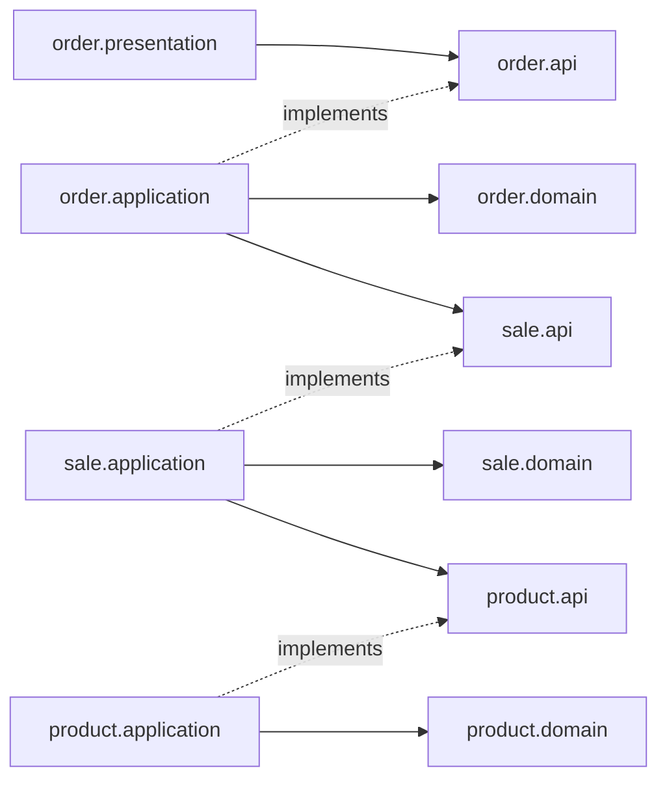

# 프로젝트 구조와 도메인 경계

작성일: 2026-11-10

[한정 수량 제품 판매 기획](project-plan.md)을 구현하기 위한 구조 설계다. 도메인별 패키지와 도메인 사이의 공개 인터페이스를 사용한다. 0단계는 애플리케이션과 로컬 실행 환경의 뼈대만 구성하며 아래 업무 계약과 구조는 이후 단계의 설계다.

기획 문서는 단계·완료 기준·진행 원칙을, 이 문서는 패키지·공개 계약·트랜잭션 경계를 관리한다. 각 소단계에서 개발자와 미정 정책을 먼저 확정한다. 아래 업무 설계는 결제 없는 주문 확정과 이벤트당 1인 1개 구매 제안을 전제로 하며, 1-1의 결정에 따라 함께 갱신한다.

## 기본 구조

하나의 Spring Boot 애플리케이션과 하나의 빌드 모듈에서 시작한다. 패키지로 도메인 경계를 나누는 모듈형 모놀리스를 사용한다. API 인스턴스가 여러 개여도 같은 MySQL을 사용한다.

다른 도메인은 `api` 패키지의 인터페이스와 계약 타입만 참조한다. 서비스 구현, 엔티티, 저장소를 직접 참조하지 않는다. 인터페이스는 기능을 제공하는 도메인이 소유한다.

호출 예시는 다음과 같다. 정확한 Java 시그니처와 HTTP 계약은 상세 설계에서 확정한다.

```text
판매 이벤트 생성 → ProductQuery.get(productId) → 제품 정보 확인 후 이벤트 저장
주문 컨트롤러 → PlaceOrderUseCase.place(saleId, userId)
주문 유스케이스 → SaleAllocation.allocate(saleId)
주문 유스케이스 → 서버가 결정한 제품·가격으로 주문 저장
```

컨트롤러는 재고 차감과 주문 저장을 직접 조합하지 않는다. 주문 유스케이스가 전체 트랜잭션을 책임진다.

## 도메인과 소유권

| 패키지 | 소유하는 데이터와 규칙 | 외부에 제공하는 기능 |
|---|---|---|
| `product` | 제품 식별자, 이름, 설명, 기준 가격 | 제품 등록·조회 |
| `sale` | 제품 참조, 판매용 제품명·가격, 판매 기간, 판매 한도와 잔여 수량 | 판매 이벤트 관리·조회, 주문용 수량 할당 |
| `order` | 사용자별 확정 주문, 주문 시점의 제품·가격, 중복 구매 방지, 이후 접수 상태와 재처리 | 주문 요청, 결과 조회, 내 주문 조회 |

초기 정책 제안은 이벤트 하나당 제품 하나, 주문당 수량 1개, 사용자당 이벤트별 확정 주문 1건이다. 판매 이벤트의 수량은 이벤트에 전용 배정한 수량이다. 공용 창고 재고와 여러 이벤트 사이의 재고 배분은 초기 범위에서 제외한다.

주문 확정은 결제 완료를 의미하지 않는다. 초기에는 결제 없는 주문 확정까지 구현하는 안을 제안한다. 결제·취소·환불을 추가하면 주문 상태, 재고 예약·만료·복구를 별도로 설계한다. 이름만 추가한 빈 `payment`, `inventory` 도메인은 만들지 않는다. Redis와 Kafka는 업무 도메인이 아니라 각 도메인의 인프라 구현이다.

회원 가입과 로그인 범위는 아직 확정하지 않았다. 인증 경계에서 식별한 사용자 ID를 주문 유스케이스에 전달한다. 로컬 테스트 전용 사용자 식별은 운영 인증과 구분하고, 실제 회원 기능이 필요할 때 회원 도메인을 추가한다.

### product

제품의 기본 정보를 소유한다. 제품은 여러 판매 이벤트에서 참조할 수 있지만 제품 자체에 전역 잔여 수량을 두지 않는다. 제품 조회를 주문마다 호출하지 않는다.

### sale

이벤트 생성 시 `product.api`로 제품 정보를 조회한다. 제품명과 판매 가격을 이벤트에 고정해 제품 정보 변경이 진행 중인 이벤트를 바꾸지 않게 한다. 초기안은 제품의 기준 가격을 판매 가격으로 복사하고 할인 정책을 두지 않는 것이다. 가격의 통화·정밀도와 함께 1-1에서 확정한다.

접수 기간 판정과 조건부 수량 차감은 `sale`이 담당한다. `order`는 조회한 잔여 수량으로 직접 구매 가능 여부를 결정하거나 판매 테이블을 갱신하지 않는다. 조회 값은 수량 확보를 보장하지 않는다.

이벤트 시작 후 제품·가격·기간·판매 한도 변경과 삭제를 금지하는 정책을 기본안으로 제안한다. 상세 요구사항에서 확정한다.

### order

- `PurchaseOrder`가 확정 주문을 나타낸다. SQL 예약어와 충돌하지 않도록 테이블 이름은 `purchase_orders` 등을 사용한다.
- `(sale_id, user_id)` 유니크 제약은 이벤트당 1인 1개 구매 정책을 최종 방어한다. 여러 개 구매를 허용하면 이 제약과 구매 한도 로직을 함께 재설계한다.
- 재시도는 이미 확정된 같은 사용자의 주문을 반환한다. 이 구매 제한과 요청 ID 기반 멱등성은 다른 개념이다. 3단계에서는 접수 ID를 별도로 관리한다.
- `sale_id`, `product_id`는 식별값으로 보관하고 다른 도메인의 엔티티를 JPA 연관관계로 연결하지 않는다.
- 제품명, 단가, 수량, 금액을 주문에 보관한다. 클라이언트가 보낸 금액 대신 `sale`이 제공한 가격을 사용한다. 초기에는 수량이 1이므로 금액은 판매 단가와 같다.
- 3단계에 `OrderRequest`, 요청 상태, 메시지 중복 처리를 추가한다. 아웃박스는 전달 방식 확정 후 도입한다. 1단계에 비동기 상태와 빈 Kafka 구현을 만들지 않는다.

## 디렉터리 제안

기본 패키지는 `com.wooyongjeong.limitedsale`로 확정한다. 단계 표시는 도입 시점이며 실제 디렉터리 이름에 포함하지 않는다.

아래 트리는 향후 구조를 포함한다. 현재 0단계에는 진입점과 도메인별 `package-info.java`, 프로파일 설정과 최소 테스트만 있으며 업무 인터페이스·구현은 아직 없다.

```text
src/main/java/com/wooyongjeong/limitedsale/
  LimitedSaleApplication.java
  product/
    api/
      ProductQuery.java
      ProductView.java
    application/
    domain/
    infrastructure/persistence/
    presentation/
  sale/
    api/
      SaleQuery.java
      SaleAllocation.java
      SaleView.java
      AllocationResult.java
    application/
    domain/
    infrastructure/
      persistence/
      cache/                 # 2단계: 판매 이벤트 조회 캐시
    presentation/
  order/
    api/
      PlaceOrderUseCase.java
      OrderQuery.java
      OrderResult.java
      OrderView.java
    application/
    domain/
    infrastructure/
      persistence/
      redis/                 # 2단계: 주문 요청 제한
      kafka/                 # 3단계: 메시지 발행·소비와 변환
      outbox/                # 3단계: 채택 시 발행 작업
    presentation/
  common/
    config/                  # 공통 기술 설정과 Clock 구성
    web/                     # 공통 HTTP 오류 형식과 요청 추적
    observability/

src/main/resources/
  application.yml
  application-local.yml
  db/migration/              # 스키마 변경 이력
src/test/java/com/wooyongjeong/limitedsale/
  LimitedSaleApplicationTests.java
  architecture/              # 패키지 경계 검증
  product/
  sale/
  order/
src/test/resources/
  application-test.yml
compose.yaml                 # 루트에서 docker compose 실행
infra/                       # 이후 모니터링 구성
  prometheus/
  grafana/
tests/
  load/                      # k6 시나리오
  reconciliation/            # 실험 후 DB 정합성 대조
docs/
  project-plan.md
  architecture.md
```

각 도메인의 `api`는 공개 계약, `application`은 유스케이스와 트랜잭션, `domain`은 업무 규칙과 저장소 계약, `infrastructure`는 외부 시스템 구현, `presentation`은 HTTP 진입점을 맡는다.

필요한 클래스가 생길 때 디렉터리를 만든다. 모든 내부 서비스에 인터페이스를 만들 필요는 없다. 다른 도메인에 공개하는 경계와 외부 의존성을 교체·검증하는 경계에 둔다. `common`에는 업무 규칙, 도메인별 DTO, 공통 엔티티를 넣지 않는다.

## 공개 인터페이스 계약

| 제공 도메인 | 인터페이스 | 입력과 결과 | 보장과 제한 |
|---|---|---|---|
| `product` | `ProductQuery` | 제품 ID → 불변 제품 정보 | 이벤트 생성에 사용할 제품 정보 조회 |
| `sale` | `SaleQuery` | 이벤트 ID → 불변 판매 정보 | 조회 후 수량 확보를 보장하지 않음 |
| `sale` | `SaleAllocation` | 이벤트 ID → 할당 또는 기간 외·품절·없음 | 기간 판정과 수량 1개 차감. 성공 결과에 제품 ID·제품명·판매 가격 포함. 주문 트랜잭션에 참여 |
| `order` | `PlaceOrderUseCase` | 이벤트 ID, 인증된 사용자 ID → 주문 결과 | 중복 구매를 방지하고 재시도는 기존 결과로 수렴 |
| `order` | `OrderQuery` | 사용자 ID와 조회 조건 → 주문 정보 | 다른 사용자의 주문을 노출하지 않음 |

계약 타입은 불변 데이터로 만들고 JPA 엔티티, Spring Data `Page`, HTTP 응답 객체, Redis·Kafka 타입을 노출하지 않는다. 다른 도메인의 ID를 `common`으로 모으지 않는다. 공개 계약에는 식별값을 전달하고 각 도메인 내부에서 자신의 값 객체로 변환한다.

품절·기간 외·기존 주문과 시스템 실패를 구분한다. 업무 결과는 명시적인 결과 타입으로 표현하고, DB 연결 실패를 정상 결과로 숨기지 않는다. 결과별 HTTP 매핑은 `presentation`이 담당한다.

`OrderResult`는 1단계에서 확정 결과를 표현한다. 3단계에서 `Accepted`와 `Confirmed` 등 접수와 확정을 서로 다른 결과 형태로 정의한다. 의미가 다른 값을 nullable 필드와 성공 여부 하나로 표현하지 않는다.

## 의존성 규칙



- 다른 도메인이 참조할 수 있는 패키지는 `api`뿐이다.
- `api`는 자기 도메인의 내부 패키지나 다른 도메인에 의존하지 않는다.
- 의존 방향은 `order → sale → product`다. `sale → product` 호출은 이벤트 생성에 사용하며 주문 경로에서는 고정된 판매 정보를 사용한다.
- 각 `domain`은 다른 도메인, HTTP, Redis·Kafka 클라이언트, 저장소 구현에 의존하지 않는다.
- 저장소 계약은 소유 도메인의 `domain`, 구현은 `infrastructure`에 둔다. 영속 엔티티 분리와 ORM 매핑 방식은 구현 전에 결정한다.
- 도메인 간 SQL 조인과 다른 도메인 테이블의 직접 쓰기는 금지한다. 물리적인 외래 키는 스키마 설계에서 별도로 판단한다.
- 공개 구현은 Spring DI로 연결한다. 소비자는 구현 클래스를 직접 주입하지 않는다.

## 1단계 주문 흐름과 트랜잭션

1. HTTP 경계에서 입력과 사용자 식별을 검증한다.
2. `PlaceOrderUseCase` 구현이 MySQL 트랜잭션을 시작한다.
3. 기존 주문이 있으면 그대로 반환한다. 이벤트 종료 후 재시도도 기존 주문을 조회할 수 있다.
4. `SaleAllocation`이 신규 요청의 기간을 판정하고 수량을 조건부 차감한다. 클라이언트가 임의의 접수 시각을 전달해 기간 검사를 우회하지 못하게 한다.
5. 할당 결과의 제품·가격으로 `order`가 주문을 저장한다.
6. 두 변경이 모두 커밋된 뒤 주문 확정 응답을 반환한다.

수량 변경은 같은 DataSource와 트랜잭션 매니저의 기존 트랜잭션에 반드시 참여한다. 구현 시 `MANDATORY` 전파 등으로 트랜잭션 없는 쓰기를 방지한다. 독립 트랜잭션이나 커밋 후 비동기 이벤트로 수량 차감과 주문 저장을 분리하지 않는다.

주문 저장이 실패하면 수량 차감도 롤백한다. 동시 중복 요청은 사전 조회를 통과할 수 있으므로 유니크 제약이 필수다. 충돌 시 전체 트랜잭션 종료·롤백 후 새 읽기에서 기존 주문을 조회한다. 롤백 전용 상태의 트랜잭션에서 예외를 삼키고 성공으로 반환하지 않는다. 이 복구는 주문 유스케이스 내부의 트랜잭션 실행 경계에서 처리한다.

같은 사용자의 중복 요청이 마지막 수량을 두고 경쟁하면 한 요청은 유니크 충돌 대신 품절 결과를 받을 수도 있다. 품절·기간 외 결과를 확정하기 전에도 트랜잭션 종료 후 새 읽기에서 기존 주문을 확인한다. DB 격리 수준에 따른 조회 가시성도 검증한다.

DB 대기 중 이벤트 종료 시각을 넘는 경우의 판정 시점은 상세 설계에서 고정한다. 트랜잭션 시작, 실제 판정, 커밋 시각을 혼용하지 않는다.

## 0단계 구현 범위

Java 21, Spring Boot 3.5.16, Gradle Wrapper 8.14.3과 MySQL 8.4.7의 로컬 Compose 설정을 사용한다. Spring Data JPA와 Flyway를 준비하되 업무 엔티티나 마이그레이션은 없다. `product`, `sale`, `order`, `common` 패키지는 책임만 표시한다. 기본 `local` 프로파일과 Actuator health를 구성하며, 지표 노출과 전체 모니터링은 1-7에서 구축한다.

H2 기반 테스트는 컨텍스트와 HTTP health만 확인한다. 실제 MySQL 연결·Flyway 초기화·local 프로파일 health 검증은 별도로 필요하며, 현재 상태와 다음 작업은 [기획 문서의 0단계](project-plan.md#0단계-프로젝트-뼈대)를 따른다. 실행 명령은 [README](../README.md)에 둔다.

## 단계별 구조 변화

### 2단계: Redis

판매 이벤트 조회 캐시는 `sale.infrastructure.cache`, 주문 요청 제한은 `order.infrastructure.redis`에 둔다. 요청 제한 정책과 사용 위치는 `order.application`이 소유한다.

두 도메인이 Redis 키를 직접 공유하지 않는다. Redis 수량 사전 판정을 추가한다면 수량을 소유한 `sale` 안에 두고 공개 계약으로 호출한다. Redis 변경은 MySQL 롤백으로 되돌아가지 않으므로 별도의 복구 설계가 필요하다. 그 전에는 조회 캐시와 요청 제한까지만 적용한다.

### 3단계: Kafka

Kafka는 `order`의 요청 접수와 주문 처리 사이에 둔다. `sale`과 `order`를 별도 소비자로 나눠 수량 차감과 주문 저장을 서로 다른 트랜잭션으로 처리하지 않는다.

```text
접수 API → 영속 접수 기록 + 발행 대기 기록 → 커밋 → 접수 응답
발행 작업 → Kafka → 소비자 → 주문 처리 유스케이스
주문 처리 → sale 수량 차감 + 주문 저장 + 요청 최종 상태 → 커밋
```

아래 계약 설명까지 포함해 DB 접수 기록과 아웃박스를 사용하는 권장 초안이다. Kafka 직접 접수 방식과 비교해 3-1에서 확정한다. 직접 접수를 선택하면 DB 접수 기록을 먼저 조회한다는 전제와 접수·상태 조회·기간 검증·복구 계약을 다시 설계한다. 접수 기록 저장도 DB 부하이므로 Kafka가 DB 병목을 자동으로 없앤다고 가정하지 않는다.

소비자는 메시지를 내부 명령으로 변환하고 주문 유스케이스를 호출한다. 메시지는 접수 ID를 참조하며, 기간 내 접수 여부는 서버가 저장한 기록으로 검증한다. 임의의 과거 시각만 믿지 않는다. `sale`의 기간 판정 계약은 서버가 검증한 기존 접수와 신규 요청을 구분하도록 확장한다. 내부 처리 기능을 외부 신규 주문 API로 노출하지 않는다.

수량 차감, 주문 저장, 요청 최종 상태는 하나의 MySQL 트랜잭션으로 처리한다. DB 커밋 후 소비 완료를 기록하는 순서와 중복 재전달 대응을 검증한다. 재시도·최종 실패 기준과 순서 보장 범위는 해당 단계 진입 전에 확정한다.

## 경계와 정합성 검증

구현 시 ArchUnit 기반 구조 검사를 빌드에 추가한다.

- 다른 도메인의 `api` 이외 패키지 참조 금지
- 도메인 간 순환 의존 금지
- `api`에서 내부 패키지 참조 금지
- `domain`에서 HTTP와 Redis·Kafka 클라이언트 및 저장소 구현 참조 금지

실제 MySQL 통합 테스트에서는 수량 차감 후 주문 저장 실패, 동시 중복 주문, 응답 유실 후 재시도, API 인스턴스 2개에서의 동시 주문을 확인한다. 제품 정보 변경이 기존 이벤트·주문의 이름과 가격을 바꾸지 않는지도 확인한다. 구조 검사가 SQL 소유권과 트랜잭션을 증명하지는 않으므로 저장소 쿼리도 리뷰한다. 수량과 처리 완료 기준은 프로젝트 기획을 따른다.

## 비교한 구조

| 대안 | 장점 | 판단 |
|---|---|---|
| 판매와 주문을 한 도메인에 배치 | 트랜잭션과 코드가 단순함 | 이벤트 관리와 사용자 주문 처리 경계를 드러내기 어려움 |
| 제품·판매·주문을 패키지로 분리 | 공개 인터페이스와 로컬 트랜잭션 유지 | 현재 선택. 패키지 경계 검사가 필요함 |
| 도메인별 서비스·DB 분리 | 독립 배포와 확장 | 재고·주문 간 분산 정합성 비용이 초기 목표에 비해 큼 |

현재 설계는 판매와 주문이 같은 DB 트랜잭션에 참여한다는 전제를 가진다. 인터페이스만으로 독립 배포가 가능해지지는 않는다. 서비스나 DB를 분리하면 수량 예약·확정·복구 계약부터 다시 설계한다.

## 구현 전에 확정할 항목

- 결제 없는 주문 확정 범위와 이벤트당 1인 1개 구매 정책
- 판매 이벤트 시간 판정 위치·기준 시계, 시작 후 변경·삭제 정책
- 가격의 통화·정밀도·유효 범위
- 사용자 식별과 관리자 인증
- API 결과·오류 계약, 테이블과 인덱스, 트랜잭션 격리와 잠금 순서
- JPA 영속 엔티티 분리와 매핑 방식

위 항목은 1-1에서 확정하고 이후 구현한다. Redis의 키·TTL·장애 정책은 2-1에서, Kafka의 접수 상태·메시지 계약·전달 방식은 3-1에서 확정한다. Redis의 수량 판정 참여는 2-6의 비교 실험 후 필요할 때 별도 설계를 논의한다. 구체적인 작업 순서와 완료 기준은 기획 문서의 소단계 표를 따른다.
