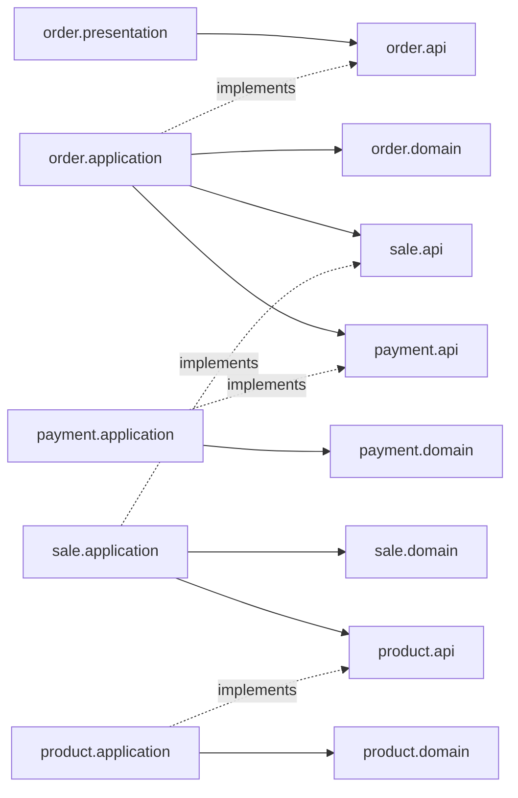

# 프로젝트 구조와 도메인 경계

작성일: 2026-11-10

[한정 수량 제품 판매 기획](project-plan.md)을 구현하기 위한 구조 설계다. 도메인별 패키지와 도메인 사이의 공개 인터페이스를 사용한다. 0단계는 애플리케이션과 로컬 실행 환경의 뼈대만 구성하며 아래 업무 계약과 구조는 이후 단계의 설계다.

기획 문서는 전체 단계와 진행 원칙을, 단계별 문서는 확정 정책·미정 사항·구현 작업·완료 기준을, 이 문서는 패키지·공개 계약·트랜잭션 경계를 관리한다. 1단계의 정책 원문은 [1단계 문서](stages/01-mysql-order.md)에 둔다. 각 소단계에서 개발자와 미정 정책을 먼저 확정한다. 결제는 Mock PG를 계속 사용하고, 이벤트당 제품 하나와 이벤트별 사용자 구매 한도를 둔다. 구매 한도 기본값은 1개다. 한 번에 여러 개 구매와 여러 번 나눠 주문을 허용한다. 결제 상태 전이·재고 복구의 기본 구조는 1-1에서 합의했다. 아래 구조는 해당 기본 계약을 따르고 구현 소단계마다 상세를 점검한다.

API·DB·프로젝트 구성의 기본 계약은 [1-1 기술 계약 문서](stages/01-contracts.md)를 따른다. 상태·복구 구조까지 합의한 기본 계약이며 상세는 구현 소단계에서 재점검한다.

## 기본 구조

판매 서버는 루트 Spring Boot 프로젝트로 유지하고 별도 HTTP 서버인 mock-pg를 Gradle 하위 프로젝트로 추가한다. Mock PG 기본 패키지는 `com.wooyongjeong.mockpg`를 사용한다. 도메인별 패키지는 판매 서버 안에서 나누며 도메인마다 별도 빌드 모듈을 만들지는 않는다. 패키지로 도메인 경계를 나누는 모듈형 모놀리스를 사용한다. API 인스턴스가 여러 개여도 같은 MySQL을 사용한다.

다른 도메인은 `api` 패키지의 인터페이스와 계약 타입만 참조한다. 서비스 구현, 엔티티, 저장소를 직접 참조하지 않는다. 인터페이스는 기능을 제공하는 도메인이 소유한다.

호출 예시는 다음과 같다. 기본 API 계약은 1-1 기술 계약을 따르며 Java 시그니처는 각 구현 소단계에서 점검한다.

```text
판매 이벤트 생성 → ProductQuery.get(productId) → 제품 정보 확인 후 이벤트 저장
주문 컨트롤러 → OrderCommand.create(주문 요청)
주문 유스케이스 → 판매 수량·사용자 한도 처리
주문·결제 흐름 → Mock PG 처리 → 결과에 따른 주문 상태 전이
```

컨트롤러는 재고·주문·결제 작업을 직접 조합하지 않는다. 주문·결제 유스케이스가 상태 전이와 각 DB 트랜잭션을 조합한다. Mock PG 호출을 DB 트랜잭션과 하나의 원자적 작업으로 간주하지 않는다.

## 도메인과 소유권

| 패키지 | 소유하는 데이터와 규칙 | 외부에 제공하는 기능 |
|---|---|---|
| `member` | 계정·비밀번호 해시·권한 | 회원가입·회원 식별·인증에 필요한 계약 |
| `payment` | PG 연동·결제 결과·결제 복구 | 결제 요청·조회·종료 계약 |
| `product` | 제품 식별자, 이름, 설명, 기준 가격 | 제품 등록·조회 |
| `sale` | 제품 참조, 판매용 제품명·가격, 판매 기간, 판매 한도와 잔여 수량, 사용자별 한도 설정·점유·확정 수량 | 판매 이벤트 관리·조회, 주문용 수량 할당 |
| `order` | 사용자별 주문, 주문 시점의 제품·가격·수량, 요청 멱등성, 이후 접수 상태와 재처리 | 주문 요청, 결과 조회, 내 주문 조회 |

확정 정책은 이벤트 하나당 제품 하나, 사용자별 구매 수량 한도는 이벤트별 설정이며 미설정 시 1개다. 한 번에 여러 개 주문과 여러 번 나눠 주문을 허용하며 사용자별 이벤트 누적 수량으로 구매 한도를 검사한다. 주문 수량은 양의 정수이고 남은 구매 한도와 판매 수량을 넘을 수 없다. 부족하면 전체 요청을 거절하며 자동 부분 구매는 허용하지 않는다. 판매 이벤트의 수량은 이벤트에 전용 배정한 수량이다. 공용 창고 재고와 여러 이벤트 사이의 재고 배분은 초기 범위에서 제외한다.

결제는 앞으로도 Mock PG로 처리하고 실제 PG를 연동하지 않는다. Mock PG가 있어도 결제 결과와 DB 상태의 불일치, 중복 결제, 응답 유실과 재고 복구를 설계해야 한다. Mock PG는 판매 서버와 별도 프로세스의 HTTP 서버로 실행하고 별도 MySQL 스키마·계정에 결제 기록을 영속 저장한다. 같은 로컬 MySQL 인스턴스를 사용할 수 있지만 판매 서버는 PG 스키마에 직접 접근하지 않고 HTTP로만 호출한다. 판매 서버의 payment 도메인이 PG 연동·결제 결과·결제 복구를 담당한다. 공개 계약과 Mock PG의 코드·실행 구성 배치는 기술 설계에서 정한다. Mock PG는 성공·명확한 실패·처리 지연·결제 성공 후 응답 유실을 재현한다. 주문 시 재고와 구매 한도를 임시 점유하고 결제 성공 시 구매 확정, 명확한 실패 시 점유 해제로 처리한다. 타임아웃은 결과 확인 전까지 점유를 유지한다. `payment`는 독립 도메인 패키지로 둔다. Redis와 Kafka는 각 도메인의 인프라 구현이다.

이메일·비밀번호 회원가입·로그인과 Redis 세션을 1단계에 구현한다. 인증 범위는 [1단계 정책](stages/01-mysql-order.md#확정한-인증-범위)을 따른다. Spring Security·Spring Session Data Redis를 사용한다. 세션은 설정 가능한 30분 유휴 만료, 여러 기기 로그인 허용, 현재 세션 로그아웃을 적용한다. 공개 가입은 USER만 생성하며 ADMIN은 별도 초기화 명령으로 생성한다. 인증 경계에서는 식별한 사용자 ID를 주문 유스케이스에 전달한다. `member`를 독립 도메인 패키지로 추가하며 인증 어댑터·공개 계약의 배치는 기술 설계에서 정한다. 아래 트리는 도메인 위치를 표시하며 세부 의존 관계는 기술 설계에서 확정한다. 회원 업무 로직을 common으로 몰아넣지 않는다.

### product

제품의 기본 정보를 소유한다. 제품은 여러 판매 이벤트에서 참조할 수 있지만 제품 자체에 전역 잔여 수량을 두지 않는다. 제품 조회를 주문마다 호출하지 않는다.

### sale

이벤트 생성 시 `product.api`로 제품 정보를 조회하고 제품명과 판매 가격을 이벤트에 보관한다. 판매 가격은 관리자가 지정하며 제품 기준 가격을 기본값으로 제공한다. 제품 정보 변경이 기존 이벤트 가격에 자동 반영되지 않게 한다. 가격은 원화 정수 단위이고 시작 후에는 판매 가격을 바꿀 수 없다. 주문에는 해당 판매 가격을 별도로 보관한다.

신규 주문은 시작 시각 이상~종료 시각 미만에 허용한다. 종료 전 재고를 점유한 주문은 종료 후에도 결제를 처리한다. 기간 판정과 조건부 수량 차감은 `sale`이 담당한다. `order`는 조회한 잔여 수량으로 직접 구매 가능 여부를 결정하거나 판매 테이블을 갱신하지 않는다. 조회 값은 수량 확보를 보장하지 않는다.

시작 후 이벤트명·설명 수정은 허용한다. 제품·가격·시작 시각·사용자 구매 한도·판매 수량·종료 시각 변경과 삭제는 금지한다. 관리자는 신규 주문을 중단할 수 있고 기존 주문·결제는 계속 처리한다. 종료·중단 상태로 이벤트 기록을 보존한다. 시작 전에는 제품·가격·기간·판매 수량·구매 한도 수정과 삭제를 허용한다. 중단한 이벤트는 판매 기간 안에서 기존 조건을 유지한 채 재개할 수 있다. 종료 후 신규 주문·재개는 금지하고 기존 조회·결제·복구는 계속 처리한다. 중단·재개와 수량 점유는 DB 상태 판정을 공유하며 잠금·SQL 순서의 상세는 기술 설계에서 정한다.

### order

- `PurchaseOrder`가 주문과 그 처리 상태를 나타낸다. 기본 상태는 AWAITING_PAYMENT/PAYMENT_PENDING/CONFIRMED/PAYMENT_FAILED/EXPIRED를 사용한다. SQL 예약어와 충돌하지 않도록 테이블 이름은 `purchase_orders` 등을 사용한다.
- 구매 한도는 주문 건수가 아닌 제품 수량 기준이다. 동시 신규 주문에도 누적 한도를 지켜야 한다. 누적 수량·점유·확정·해제는 sale이 소유하고 order와 payment는 공개 계약을 통해 조합한다. SQL·잠금 순서는 기술 설계에서 정한다. 주문 테이블의 `(sale_id, user_id)` 유니크 제약으로 구매 한도를 대체하지 않는다.
- 요청 재시도와 같은 사용자의 새 주문을 구분한다. 1단계부터 주문과 Mock PG 호출의 멱등성 키·중복 처리 계약을 설계한다. 비동기 접수 ID와의 관계는 3단계에서 정한다.
- `sale_id`, `product_id`는 식별값으로 보관하고 다른 도메인의 엔티티를 JPA 연관관계로 연결하지 않는다.
- 제품명, 단가, 수량, 금액을 주문에 보관한다. 클라이언트가 보낸 금액 대신 `sale`이 제공한 가격을 사용한다. 금액은 판매 단가와 주문 수량으로 계산한다.
- 3단계에 `OrderRequest`, 요청 상태, 메시지 중복 처리를 추가한다. 아웃박스는 전달 방식 확정 후 도입한다. 1단계에 비동기 상태와 빈 Kafka 구현을 만들지 않는다.

## 디렉터리 제안

기본 패키지는 `com.wooyongjeong.limitedsale`로 확정한다. 단계 표시는 도입 시점이며 실제 디렉터리 이름에 포함하지 않는다.

아래 트리는 향후 구조를 포함한다. 현재 1-2에서 도메인별 영속 엔티티와 Mock PG 실행 뼈대를 추가했다. 업무 인터페이스·유스케이스는 아직 없다.

```text
src/main/java/com/wooyongjeong/limitedsale/
  LimitedSaleApplication.java
  member/                    # 1단계 회원·권한·인증
  payment/                   # 1단계 PG 연동·결제·복구
  product/
    api/
      ProductQuery.java
      ProductView.java
    application/
    domain/
    infrastructure/persistence/
    presentation/
  sale/
    api/
      SaleQuery.java
      SaleReservation.java
      SaleView.java
      AllocationResult.java
    application/
    domain/
    infrastructure/
      persistence/
      cache/                 # 2단계: 판매 이벤트 조회 캐시
    presentation/
  order/
    api/
      OrderCommand.java
      OrderQuery.java
      OrderResult.java
      OrderView.java
    application/
    domain/
    infrastructure/
      persistence/
      redis/                 # 2단계: 주문 요청 제한
      kafka/                 # 3단계: 메시지 발행·소비와 변환
      outbox/                # 3단계: 채택 시 발행 작업
    presentation/
  common/
    config/                  # 공통 기술 설정과 Clock 구성
    web/                     # 공통 HTTP 오류 형식과 요청 추적
    observability/

src/main/resources/
  application.yml
  application-local.yml
  db/migration/              # 스키마 변경 이력
src/test/java/com/wooyongjeong/limitedsale/
  LimitedSaleApplicationTests.java
  architecture/              # 패키지 경계 검증
  product/
  sale/
  order/
src/test/resources/
  application-test.yml
compose.yaml                 # 루트에서 docker compose 실행
infra/                       # 이후 모니터링 구성
  prometheus/
  grafana/
mock-pg/                    # 별도 실행 Gradle 하위 프로젝트, 구현 예정
tests/
  load/                      # k6 시나리오
  reconciliation/            # 실험 후 DB 정합성 대조
docs/
  project-plan.md
  architecture.md
  stages/
    00-project-bootstrap.md
    01-mysql-order.md
    01-contracts.md
    01-2-mysql-schema-and-boundaries.md
    02-redis.md
    03-kafka.md
    04-reliability.md
```

각 도메인의 `api`는 공개 계약, `application`은 유스케이스와 트랜잭션, `domain`은 업무 규칙과 저장소 계약, `infrastructure`는 외부 시스템 구현, `presentation`은 HTTP 진입점을 맡는다.

필요한 클래스가 생길 때 디렉터리를 만든다. 모든 내부 서비스에 인터페이스를 만들 필요는 없다. 다른 도메인에 공개하는 경계와 외부 의존성을 교체·검증하는 경계에 둔다. `common`에는 업무 규칙, 도메인별 DTO, 공통 엔티티를 넣지 않는다.

## 공개 인터페이스 계약

| 제공 도메인 | 공개 인터페이스 기본안 | 책임 |
|---|---|---|
| member | MemberRegistration, MemberAuthentication, MemberQuery | 계정 생성·인증·회원 정보 |
| product | ProductCommand, ProductQuery | 제품 등록·정보 조회 |
| sale | SaleCommand, SaleQuery, SaleReservation | 이벤트 관리·조회, 판매 수량·사용자 한도 점유·확정·해제 |
| order | OrderCommand, OrderQuery | 주문 생성·결제 요청 조합·주문 결과 조회 |
| payment | PaymentCommand, PaymentQuery, PaymentRecovery | PG 요청·결과 조회·종료·결제 상태 복구 |

계약 타입은 불변 데이터로 만들고 JPA 엔티티, Spring Data `Page`, HTTP 응답 객체, Redis·Kafka 타입을 노출하지 않는다. 다른 도메인의 ID를 `common`으로 모으지 않는다. 공개 계약에는 식별값을 전달하고 각 도메인 내부에서 자신의 값 객체로 변환한다.

품절·기간 외·기존 주문과 시스템 실패를 구분한다. 업무 결과는 명시적인 결과 타입으로 표현하고, DB 연결 실패를 정상 결과로 숨기지 않는다. 결과별 HTTP 매핑은 `presentation`이 담당한다. 공통 ApiResponse<T>와 ResponseCode 인터페이스는 `common.web`에 둔다. 도메인별 성공·오류 enum은 해당 도메인의 `presentation.code`에서 인터페이스를 구현한다. 공통 오류 enum도 같은 인터페이스를 구현하며 enum 상속을 사용하지 않는다. 응답은 실제 HTTP 상태와 같은 httpStatus·고정 문자열 code·제네릭 data·message를 담는다. 빈 데이터는 null, 입력 검증 오류의 data는 필드별 오류 목록이다. 내부 도메인 계약에는 HTTP 타입과 웹 응답 enum을 노출하지 않는다.

`OrderResult`는 1단계에서 주문·Mock PG 결제 정책에 맞는 처리 결과를 표현한다. 결제 응답이 불명확하면 확인 중 상태와 조회 경로를 반환하는 기본 계약을 따른다. 3단계에서 `Accepted`와 `Confirmed` 등 접수와 확정을 서로 다른 결과 형태로 정의한다. 의미가 다른 값을 nullable 필드와 성공 여부 하나로 표현하지 않는다.

## 의존성 규칙



- 다른 도메인이 참조할 수 있는 패키지는 `api`뿐이다.
- `api`는 자기 도메인의 내부 패키지나 다른 도메인에 의존하지 않는다.
- 핵심 의존 방향은 `order → sale → product`, `order → payment`다. payment가 order 구현을 역호출하지 않으며, order의 복구 작업이 payment.api 결과를 조회해 주문·수량을 마무리한다. `sale → product` 호출은 이벤트 생성에 사용하며 주문 경로에서는 고정된 판매 정보를 사용한다.
- 각 `domain`은 다른 도메인, HTTP, Redis·Kafka 클라이언트, 저장소 구현에 의존하지 않는다.
- 저장소 계약은 소유 도메인의 `domain`, 구현과 분리한 JPA 영속 엔티티는 `infrastructure.persistence`에 둔다. READ COMMITTED와 명시적 행 잠금을 기본안으로 하고 상세 인덱스·매핑은 1-2에서 재점검한다.
- 도메인 간 SQL 조인과 다른 도메인 테이블의 직접 쓰기는 금지한다. 판매 스키마 내 물리 FK는 RESTRICT로 적용하되 Java 도메인 간에는 ID만 보관한다. 별도 PG 스키마로 FK를 연결하지 않는다.
- 공개 구현은 Spring DI로 연결한다. 소비자는 구현 클래스를 직접 주입하지 않는다.

## 1단계 주문·결제 흐름과 트랜잭션

기존의 수량 차감·확정 주문 저장만 묶는 설계는 Mock PG와 가변 구매 한도를 반영해 다시 설계한다. 주문 생성 API와 결제 요청 API를 분리한다. 주문 생성은 재고·사용자 한도 임시 점유까지 처리하며, 별도 결제 요청 API가 Mock PG를 호출한다. 이후 성공 시 확정 또는 명확한 실패 시 해제로 합의했다. 결제를 요청하지 않은 주문도 생성 후 5분 정리 대상이다. 타임아웃 시 결과 확인 전 점유를 유지한다. 다음 책임은 합의한 기술 계약에 따라 구현하며, 설정값·SQL 상세는 해당 소단계에서 점검한다.

- 확정된 다수 수량·분할 주문 정책에 따른 사용자별 누적 수량과 처리 중 수량의 관리 주체
- 클라이언트 요청 키를 사용한다. 같은 키·같은 입력은 기존 주문·결제 결과로 수렴하고 이벤트·수량이 다르면 충돌 거절한다. 사용자별 UUID 키를 필수로 받아 주문과 함께 보관하며 PG에는 주문에 고정된 결제 키를 사용한다. DB 제약과 키 매핑 상세는 추가 설계한다.
- 재고·구매 한도 점유, Mock PG 호출, 주문 확정 사이의 트랜잭션 경계와 복구
- 확정한 Mock PG 시나리오에 대한 결과 조회·종료·재시도 계약과 중복 복구 작업 선점
- 결제 성공 후 DB 저장 실패, 응답 유실, 서버 재시작 시 복구
- 주문과 재고의 DB 트랜잭션 경계·잠금 순서, 결제 실패 후 복원 조건

같은 DB 트랜잭션에 포함한 수량 변경과 주문 저장은 함께 커밋·롤백한다. Mock PG에서 이미 처리한 결제는 DB 롤백만으로 취소되지 않는다. 주문·점유와 결제 시작 상태를 짧은 로컬 트랜잭션으로 커밋하고, PG 호출은 트랜잭션 밖에서 수행한다. 결제 결과 저장과 주문·수량 반영 사이의 실패는 DB 기반 복구로 수렴시킨다.

여러 번 구매를 허용하므로 같은 사용자의 기존 주문을 무조건 반환해서는 안 된다. 기존 결과 반환은 동일 요청의 재시도에만 적용하며, 새 요청은 구매 한도를 다시 검사한다. 마지막 재고·사용자 잔여 한도 경쟁과 DB 격리 수준에 따른 조회 가시성도 검증한다.

이벤트 시간·중단 여부는 MySQL 수량 점유 트랜잭션에서 잠금 획득 후 DB 시각과 상태로 판정하며 UTC로 저장한다. HTTP 도착·트랜잭션 시작·커밋 시각을 혼용하지 않는다. MySQL 현재 시각 함수는 SQL 실행 시작 기준이므로, 잠금 대기를 포함한 같은 SQL의 NOW()를 잠금 후 시각이라고 가정하지 않는다. 잠금 획득 후 별도 시각 판정 SQL을 실행하는 등의 방법을 실제 MySQL 대기 테스트로 검증한다. 참고: [MySQL 날짜·시간 함수](https://dev.mysql.com/doc/refman/8.4/en/date-and-time-functions.html).

결제 응답 대기는 기본 3초, 결과 미확인 재조회는 10초 간격이며 주문 생성 후 5분 경과 시 미결제 종료·취소를 요청한다. 모두 설정 가능하다. 실패·취소 확정 전에는 점유를 유지한다. DB에 저장한 미완료 상태를 조회해 서버 재시작 후에도 복구한다. 이 상태 복구와 3단계의 메시지 전달용 Outbox는 별도 책임이다. 상세 정책은 [1단계 문서](stages/01-mysql-order.md#확정한-결제-결과-확인복구-정책)를 따른다.

## 0단계 구현 범위

Java 21, Spring Boot 3.5.16, Gradle Wrapper 8.14.3과 MySQL 8.4.7의 로컬 Compose 설정을 사용한다. Spring Data JPA와 Flyway를 준비하되 업무 엔티티나 마이그레이션은 없다. `product`, `sale`, `order`, `common` 패키지는 책임만 표시한다. 기본 `local` 프로파일과 Actuator health를 구성하며, 지표 노출과 전체 모니터링은 1-9에서 구축한다.

1-2 워커가 실제 MySQL 연결·Flyway 초기화·local health를 확인했고 Testcontainers 검사를 추가했다. 주 에이전트 검증은 대기 중이다. 실행 명령은 [README](../README.md)에 둔다.

## 단계별 구조 변화

### 2단계: Redis 캐시·분산 요청 제한

1단계의 세션용 Redis를 유지하고 활용 범위를 확장한다. 판매 이벤트 조회 캐시는 `sale.infrastructure.cache`, 주문 요청 제한은 `order.infrastructure.redis`에 둔다. 요청 제한 정책과 사용 위치는 `order.application`이 소유한다.

두 도메인이 Redis 키를 직접 공유하지 않는다. Redis 수량 사전 판정을 추가한다면 수량을 소유한 `sale` 안에 두고 공개 계약으로 호출한다. Redis 변경은 MySQL 롤백으로 되돌아가지 않으므로 별도의 복구 설계가 필요하다. 그 전에는 조회 캐시와 요청 제한까지만 적용한다.

### 3단계: Kafka

Kafka는 `order`의 요청 접수와 주문 처리 사이에 둔다. `sale`과 `order`를 별도 소비자로 나눠 수량 차감과 주문 저장을 서로 다른 트랜잭션으로 처리하지 않는다.

```text
접수 API → 영속 접수 기록 + 발행 대기 기록 → 커밋 → 접수 응답
발행 작업 → Kafka → 소비자 → 주문 처리 유스케이스
주문 처리 → 판매 수량·사용자 한도 + Mock PG 결제 흐름 → 요청 최종 결과
```

아래 계약 설명까지 포함해 DB 접수 기록과 아웃박스를 사용하는 권장 초안이다. Kafka 직접 접수 방식과 비교해 3-1에서 확정한다. 직접 접수를 선택하면 DB 접수 기록을 먼저 조회한다는 전제와 접수·상태 조회·기간 검증·복구 계약을 다시 설계한다. 접수 기록 저장도 DB 부하이므로 Kafka가 DB 병목을 자동으로 없앤다고 가정하지 않는다.

소비자는 메시지를 내부 명령으로 변환하고 주문 유스케이스를 호출한다. 메시지는 접수 ID를 참조하며, 기간 내 접수 여부는 서버가 저장한 기록으로 검증한다. 임의의 과거 시각만 믿지 않는다. `sale`의 기간 판정 계약은 서버가 검증한 기존 접수와 신규 요청을 구분하도록 확장한다. 내부 처리 기능을 외부 신규 주문 API로 노출하지 않는다.

1단계에서 확정한 주문·Mock PG 상태 전이와 복구 흐름을 재사용한다. Kafka 소비 완료와 DB 상태 반영의 경계, 중복 재전달 시 중복 결제 방지까지 검증한다. 재시도·최종 실패 기준과 순서 보장 범위는 해당 단계 진입 전에 확정한다.

## 경계와 정합성 검증

구현 시 ArchUnit 기반 구조 검사를 빌드에 추가한다.

- 다른 도메인의 `api` 이외 패키지 참조 금지
- 도메인 간 순환 의존 금지
- `api`에서 내부 패키지 참조 금지
- `domain`에서 HTTP와 Redis·Kafka 클라이언트 및 저장소 구현 참조 금지

실제 MySQL 통합 테스트에서는 수량 차감 후 주문 저장 실패, 동시 중복 주문, 응답 유실 후 재시도, API 인스턴스 2개에서의 동시 주문을 확인한다. 제품 정보 변경이 기존 이벤트·주문의 이름과 가격을 바꾸지 않는지도 확인한다. 구조 검사가 SQL 소유권과 트랜잭션을 증명하지는 않으므로 저장소 쿼리도 리뷰한다. 수량과 처리 완료 기준은 프로젝트 기획을 따른다.

## 비교한 구조

| 대안 | 장점 | 판단 |
|---|---|---|
| 판매와 주문을 한 도메인에 배치 | 트랜잭션과 코드가 단순함 | 이벤트 관리와 사용자 주문 처리 경계를 드러내기 어려움 |
| 제품·판매·주문을 패키지로 분리 | 공개 인터페이스와 로컬 트랜잭션 유지 | 현재 선택. 패키지 경계 검사가 필요함 |
| 도메인별 서비스·DB 분리 | 독립 배포와 확장 | 재고·주문 간 분산 정합성 비용이 초기 목표에 비해 큼 |

현재 설계는 판매와 주문이 같은 DB 트랜잭션에 참여한다는 전제를 가진다. 인터페이스만으로 독립 배포가 가능해지지는 않는다. 서비스나 DB를 분리하면 수량 예약·확정·복구 계약부터 다시 설계한다.

1-2에서 확정한 UUID BINARY(16), 문자열 enum+CHECK, FK·RESTRICT와 주문 중심 복구 예약의 상세는 [스키마 설계](stages/01-2-mysql-schema-and-boundaries.md)를 따른다.

## 구현 소단계에서 점검할 상세

- sale이 소유하는 사용자별 누적 수량·점유·복원의 SQL·잠금 계약
- 결제 소유권·인터페이스, 설정 가능한 복구 시간값의 검증·결과 조회·종료 계약과 작업 선점 방식
- 사용자별 UUID 요청 키의 DB 유니크 제약·동시 처리와 PG 결제 키 매핑 상세
- 시작 전 변경·중단·재개와 수량 점유의 잠금·SQL 순서 상세
- 확정 가격·수량 범위의 DB 제약과 주문 금액 계산·오버플로 검증
- 사용자 식별과 관리자 인증
- API 결과·오류 계약, 테이블과 인덱스, 트랜잭션 격리와 잠금 순서
- 합의한 영속 엔티티 분리에 따른 JPA 매핑·테이블·인덱스 상세

기본 정책·계약은 1-1에서 확정하고, 테이블·인덱스·JPA 매핑 상세는 1-2 진입 시 재점검한다. 나머지 소단계의 설정값·오류 코드 등도 해당 단계 진입 시 다시 확인한다. Redis 세션의 만료·쿠키·장애 정책은 1-1에서, 캐시·요청 제한의 키·TTL·장애 정책은 2-1에서, Kafka의 접수 상태·메시지 계약·전달 방식은 3-1에서 확정한다. Redis의 수량 판정 참여는 2-6의 비교 실험 후 필요할 때 별도 설계를 논의한다. 구체적인 작업 순서와 완료 기준은 기획 문서의 소단계 표를 따른다.
