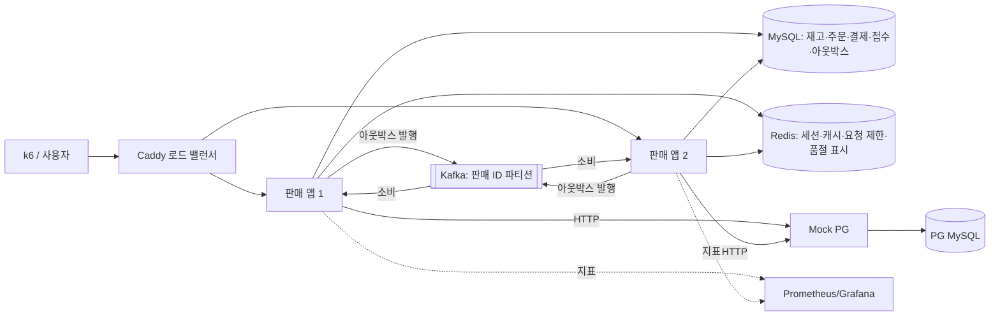

# 포트폴리오 요약: 한정 수량 선착순 판매 백엔드

작성일: 2026-11-25 · [기획](project-plan.md) · [구조](architecture.md) · [개발자 위키](wiki/README.md)

정해진 시각에 열리는 판매 이벤트에서 한정 수량을 선착순으로 파는 Java 25·Spring Boot 4 백엔드다. 목표는 기능 수가 아니라 다음 네 가지를 근거와 함께 보여 주는 것이다.

- 동시 요청이 몰려도 초과 판매·한도 초과·중복 주문·중복 결제가 생기지 않는다.
- 결제 결과가 불확실하거나 서버가 죽어도 DB 기록으로 복구한다.
- Redis와 Kafka를 넣을 때 무엇이 빨라지고 무엇이 그대로인지 측정으로 구분한다.
- 전체 구성에 장애를 일으켜도 위 규칙이 지켜지는지 실제 프로세스로 확인한다.

구현은 AI(Claude Code)가 주로 했다. 개발자는 단계마다 정책을 선택지와 장단점으로 검토해 결정하고, 실험 설계와 결과 해석을 검토했다. AI가 만든 결과에서 드러난 문제는 아래 "AI 협업 기록"에 모았다.

## 구성



- 동기 주문(v1, `POST /api/v1/orders`): 판매 행 잠금 아래에서 수량을 점유하고 주문과 READY 결제를 한 트랜잭션에 만든다. 결제(`POST /api/v1/orders/{id}/payment`)는 Mock PG를 부르고 결과를 확인한 뒤 확정하거나 해제한다.
- 비동기 주문(v2, `POST /api/v2/orders`): 접수와 아웃박스 행을 한 트랜잭션에 저장하고 202로 답한다. 발행기가 Kafka로 보내고 소비자가 v1과 같은 규칙으로 주문을 만든다. 결제는 v1 API로 한다.
- 모듈형 모놀리스(member·product·sale·order·payment)이고, 도메인 간 호출은 공개 api 패키지로만 한다(ArchUnit으로 고정).

## 단계별 진행

| 단계 | 한 일 | 문서 |
|---|---|---|
| 0 | 프로젝트 뼈대, Compose, 빌드 | [0단계](stages/00-project-bootstrap.md) |
| 1 | MySQL 행 잠금 기반 주문·수량 점유, 요청 키 멱등성, Mock PG(성공·거절·지연·응답 유실), 결제 결과 확인과 DB 기반 자동 복구, 2인스턴스 정합성, 관측, 기준 부하 | [1단계](stages/01-mysql-order.md) |
| 2 | Redis 조회 캐시, 분산 요청 제한, Redis 장애 실험, 품절 사전 판정 | [2단계](stages/02-redis.md) |
| 3 | DB 접수 + 아웃박스 + Kafka 비동기 주문, 단일 발행자, 멱등 소비, 재시도·정체 재발행, 비동기 관측, v1·v2 비교 | [3단계](stages/03-kafka.md) |
| 4 | 넘어온 과제 수정, 전체 구성 장애 9가지 × 3회, 이 문서 | [4단계](stages/04-reliability.md) |

## 핵심 결과

같은 한 컴퓨터(Apple M4 Pro 14코어·48GB)에서 부하 생성기와 서버를 함께 돌렸다. 숫자는 비교용이며 운영 성능 보장이 아니다. 모든 결과는 [benchmarks](../benchmarks/)에 실행별 JSON으로 있고, 재현 명령은 아래에 있다.

| 실험 | 조건 | 결과 |
|---|---|---|
| 1-10 다중 인스턴스 정합성 | 사용자 1,000명·재고 300·같은 사용자 중복 요청 포함 1,400건, 인스턴스 1·2개 | 두 모드 모두 확정 300·잔여 0·대조 SQL 위반 0 |
| 1-7-5 복구 회귀 | 경계 세 곳에서 판매 JVM SIGKILL 9회, PG 11분 중단 | 9건 모두 120초 안에 최종 상태, PG 재기동 8초 뒤 확정 |
| 1-11 기준 부하(v1, DB만) | 사용자 10,000·재고 1,000·VU 500 | 확정 1,000, 주문 생성 p50 1.3초. 처리량 상한은 판매 행 하나의 잠금 직렬화(잠금 대기 약 11,000회) |
| 2-6 조회 캐시 | 주문마다 상세 조회 5회 | 상세 조회 p50 366 → 86ms, 적중률 99.3%. 행 잠금 대기는 그대로라 주문 처리량 상한은 바뀌지 않음 |
| 2-6 요청 제한 | 남용 사용자 100명 추가, 1초 1회 | 남용 요청 약 86%를 DB 전에 429로 차단, 정상 사용자 429 0 |
| 2-7 품절 사전 판정 | 기준 부하, Redis 품절 표시 켬/끔 | 부하 시간 38.9 → 19.8초, 품절 응답 p50 1,336 → 344ms, 행 잠금 대기 10,998 → 2,230회 |
| 3-8 v1 동기 대 v2 비동기 | 기준 부하, 3회 교차 | 주문 요청 성공 응답 p50 2.34 → 0.15초(202). 그러나 최종 확정 처리량은 51.8 → 36.6/초, 요청~결제 확정 p50 6.1 → 8.0초. 판매 하나가 파티션 하나라 소비자 하나가 차례로 처리하기 때문이다. DB 행 잠금 대기 시간은 248 → 98초로 줄었다 |
| 3-8 v2 장애 | 브로커 중단·인스턴스 SIGKILL·중복 전달·적체 중 판매 종료, 각 1회 | 모두 통과, 중복 주문 0 |
| 4-3 전체 구성 장애 | 9가지 시나리오 × v1/v2 12개 조합 × 3회(사용자 2,000·재고 300) | 36회 모두 통과: 확정 300, 초과 판매·중복 주문·중복 결제·대조 SQL 위반 0, 응답을 못 받은 요청 0. SIGKILL된 소비자의 파티션 인계 9.5~11.9초(조정 전 최대 45초) |

결과를 해석할 때 지킨 원칙:

- 빠른 202를 주문 처리량 향상으로 설명하지 않았다(3-8).
- 거절을 늘려 얻은 수치를 처리량 개선으로 보지 않았다(2-6).
- "모두 실패해서 정합성 통과"인 결과를 성공으로 치지 않았다(4단계 검증 기준).

## 설계 결정과 대안

| 결정 | 고른 것 | 대안과 트레이드오프 | 근거 |
|---|---|---|---|
| 재고 점유 | MySQL 판매 행 `SELECT … FOR UPDATE` 아래에서 판매 수량·회원 누적 수량을 함께 점유 | Redis 원자 감소는 빠르지만 DB와 두 원장이 생긴다. 정합성을 DB 하나에 둔다 | 1-11에서 상한이 잠금 직렬화임을 측정했고, 2-7·3단계는 이 상한을 피해 가는 방식으로 다뤘다 |
| 중복 요청 | 클라이언트 요청 키(회원·키 유니크)로 결과 재생, 입력이 다르면 409 | 서버 중복 제거만 하면 재시도와 새 주문을 구분 못 한다 | 1-10·4-3에서 재시도가 주문을 늘리지 않음을 확인 |
| 결제 불확실성 | 응답이 없으면 점유를 유지하고 PG 결과를 조회해 확정/해제, 만료 시 PG 종료 확인 | 시간만으로 해제하면 PG 성공 뒤 재고가 두 번 팔린다 | 1-7-5 PG 11분 중단, 4-3 S7 응답 유실에서 중복 결제 0 |
| Redis 장애 | 캐시·요청 제한·품절 표시는 우회하고 정합성은 MySQL이 지킴. 세션 인증은 503 | Redis를 정합성에 쓰면 장애가 곧 판매 중단이 된다 | 2-5, 4-3 S1·S8 |
| 품절 사전 판정 | 재고 0을 커밋한 뒤 Redis 표시(TTL 5초), 표시가 있으면 행 잠금 없이 거절 | 남은 수량 캐시는 갱신 경합이 생긴다. 표시는 "거절만 앞당김"이라 초과 판매를 만들 수 없다 | 2-7 |
| 비동기 전달 | DB 접수 + 아웃박스 + Kafka. 접수 시각을 DB에 남겨 판매 종료 뒤에도 처리 | Kafka에 바로 보내면 접수 증거와 상태 조회가 브로커에 달린다 | 3-1, 3-8 ④(적체 중 종료) |
| 순서 | 파티션 키 = 판매 ID, 발행자 하나(MySQL 이름 잠금) | 여러 발행자는 같은 판매의 접수가 섞인다. 판매 하나의 처리량 상한이 소비자 하나가 된다 | 3-4, 3-8 |
| 멱등 소비 | 접수 행 잠금 → 이미 끝났으면 건너뜀, DB 커밋 뒤 오프셋 확인 | Kafka 트랜잭션은 MySQL 쓰기를 묶지 못한다 | 3-5, 3-8 ③ |
| 실패 처리 | 알려진 일시 오류만 30초 재시도, 그 밖은 즉시 실패 저장, 실패 저장도 안 되면 DB가 돌아올 때까지 대기 | 모든 오류 재시도는 결함 하나가 파티션을 오래 막는다 | 3-6, 4-3 S5·S6에서 `PROCESSING_FAILED` 0 |
| 정체 재발행 | 소비자 그룹이 지나쳤는데 끝나지 않은 접수만 60초 뒤, 5분 넘으면 무조건, 3회 뒤 `STALLED` | 고정 60초는 적체가 크면 대량 재발행을 만든다 | 3-6 |

## 한계와 다음 단계

- 측정은 모두 한 컴퓨터에서 했다. 4단계 실행 때 다른 프로그램 때문에 부하 평균이 10~12였다.
- 브로커는 하나(복제 1)라 고가용성 검증이 아니다.
- v2의 판매 하나당 처리량 상한은 소비자 스레드 하나다. 여러 판매를 동시에 여는 조건은 측정하지 않았다.
- 4-3의 장애는 20초짜리이고, 분 단위 장애는 보지 않았다.
- 원인을 확정하지 못한 것
  - Redis 장애 중 Caddy 502: 증상은 로드 밸런서가 인스턴스에 3초 안에 연결하지 못한 것이다(2-5에서 처음 보고, 4-3에서 장애 중 재현). 근본 원인은 모른다.
  - 4-3 S5 v1의 커넥션 풀 고갈
  - 전체 빌드에서 두 번 본, 시간 제한 없는 테스트 HTTP 요청의 멈춤(3-4, 4-2)
- 다음 단계 후보
  - Redis 장애 감지 시 빠른 실패(차단기)
  - Tomcat 지표 활성화
  - 판매 여러 개 동시 판매 실험
  - 운영 보안(TLS·SASL)과 다중 브로커

## AI 협업 기록

### 역할과 방식

- 정책은 단계마다 AskUserQuestion 선택지로 정했다. 추천안을 표시하고, 4단계부터는 선택지마다 장단점과 트레이드오프를 함께 적었다. 결정은 단계 문서의 "확정 정책" 표에 남겼다.
- 구현은 처음에 별도 워커 에이전트(Sonnet)가 맡고, 주 에이전트가 코드 리뷰·직접 빌드·실험 결과 확인으로 독립 검증했다. 3-5부터는 사용자 지시로 주 에이전트가 직접 구현하고 검증했다(작성자와 검증자가 같다는 한계를 기록).
- 소단계마다 브랜치 → `./gradlew clean build` → PR로 진행했고, 머지는 사용자가 지시할 때만 했다.

### AI 결과물에서 발견한 문제와 수정

| 단계 | 문제 | 발견 경위 | 수정 |
|---|---|---|---|
| 1-3 | `text/plain` 요청이 415가 아닌 500, `Accept: application/xml`이면 가입이 실행된 뒤 406 | 주 에이전트의 독립 MockMvc 재현 | 입력·응답 협상 시점 보정 |
| 1-7-5 | 실험 JVM이 셸 환경 변수를 물려받아 개발 DB·Redis에 붙을 수 있음. 장애 감사 도구가 수렴 실패 결과도 통과시킴 | 독립 리뷰 | 허용 목록의 변수만 전달, 감사 도구가 수렴·최종 스냅샷 검사 |
| 1-7-5 | Mac 유휴 잠자기로 단조시계가 멈춘 실행이 "20초 만에 수렴"으로 기록됨 | 결과의 시간 모순 | 무효 처리, 벽시계·단조시계 차이 5초 초과 시 실패하는 `clock_guard.py` |
| 2-7 | 남은 수량보다 많이 요청한 품절 판정도 품절 표시를 둬 다른 구매자를 막음 | 정책 문구 검토 | 구매 가능 수량이 0일 때만 표시 |
| 3-2 | 테스트 문맥에서 Kafka 관리 클라이언트가 재접속 루프로 로그 수만 줄, 빌드 5 → 18분 | 빌드 시간 이상 | 기동 중 토픽 생성 금지 가드, 재접속 간격 |
| 3-3 | application 계층이 infrastructure 상수를 import | 리뷰 | 상수를 domain으로 옮기고 ArchUnit 규칙 추가 |
| 3-5 | `@KafkaListener(id)`가 리스너 ID를 그룹 ID로 써서 정해 둔 그룹이 아님 | 테스트 로그 | `idIsGroup = false`와 그룹 단언 |
| 3-6 | NULL이 섞인 CHECK가 통과(UNKNOWN은 통과) | 제약 테스트 | `IS NOT NULL` 명시 |
| 3-6 | "DB 장애 대기" 테스트가 기동 직후 리밸런스로 그 경로를 거치지 않고 통과 | 로그 대조 | 파티션 배정 뒤 시작, 해당 로그를 단언 |
| 3-8 | 장애를 "5초 뒤" 주입했는데 이미 재고가 팔려 대기 접수가 없음 | 스모크 실행의 고유 검사 실패 | DB 상태로 주입 시점 결정 |
| 4-2 | 세션 저장 실패를 새 세션까지 무시해 저장되지 않은 CSRF 토큰을 내줌 | 기존 Redis 장애 테스트 | 기존 세션만 대상으로 좁힘 |
| 4-2 | Mock PG 설정이 판매 앱 설정을 가려 일부 테스트가 다른 설정으로 돎 | 3-2에서 기록한 의심을 4-2에서 정리 | `mock-pg.yml`로 분리, 규칙 테스트 |
| 4-3 | 응답 커밋 뒤 Redis 실패가 다시 던져져 Tomcat 오류 처리가 실패(회당 약 200건) | 장애 실험 로그 | 커밋 뒤 실패는 기록만 하고 응답 유지, 수정 전 실패하는 테스트 추가, 재실행 9회 |
| 4-3 | 위 결함을 502의 원인으로 잘못 추정 | 수정 뒤에도 502가 남음, Caddy 오류 로그 | 잘못된 추정을 문서와 커밋 메시지에서 바로잡음 |

## 재현 방법

```sh
# 빌드와 전체 테스트(단위·통합·Mock PG·Python 실험 도구, 약 11분)
PYTHONDONTWRITEBYTECODE=1 ./gradlew clean build

# 로컬 실행: README의 "실행"과 같다
cp .env.example .env   # 비밀번호를 로컬 전용 값으로 바꾼다
set -a; source .env; set +a
docker compose up -d && ./scripts/prepare-local-db.sh
./gradlew :bootRun        # 판매 앱
./gradlew :mock-pg:bootRun  # Mock PG
docker compose --profile monitoring up -d   # Prometheus·Grafana(대시보드: infra/grafana)

# 실험(격리 환경을 실행마다 새로 만든다, JAVA_HOME=Java 25, k6 필요)
./gradlew bootJar :mock-pg:bootJar
caffeinate -ims python3 -B tools/order-regression/run_baseline.py --scenario baseline --runs 3 --output /tmp/baseline
caffeinate -ims python3 -B tools/order-regression/run_comparison.py --conditions v1-sync,v2-async --rounds 3 --order-file execution-order.json --output /tmp/async-comparison
caffeinate -ims python3 -B tools/order-regression/run_reliability.py --rounds 3 --output /tmp/reliability
```

실험 도구의 조건·통과 기준·결과 파일 형식은 [tools/order-regression/README.md](../tools/order-regression/README.md)에 있다.

## 문서 지도

- 무엇을 왜 만들었나: [기획](project-plan.md) → 단계 문서([1](stages/01-mysql-order.md), [2](stages/02-redis.md), [3](stages/03-kafka.md), [4](stages/04-reliability.md))의 "확정 정책"·"구현과 검증"
- 코드가 어떻게 돌아가나: [개발자 위키](wiki/README.md)(첫 주문 따라가기, 주문, 결제, 복구, 운영, 장애 사례)
- 구조와 경계: [구조 설계](architecture.md)
