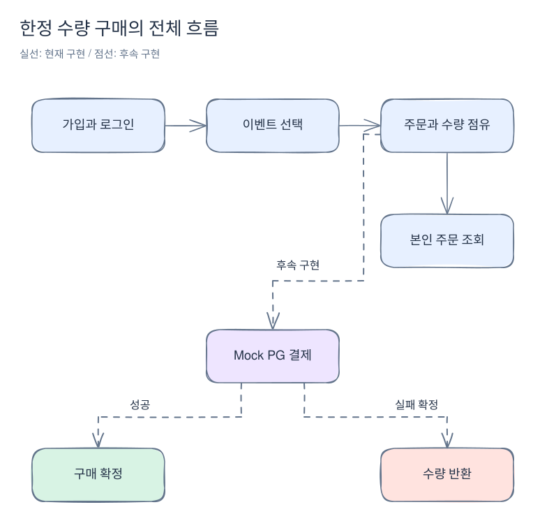

# 한정 수량 판매 서비스, 처음부터 읽기

이 서버는 판매 이벤트에서 한정된 수량을 먼저 확보한 사람에게 제품을 판매한다. 가장 중요한 일은 주문 버튼이 동시에 눌려도 재고와 사용자 구매 한도를 넘지 않고, 재시도 때문에 주문이나 결제가 두 번 생기지 않게 하는 것이다.

예를 들어 10,000원짜리 텀블러 3개를 판매하고 한 사람은 최대 2개까지 살 수 있다고 하자. 사용자는 로그인하고 이벤트를 골라 주문한다. 서버가 먼저 수량을 임시로 잡고, 결제가 성공하면 그 수량을 구매 확정으로 바꾸는 구조다.

**현재 실행 가능한 코드는 로그인 → 이벤트 조회 → 주문 생성·수량 점유 → 본인 주문 조회까지다.** 주문 시 READY 결제 기록을 만든다. Mock PG 자체의 결제·조회·종료와 키별 시나리오도 구현했지만, 판매 앱의 사용자 결제 연동·구매 확정·수량 반환·자동 복구는 아직 구현하지 않았다. 아래 설명에서는 현재 동작과 후속 결제 설계를 구분한다.

[Excalidraw 원본 편집](diagrams/README-1.excalidraw)

## 먼저 읽을 네 페이지

파일 이름을 외우기 전에 사용자의 행동을 따라 읽는다.

| 순서 | 읽을 페이지 | 읽고 나면 설명할 수 있는 것 |
|---|---|---|
| 1 | [로그인부터 구매 완료까지](purchase-flow.md) | 정상 구매의 전체 흐름, 주문과 결제의 차이, 현재 구현의 끝 |
| 2 | [실패·재시도·장애 사례](failure-cases.md) | 품절·한도·중복 주문·결제 거절·응답 유실 때의 처리 |
| 3 | [실제 코드를 따라 읽기](code-walkthrough.md) | 어느 메서드가 인증·점유·저장·응답을 맡는지 |
| 4 | [로컬에서 주문까지 따라 하기](first-order.md) | 세션·CSRF·요청 키를 준비하고 주문 결과를 확인하는 순서 |

전체 흐름을 이해했다면 아래에서 필요한 기능을 더 깊게 읽는다. 이 페이지들은 구현 세부를 찾아보는 용도다.

| 궁금한 내용 | 상세 설명 |
|---|---|
| 서버 두 개와 도메인 패키지는 왜 나눴나? | [구조와 경계](architecture.md) |
| 가입·닉네임·비밀번호 저장은 어떻게 하나? | [회원 가입](member.md) |
| 로그인 후 다음 요청도 나를 어떻게 알아보나? | [세션 인증](authentication.md) |
| 제품과 판매 이벤트는 무엇이 다른가? | [제품](products.md), [판매 이벤트](sales.md) |
| PG를 직접 호출하고 장애를 재현하려면? | [Mock PG와 시나리오](mock-pg.md) |
| 동시에 주문해도 수량이 맞는 이유는? | [주문과 수량 점유](orders.md) |
| record·DTO·api 계약·엔티티는 무엇이 다른가? | [HTTP 계약](http-contracts.md), [코드 읽기](code-walkthrough.md) |
| DB에는 무엇이 저장되고 누가 바꾸나? | [데이터베이스](persistence.md) |
| 실행·검사·오류 추적은 어디서 시작하나? | [실행과 문제 해결](operations.md) |

## 지금 되는 것과 다음에 만들 것

| 구분 | 범위 |
|---|---|
| 구현됨 | 가입, 관리자 초기화, Redis 세션 로그인, 로그인 실패 제한, 제품·판매 이벤트 관리와 공개 조회, 주문 생성·수량 점유·요청 키 결과 보관, 본인 주문 상세 |
| Mock PG 구현됨 | 별도 서버의 결제·조회·종료·키별 시나리오·재시작 보존, 판매 앱의 로컬/테스트 ADMIN 설정 전달 |
| 후속 구현 | 판매 서버 사용자 결제 연동, 주문 확정·점유 해제, DB 복구 실행기, 내 주문 목록 |
| 더 뒤의 단계 | Redis 재고 캐시·분산 요청 제한, Kafka, Prometheus·Grafana 기반 관측·부하 실험 |

현재 Redis는 세션과 로그인 실패 제한에 사용한다. 재고의 최종 판단은 MySQL이 한다. 판매 앱의 후속 사용자 결제 API 경로와 상태는 [합의된 기술 계약](../stages/01-contracts.md)을 설명한 것이며 호출 가능한 기능으로 간주하지 않는다.

정책 원문은 [전체 계획](../project-plan.md), 진행 상태는 [1-7 작업 분할](../stages/01-7-order-payment.md)에서 관리한다. 이 위키의 소스 링크는 현재 작업 트리를 기준으로 한다.

도식은 Excalidraw 원본과 SVG 이미지를 함께 관리한다. 각 그림 아래 원본 링크로 편집할 파일을 찾을 수 있다. [그림 편집과 검증 방법](diagrams/README.md)을 따른다.
