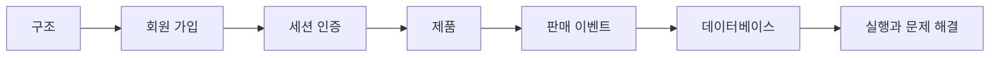

# 개발자 위키

이 위키는 현재 저장소의 실행 흐름을 따라 코드를 이해하고 변경할 때 쓰는 안내서다. 정책과 단계별 결정은 [프로젝트 계획](../project-plan.md)과 [1단계 문서](../stages/01-mysql-order.md)가 원문이다. 위키는 현재 작업 트리의 구현을 설명하며, 단계 문서의 과거 검토안이 현재 동작이라는 뜻은 아니다.

## 읽는 순서

1. [구조와 경계](architecture.md)에서 두 프로세스와 도메인 경계를 살펴본다.
2. [회원 가입](member.md)과 [세션 인증](authentication.md)에서 요청부터 저장과 응답까지 따라간다.
3. [제품 등록과 조회](products.md)와 [판매 이벤트](sales.md)에서 공개 계약·트랜잭션·상태를 확인한다.
4. [데이터베이스와 마이그레이션](persistence.md), [실행과 문제 해결](operations.md)을 변경 및 검증 때 참고한다.

현재 회원 가입·관리자 초기화, 세션 인증, 제품 등록·조회와 판매 이벤트 관리·조회까지 구현되어 있다. 이는 1-3~1-6 기능에 해당한다. 1-1 계약과 1-2 스키마 기반도 존재한다. 이후 주문·수량 점유·결제 유스케이스와 복구는 아직 구현 범위가 아니다. Mock PG는 별도 부트스트랩과 스키마만 있으며 결제 처리 API가 없다. Redis 캐시·분산 요청 제한과 Kafka는 향후 계획이다. 로그인 실패 제한은 현재 Redis를 사용한다.

아래 지도는 첫 학습 경로다. 페이지 이동은 위의 텍스트 링크를 사용한다. Mermaid 지원 여부는 뷰어마다 다르며 GitHub 또는 지원되는 IDE Markdown 미리보기에서 도식을 볼 수 있다.

## 소스 찾기와 유지보수

판매 앱 진입점은 [LimitedSaleApplication](../../src/main/java/com/wooyongjeong/limitedsale/LimitedSaleApplication.java), 별도 서버 진입점은 [MockPgApplication](../../mock-pg/src/main/java/com/wooyongjeong/mockpg/MockPgApplication.java)이다. HTTP 요청은 각 도메인의 `presentation`, 업무 흐름은 `application`, 규칙과 저장소 계약은 `domain`, 실제 저장·보안 구현은 `infrastructure`에서 찾는다. [구조 테스트](../../src/test/java/com/wooyongjeong/limitedsale/architecture/ArchitectureTest.java)는 패키지 의존성을 검사한다.

흐름이나 계약을 변경하면 해당 위키 페이지의 설명과 소스·테스트 링크도 함께 고친다. 현재 동작은 소스와 테스트에서 확인하고, 합의한 정책 변경은 해당 단계 문서에도 기록한다. 향후 계획은 구현된 것처럼 옮기지 않는다.
