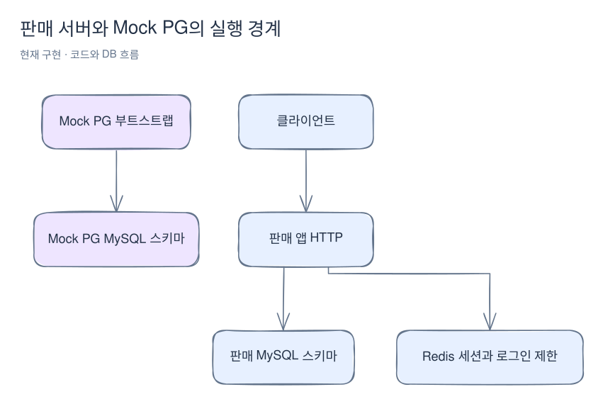
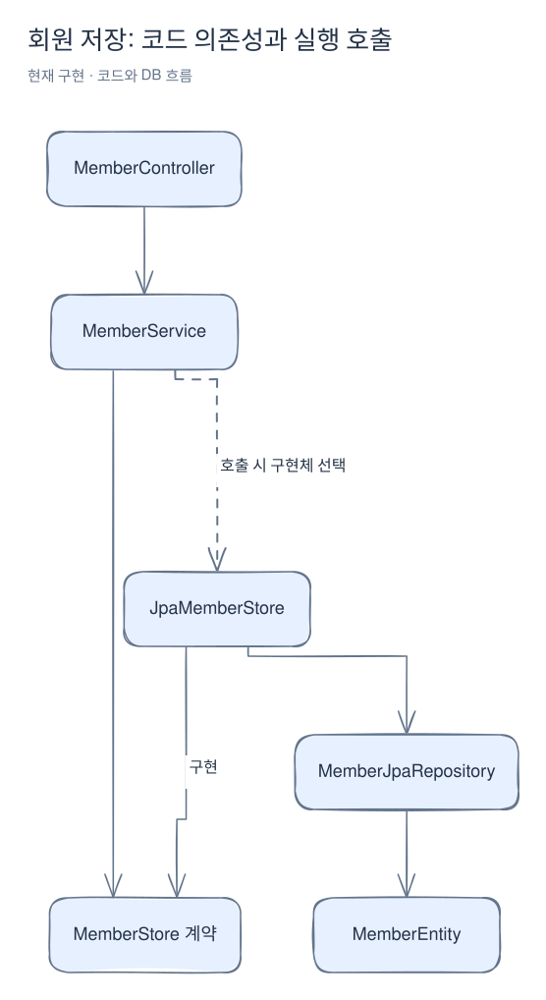
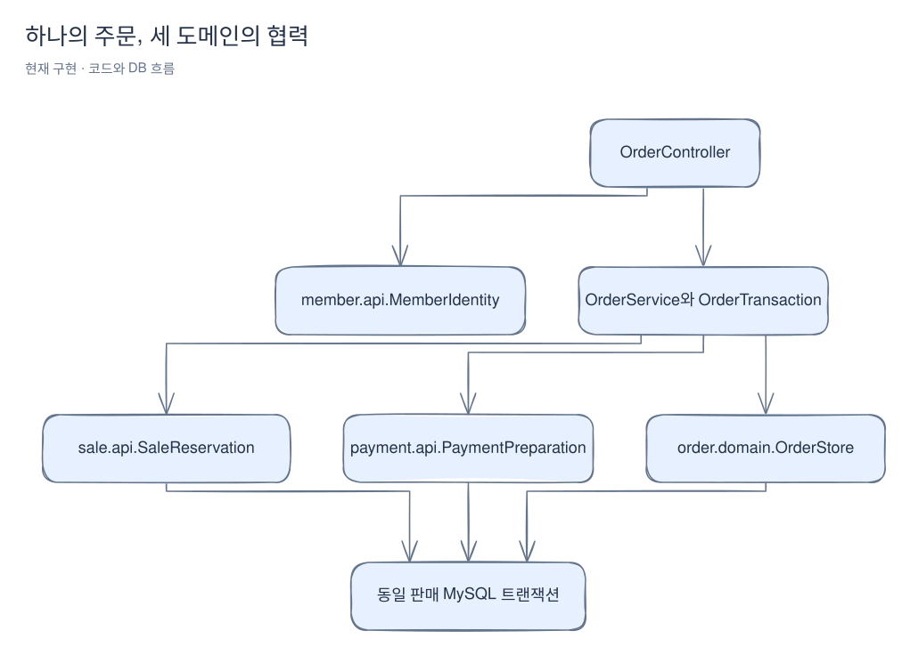

# 구조와 경계

[위키 시작](README.md) · 다음: [회원 가입](member.md)

처음 읽는다면 [전체 구매 흐름](purchase-flow.md)을 먼저 본다. 이 페이지는 그 흐름을 서버·패키지·의존 관계로 나눠 설명한다. Java 인터페이스를 통한 내부 호출과 Mock PG HTTP 호출의 차이를 중심으로 읽으면 된다.

판매 앱은 하나의 Spring Boot 프로세스 안에서 도메인 패키지를 나눈다. Mock PG는 별도 애플리케이션과 별도 DB 스키마를 갖지만 현재는 부트스트랩과 스키마만 있다. 아래 화살표는 현재 사용 중인 연결이다.

[Excalidraw 원본 편집](diagrams/architecture-1.excalidraw)

[판매 앱](../../src/main/java/com/wooyongjeong/limitedsale/LimitedSaleApplication.java)과 [Mock PG](../../mock-pg/src/main/java/com/wooyongjeong/mockpg/MockPgApplication.java)는 각각 시작한다. 현재 판매 앱에서 PG로 결제 HTTP 호출을 수행하지 않는다. 판매 이벤트 관리·조회는 [판매 이벤트 페이지](sales.md)를 본다. 현재 주문 트랜잭션의 조합은 [주문 생성과 수량 점유](orders.md), 후속 결제 경계는 [구조 설계](../architecture.md)에 기록되어 있다.

## 요청이 지나는 경계

`presentation`은 HTTP 입력과 응답을 담당한다. `application`은 유스케이스를 조합하고, `domain`은 업무 입력·모델·저장소 계약을 소유한다. `infrastructure`는 계약을 구현하고 JPA와 Redis를 연결한다. 제품은 [ProductCommand](../../src/main/java/com/wooyongjeong/limitedsale/product/api/ProductCommand.java)와 [ProductQuery](../../src/main/java/com/wooyongjeong/limitedsale/product/api/ProductQuery.java)를 `api`에 제공하고 서비스가 구현한다. 다른 도메인은 이 공개 계약을 참조하도록 [ArchUnit 검사](../../src/test/java/com/wooyongjeong/limitedsale/architecture/ArchitectureTest.java)가 경계를 확인한다. 패키지 전부가 모든 도메인에 이미 구현된 것은 아니다.

`api` 패키지는 HTTP URL을 정의하는 곳이 아니다. `ProductQuery.find`는 서버 내부에서 호출하는 Java 계약이고, `GET /api/v1/products/{id}`는 `presentation`의 컨트롤러가 받는 HTTP 요청이다. 컨트롤러도 같은 Java 계약을 호출해 결과를 HTTP 응답으로 바꾼다. 저장소의 `MemberStore`처럼 자기 도메인 내부에서만 쓰는 계약은 `domain`에 둔다.

아래는 회원 저장을 예로 든 소스 의존성이다. 실선은 타입 참조 또는 계약 구현 방향이고 점선은 실행 중 호출 방향이다. 실행 호출은 인터페이스를 거쳐 어댑터에 도달하므로 소스 의존성과 방향이 다를 수 있다.

[Excalidraw 원본 편집](diagrams/architecture-2.excalidraw)

예를 들어 [MemberService](../../src/main/java/com/wooyongjeong/limitedsale/member/application/MemberService.java)는 `MemberStore`를 호출하고, Spring이 연결한 [JpaMemberStore](../../src/main/java/com/wooyongjeong/limitedsale/member/infrastructure/persistence/JpaMemberStore.java)가 저장을 수행한다. 실선은 네트워크 연결을 뜻하지 않는다.

| 표현 | 예 | 책임과 노출 범위 |
|---|---|---|
| 도메인 값 | `Member`, `Product` | 업무 흐름에서 사용하는 값 |
| 영속 엔티티 | `MemberEntity`, `ProductEntity` | JPA가 테이블에 매핑하는 객체 |
| 인증 전용 값 | `AuthenticationRecord` | 내부 ID와 해시를 포함해 인증에 사용 |
| HTTP 응답 | `ApiResponse<MemberResponse>` | 공통 응답 틀과 외부에 제공할 회원 값 |

[Member](../../src/main/java/com/wooyongjeong/limitedsale/member/domain/Member.java)와 [Product](../../src/main/java/com/wooyongjeong/limitedsale/product/domain/Product.java)는 JPA 엔티티가 아니다. 각 저장소 어댑터가 영속 엔티티를 도메인 값으로 바꾼다. 이 분리 덕분에 호출자는 영속성 객체를 직접 다루지 않는다. 자세한 매핑과 아직 사용하지 않는 엔티티는 [데이터베이스](persistence.md)를 본다.

공통 HTTP 응답 [ApiResponse](../../src/main/java/com/wooyongjeong/limitedsale/common/web/ApiResponse.java)는 `httpStatus`, `code`, `data`, `message`를 담는다. 공통 및 도메인별 코드 enum은 [ResponseCode](../../src/main/java/com/wooyongjeong/limitedsale/common/web/ResponseCode.java)를 구현한다. 이 공통 영역은 회원이나 재고 규칙을 소유하지 않는다.

## 주문이 도메인을 조합하는 경계

[OrderTransaction](../../src/main/java/com/wooyongjeong/limitedsale/order/application/OrderTransaction.java)은 `sale.api`로 수량을 점유하고 `payment.api`로 READY 기록을 준비한다. 세 도메인은 같은 판매 DB 트랜잭션에 참여한다. HTTP 인증 정보는 `member.api.MemberIdentity`로 전달한다. 도메인 간 호출이 인터페이스를 거친다는 사실은 별도 프로세스나 별도 트랜잭션이라는 뜻이 아니다.

[Excalidraw 원본 편집](diagrams/architecture-3.excalidraw)

외부 요청·응답은 도메인별 presentation/request·response의 최상위 DTO다. 내부 api·domain 결과를 그대로 반환하지 않고 컨트롤러와 응답 DTO의 from 메서드에서 변환한다. [HTTP 계약과 내부 계약](http-contracts.md)에서 배치·변환 예와 구조 검사의 범위를 설명한다.
