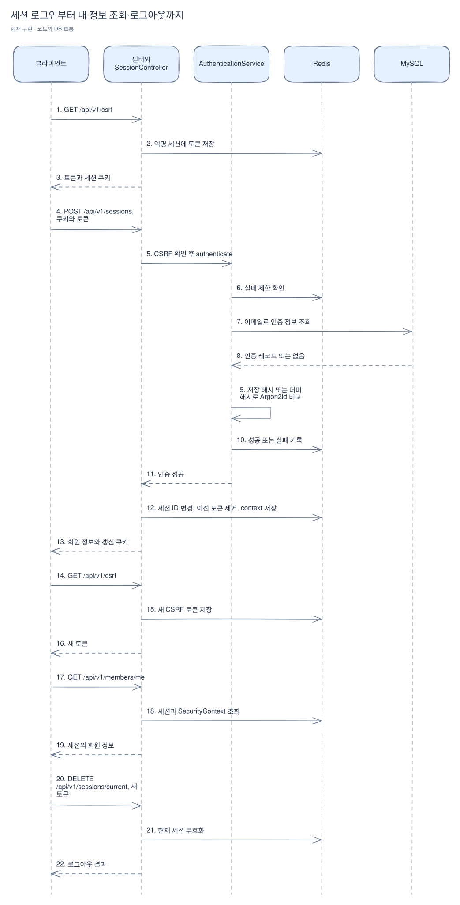
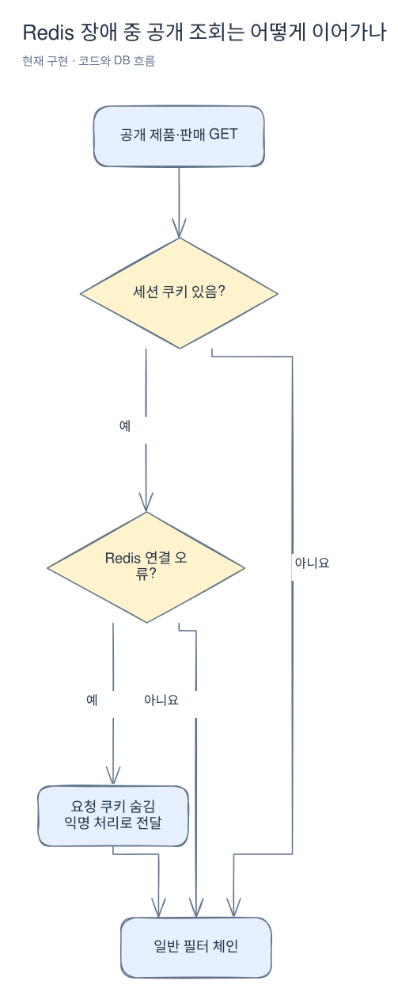

# 세션 인증과 CSRF

[위키 시작](README.md) · 이전: [회원 가입](member.md) · 다음: [제품](products.md)

로그인 성공 후 주문할 때마다 비밀번호를 다시 보내지는 않는다. 클라이언트의 세션 쿠키를 Redis에 저장된 인증 정보와 연결해 사용자를 식별한다. 이 페이지는 세션과 CSRF가 어디에서 만나고, 인증 실패가 어느 단계에서 끝나는지 설명한다. 먼저 [로그인부터 구매까지](purchase-flow.md)를 읽어도 좋다.

로그인은 [SessionController](../../src/main/java/com/wooyongjeong/limitedsale/member/presentation/SessionController.java)의 HTTP 요청에서 시작한다. [AuthenticationService](../../src/main/java/com/wooyongjeong/limitedsale/member/application/AuthenticationService.java)는 컨트롤러가 호출하는 인증 업무이며 HTTP 진입점이 아니다.

아래에서 클라이언트 화살표는 HTTP다. 서버의 Redis와 MySQL 접근은 각각 별도 연결이며 하나의 DB 트랜잭션으로 묶이지 않는다.

[Excalidraw 원본 편집](diagrams/authentication-1.excalidraw)

서블릿 필터 순서는 [RedisFailureFilter](../../src/main/java/com/wooyongjeong/limitedsale/member/infrastructure/security/RedisFailureFilter.java), [PublicSessionFallbackFilter](../../src/main/java/com/wooyongjeong/limitedsale/member/infrastructure/security/PublicSessionFallbackFilter.java), 이후 세션 및 [SecurityConfiguration](../../src/main/java/com/wooyongjeong/limitedsale/member/infrastructure/security/SecurityConfiguration.java)의 보안 처리다. 보안 설정은 CSRF와 권한을 검사한다. 가입·로그인 요청은 [MemberJson](../../src/main/java/com/wooyongjeong/limitedsale/member/presentation/request/MemberJson.java)에서 JSON 객체 하나만 허용한다. 후행 값·중복 필드·미지 필드·비문자열 값은 400으로 거절하고 인증이나 로그인 실패 카운터 갱신 전에 끝난다. `GET /api/v1/csrf`는 세션에 저장된 토큰을 반환한다. 클라이언트는 `data.token`을 `X-CSRF-TOKEN`에 넣고 같은 쿠키를 보낸다. 가입과 로그인에도 필요하다.

세 가지 값은 역할이 다르다. 예를 들어 로그인 성공 후 쿠키를 갱신해도 이전 CSRF 토큰은 그대로 쓸 수 없다.

| 값 | 위치 | 역할 |
|---|---|---|
| 세션 쿠키 | 클라이언트 | 서버가 세션을 찾는 식별자 전달 |
| CSRF 토큰 | 세션과 응답, 이후 요청 헤더 | 변경 요청의 토큰 검증 |
| SecurityContext | Redis에 보관되는 세션 | 로그인한 principal과 권한 보관 |

아래는 공개 제품·판매 GET에 적용되는 [PublicSessionFallbackFilter](../../src/main/java/com/wooyongjeong/limitedsale/member/infrastructure/security/PublicSessionFallbackFilter.java)의 분기다. 그 외 요청은 이 fallback 없이 일반 필터 체인으로 전달한다. 공개 GET이라도 다른 원인의 오류나 뒤이어 발생한 오류가 무조건 성공한다는 뜻은 아니다.

[Excalidraw 원본 편집](diagrams/authentication-2.excalidraw)

인증 서비스는 입력 검증 뒤 정규화 이메일과 직접 연결 IP 조합의 제한을 확인한다. [RedisLoginAttemptLimit](../../src/main/java/com/wooyongjeong/limitedsale/member/infrastructure/security/RedisLoginAttemptLimit.java)은 해시한 키와 Lua 스크립트로 실패 횟수 및 첫 실패부터 시작하는 고정 구간을 관리한다. 기본 5분, 다섯 번째 실패부터 429다. 제한 전 성공은 해당 키를 삭제한다. 이미 제한에 도달하면 올바른 비밀번호도 구간 만료까지 거절한다. 없는 이메일과 잘못된 비밀번호는 같은 401 응답이다. 없는 회원도 빈 초기화 시 한 번 만든 더미 해시와 비교하고, 비교가 일치하더라도 인증하지 않는다. 이 보완은 해시 비교 생략에 따른 비용 차이를 줄이지만 모든 처리 시간을 같게 보장하지는 않는다.

이 시퀀스 그림은 로그인 성공 경로다. 입력 형식이 잘못되면 인증 서비스에서 400, 자격 증명이 틀리면 제한에 도달하기 전까지 401, 실패 제한에 도달하면 429로 끝나며 로그인 상태를 저장하지 않는다.

로그인 성공 시 컨트롤러는 세션 ID를 변경하고 이전 CSRF 토큰을 지운다. `SessionPrincipal`에 ID, 이메일, 닉네임, 역할을 넣고 `SecurityContext`를 명시 저장한다. Spring Session이 Redis에 세션을 보관하므로 같은 Redis를 쓰는 인스턴스에서 세션을 읽는다. 로그인 후 새 CSRF 토큰을 조회해야 한다.

`GET /api/v1/members/me`는 DB를 다시 조회하지 않고 세션의 회원 정보를 반환한다. 따라서 이후 DB에서 닉네임·권한이 바뀌더라도 기존 세션 값이 자동 갱신되는 구조는 아니다. 현재는 해당 정보의 변경 API가 없다. `DELETE /api/v1/sessions/current`는 토큰을 지우고 현재 세션만 무효화하며 다른 기기의 세션은 유지한다. 이후 변경 요청 전에 토큰을 다시 조회한다.

기본 유휴 시간은 30분이다. 쿠키는 HttpOnly와 SameSite=Lax이며 HTTPS 요청에서 Secure가 적용된다. 로컬 HTTP에서는 Secure가 붙지 않는다. 설정은 [application.yml](../../src/main/resources/application.yml)과 [실행 안내](../../README.md)를 본다. Redis 오류가 응답 커밋 전에 발생하면 필터가 503으로 변환한다. 공개 제품·판매 GET에 세션 쿠키가 있고 Redis 연결이 실패하면 fallback 필터는 해당 쿠키를 요청에서 제거해 익명 조회를 계속한다. 판매 이벤트 관리·조회 API도 같은 세션·CSRF 및 공개 조회 fallback을 사용한다. 인증·CSRF 및 보호된 요청은 Redis 장애 시 실패할 수 있다.

fallback은 현재 요청을 감싼 객체에서만 세션 쿠키를 숨긴다. 브라우저 쿠키를 삭제하거나 Redis 세션을 복구하는 작업은 아니다. `ping` 이후 실제 세션 조회에서 새로 장애가 생기면 바깥 필터가 503을 반환할 수도 있다. 또한 응답이 이미 커밋됐거나 예외가 필터까지 전파되지 않으면 필터가 응답을 503으로 바꿀 수 없다.

[세션 통합 테스트](../../src/integrationTest/java/com/wooyongjeong/limitedsale/member/SessionIntegrationTest.java)는 다중 인스턴스 세션, 토큰 교체, 실패 제한, 쿠키와 Redis 장애를 다룬다. [제품 통합 테스트](../../src/integrationTest/java/com/wooyongjeong/limitedsale/product/ProductIntegrationTest.java)는 공개 조회와 보호된 생성의 장애 동작을 확인한다.

로그인 본문은 [LoginRequest](../../src/main/java/com/wooyongjeong/limitedsale/member/presentation/request/LoginRequest.java), CSRF 조회 data는 [CsrfTokenResponse](../../src/main/java/com/wooyongjeong/limitedsale/member/presentation/response/CsrfTokenResponse.java)다. 로그인·내 정보는 MemberResponse로 변환한다. 기존 JSON 필드는 유지하며 [HTTP 계약 페이지](http-contracts.md)에서 파일 배치와 변환을 확인한다.
