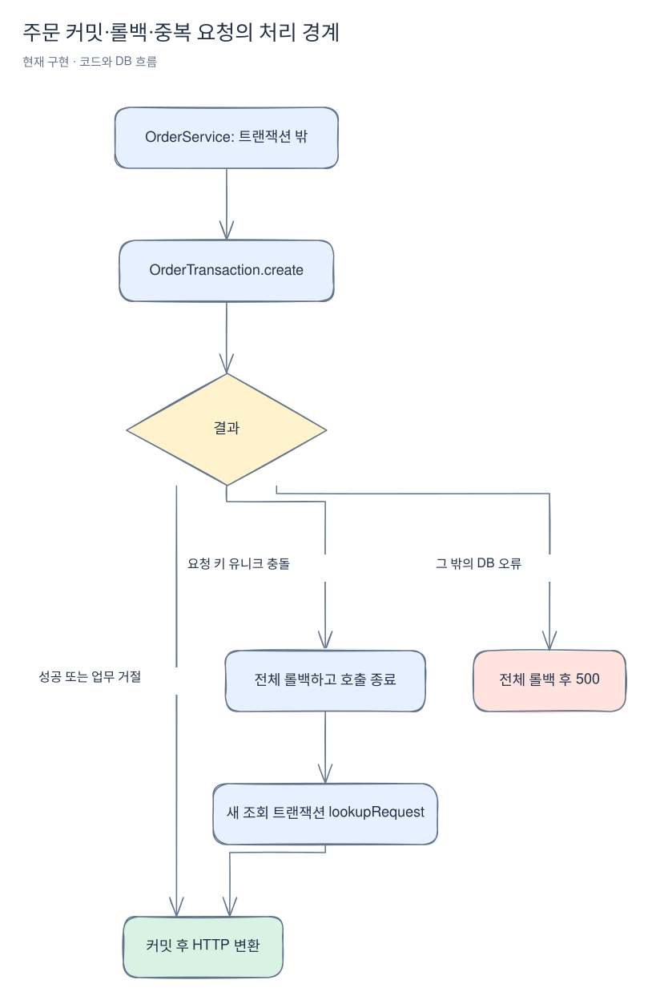
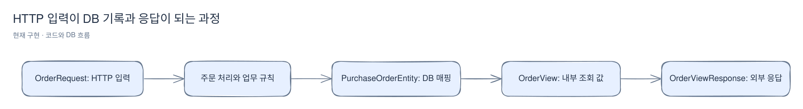

# 실제 코드를 따라 읽기

[위키 시작](README.md) · 이전: [실패 사례](failure-cases.md) · 다음: [로컬에서 따라 하기](first-order.md)

코드를 읽을 때 처음부터 저장소 전체를 펼칠 필요는 없다. 먼저 사용자가 보낸 HTTP 요청을 잡고, 입력을 누가 해석하는지, 규칙을 누가 판단하는지, 저장을 누가 끝내는지 순서대로 따라간다. 여기서는 실제 로그인과 주문 생성 두 경로를 읽는다.

## 먼저 다섯 단어만 구분한다

| 이름 | 이 프로젝트에서 하는 일 | 실제 예 |
|---|---|---|
| presentation | HTTP 입력·인증 정보와 응답 형식을 다룸 | SessionController, LoginRequest |
| application | 한 작업을 어떤 순서·트랜잭션으로 수행할지 조합 | OrderTransaction |
| domain | 판매 가능 조건 등 업무 규칙과 내부 값·저장소 계약 | Sale, OrderStore |
| infrastructure | JPA·Redis처럼 실제 기술로 계약을 구현 | JpaOrderStore |
| api | 다른 도메인이 호출할 Java 인터페이스 | SaleReservation |

`api`는 REST URL 모음이 아니다. `POST /api/v1/orders`는 컨트롤러가 받는 HTTP이고, `sale.api.SaleReservation.allocate`는 같은 프로세스 안의 Java 호출이다.

## 로그인: 비밀번호가 인증된 세션이 되는 과정

1. [LoginRequest](../../src/main/java/com/wooyongjeong/limitedsale/member/presentation/request/LoginRequest.java)는 email·password 입력 모양을 정의한다. [MemberJson](../../src/main/java/com/wooyongjeong/limitedsale/member/presentation/request/MemberJson.java)이 중복·미지 필드와 잘못된 타입을 먼저 거른다. `toString()`은 비밀번호를 가린다.
2. [SessionController.login](../../src/main/java/com/wooyongjeong/limitedsale/member/presentation/SessionController.java)은 `service.authenticate(...)`로 자격 증명을 넘긴다. 비밀번호 비교 자체를 컨트롤러에서 수행하지 않는다.
3. [AuthenticationService.authenticate](../../src/main/java/com/wooyongjeong/limitedsale/member/application/AuthenticationService.java)는 이메일 정규화·형식 검사 → Redis 차단 여부 → 계정 조회 → 해시 비교 → 실패 횟수 반영 순서로 처리한다. 이 메서드가 성공해도 아직 세션 저장 작업이 끝난 것은 아니다.
4. 컨트롤러로 돌아와 `request.changeSessionId()`로 세션 ID를 바꾸고 기존 CSRF 토큰을 지운다. 인증된 principal을 SecurityContext에 넣고 `contexts.saveContext(...)`로 명시적으로 저장한다. Spring Session Redis가 세션을 저장한다.
5. 내부 회원 값을 [MemberResponse.from](../../src/main/java/com/wooyongjeong/limitedsale/member/presentation/response/MemberResponse.java)으로 바꾸고 `ApiResponse`에 담아 반환한다. 비밀번호 해시와 회원 내부 ID를 응답에 넣지 않는다.

컨트롤러 안의 principal 생성은 다음 요청에서 사용자를 알아보기 위한 인증 정보를 만드는 부분이다. JSON에 회원을 반환하는 것만으로 세션 로그인이 완성되는 것은 아니다. 필터·세션 흐름은 [인증 상세](authentication.md)에서 더 읽는다.

## 주문: 이 호출 여섯 개를 중심으로 읽는다

[OrderController.create](../../src/main/java/com/wooyongjeong/limitedsale/order/presentation/OrderController.java)에서 시작한다. 본문과 UUID 요청 키를 검사하고 세션 principal의 MemberIdentity에서 회원 ID를 얻는다. 요청자가 회원 ID나 가격을 본문으로 지정하지 않는다.

[OrderService.create](../../src/main/java/com/wooyongjeong/limitedsale/order/application/OrderService.java)는 트랜잭션 바깥에서 작업을 호출하고 요청 키 충돌을 처리한다. 실제 생성 조합은 다른 Spring bean인 [OrderTransaction.create](../../src/main/java/com/wooyongjeong/limitedsale/order/application/OrderTransaction.java)에 있다.

아래는 그 메서드의 핵심 호출을 줄여 적은 읽기용 순서다. 붙여 넣어 실행하는 별도 구현 코드는 아니다.

```text
orders.request(...)       이미 처리한 키인가?
sales.allocate(...)       기간·한도·재고를 검사하고 점유
orders.create(...)        가격 스냅샷과 주문 저장
sales.attach(...)         방금 만든 주문에 점유 기록 연결
payments.prepare(...)     PG 키와 READY 결제 준비
orders.record(...)        이 요청 키의 성공 결과 저장
```

### allocate 안에서는 무엇이 일어나나?

[JpaSaleReservation.allocate](../../src/main/java/com/wooyongjeong/limitedsale/sale/infrastructure/persistence/JpaSaleReservation.java)은 이벤트 행을 `findForUpdate`로 잠근다. 기존 사용자 수량 행을 잠그고 **그 뒤에** DB 시각을 읽는다. 앞 요청을 기다리는 동안 시간이 흘렀을 수 있기 때문이다.

[Sale.allocationDecision](../../src/main/java/com/wooyongjeong/limitedsale/sale/domain/Sale.java)은 SQL을 실행하지 않는다. 전달받은 현재 시각·누적 수량·요청 수량으로 기간 → 중단 → 사용자 한도 → 가용 재고를 판정한다. 규칙이 허용한 경우에만 어댑터가 수량 엔티티를 변경한다.

기존 JPA 엔티티는 현재 트랜잭션에 연결된 상태이므로 필드 변경이 커밋 때 UPDATE로 반영된다. 새 사용자 수량·주문·점유·결제는 Spring Data JPA 저장소에 저장한다. `save`가 각자 독립 커밋한다는 뜻은 아니다. 바깥 주문 트랜잭션이 전체 성공·실패를 결정한다.

### 업무 거절은 왜 예외 대신 결과로 반환하나?

거절도 키별로 저장해야 하기 때문이다. 기간 외이면 `orders.record(...)`로 거절만 저장하고 결과 타입을 반환한다. 그 뒤 컨트롤러가 HTTP 409로 바꾼다. 저장 직후 롤백 예외를 던져버리면 보관하려던 거절까지 사라진다.

### Service와 Transaction이 왜 나뉘어 있나?

동시 요청의 유니크 충돌은 JPA 트랜잭션을 실패 상태로 만든다. 그 안에서 기존 결과를 읽고 정상 처리하려고 하면 다시 롤백될 수 있다. OrderService는 실패한 OrderTransaction 호출이 끝난 뒤 `lookupRequest`를 새 트랜잭션으로 호출한다. 단순 이름 구분이 아니라 **롤백이 끝나는 경계**를 분리한 것이다.



[Excalidraw 원본 편집](diagrams/code-walkthrough-1.excalidraw)

## record와 Entity는 무엇이 다른가?

같은 주문 정보라도 경계를 넘을 때 역할이 달라진다.



[Excalidraw 원본 편집](diagrams/code-walkthrough-2.excalidraw)

[PurchaseOrderEntity](../../src/main/java/com/wooyongjeong/limitedsale/order/infrastructure/persistence/PurchaseOrderEntity.java)는 JPA 애너테이션과 DB 컬럼 매핑·버전을 가진다. [OrderView](../../src/main/java/com/wooyongjeong/limitedsale/order/domain/OrderView.java)는 내부에서 전달하는 조회 값이다. [OrderViewResponse](../../src/main/java/com/wooyongjeong/limitedsale/order/presentation/response/OrderViewResponse.java)는 실제 JSON에 보낼 필드를 정한다. 내부 엔티티에 필드가 늘었다고 API에 그대로 노출되지 않게 한 것이다.

[OrderRequest](../../src/main/java/com/wooyongjeong/limitedsale/order/presentation/request/OrderRequest.java)는 현재 JsonNode를 담는 record다. 따라서 파일만 열면 saleId·quantity가 구성요소로 바로 보이지 않는다. 실제 필드 검사는 [OrderJson](../../src/main/java/com/wooyongjeong/limitedsale/order/presentation/OrderJson.java)과 컨트롤러에서 읽어야 한다. 판매 PATCH도 생략·명시적 null을 구분하기 위해 JSON 트리 정보를 유지한다.

## 어느 테스트를 먼저 열면 좋을까?

| 궁금한 동작 | 읽을 테스트와 관찰점 |
|---|---|
| 로그인·토큰·세션·권한·Redis 장애 | [SessionIntegrationTest](../../src/integrationTest/java/com/wooyongjeong/limitedsale/member/SessionIntegrationTest.java): 실제 HTTP 입력과 응답 |
| 주문 경쟁·키 재생·롤백 | [OrderIntegrationTest](../../src/integrationTest/java/com/wooyongjeong/limitedsale/order/OrderIntegrationTest.java): HTTP 결과와 SQL 수량을 함께 대조 |
| 시간·한도·재고의 판정 순서 | [SaleTest](../../src/test/java/com/wooyongjeong/limitedsale/sale/domain/SaleTest.java): 프레임워크 없이 규칙 입력·결과 확인 |
| 도메인 간 api 경계를 지키나? | [ArchitectureTest](../../src/test/java/com/wooyongjeong/limitedsale/architecture/ArchitectureTest.java) |
| 컨트롤러가 내부 모델을 응답으로 내보내나? | [HttpContractStructureTest](../../src/test/java/com/wooyongjeong/limitedsale/architecture/HttpContractStructureTest.java)와 실제 응답 매핑 |

테스트가 존재한다는 것과 부하·장애의 모든 경우를 검증했다는 것은 다르다. Mock PG HTTP와 ADMIN 시나리오 설정 코드는 [Mock PG 페이지](mock-pg.md)에서 이어 읽는다. 판매 앱의 사용자 결제 연동·복구 실행기는 아직 없으므로 그 부분은 [후속 설계](purchase-flow.md)를 읽는다.
