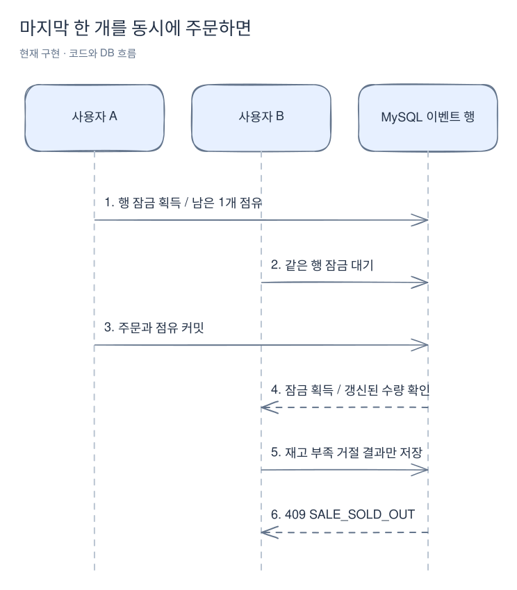
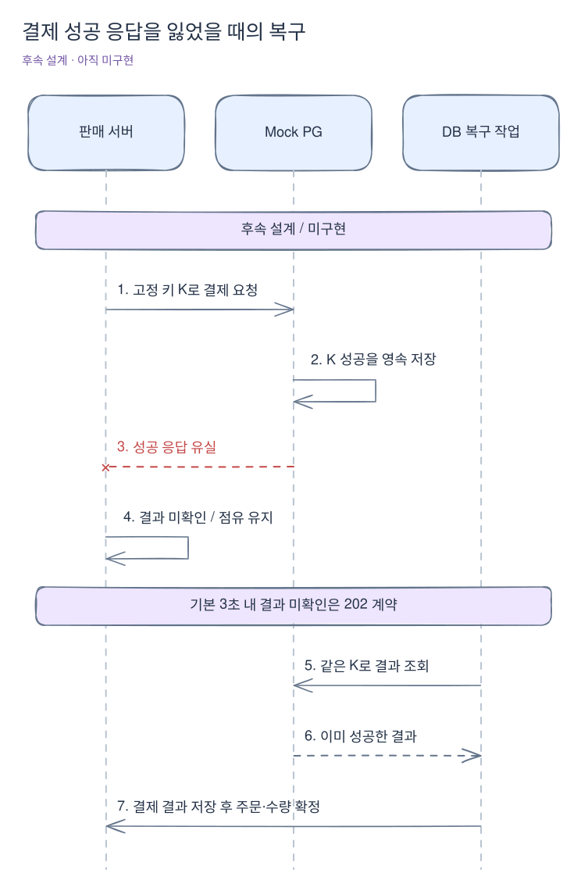
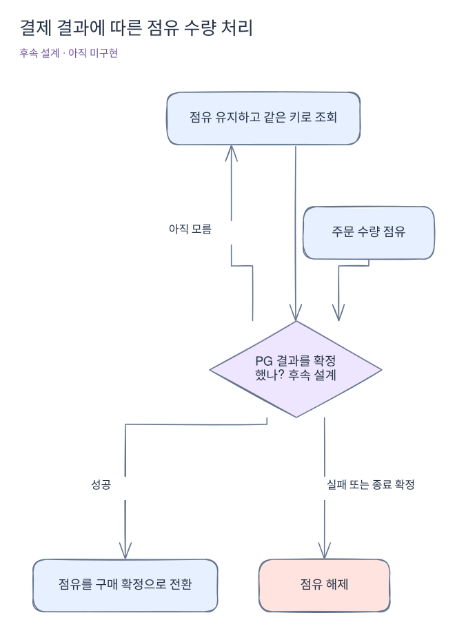

# 실패·재시도·장애가 생기면

[위키 시작](README.md) · 이전: [전체 구매 흐름](purchase-flow.md) · 다음: [실제 코드 읽기](code-walkthrough.md)

주문을 거절하는 것과 서버가 처리하지 못한 것은 다르다. 품절은 판정이 끝난 업무 결과지만 DB 연결 실패는 구매 가능 여부를 확정한 결과가 아니다. 결제에서는 한 가지가 더 있다. PG가 돈을 처리했는지 서버가 아직 모르는 경우다.

## 사례 1. 로그인에 실패했다 — 구현됨

형식이 올바른 이메일·비밀번호를 보냈지만 계정이 없거나 비밀번호가 다르면 같은 실패 메시지로 401을 반환한다. 계정 존재 여부를 메시지로 구분하지 않는다. 없는 계정도 더미 해시로 비밀번호 비교를 수행한다.

실패 횟수는 정규화 이메일과 직접 연결 IP 조합으로 Redis에 기록한다. 첫 실패부터 5분 동안 세고, 1~4번째는 401, 5번째부터는 429다. 차단 중에는 올바른 비밀번호도 거절한다. 입력 형식 오류 400이나 CSRF 오류 403은 비밀번호 불일치와 다른 경로다.

Redis를 사용할 수 없어 인증을 확인할 수 없으면 503이다. 이때 사용자를 로그인된 것으로 추정하지 않는다. 제품·판매 이벤트 공개 GET은 가능한 범위에서 계속 제공한다. [인증 상세](authentication.md)와 [AuthenticationService](../../src/main/java/com/wooyongjeong/limitedsale/member/application/AuthenticationService.java)를 함께 본다.

## 사례 2. 조회 때 OPEN이었는데 주문이 거절됐다 — 구현됨

수량 조회와 실제 점유 사이에 다른 요청이 들어올 수 있다. 두 사람이 마지막 1개를 동시에 주문하면 이벤트 잠금을 먼저 얻은 요청이 확보하고 다음 요청은 갱신된 수량을 본다.

[Excalidraw 원본 편집](diagrams/failure-cases-1.excalidraw)

단, 사용자 한도를 먼저 넘었다면 재고보다 먼저 `PURCHASE_LIMIT_EXCEEDED`를 반환한다. 판정 순서는 기존 키 → 없는 이벤트 → 기간 외 → 중단 → 사용자 한도 → 재고다. 잠금 대기 중 판매가 끝나면 획득 후 DB 시각으로 기간 외를 판정한다.

거절 요청에는 주문·결제·점유를 만들지 않고 요청 결과만 저장한다. 공개 상태의 SOLD_OUT은 구매 확정 수량을 기준으로 하므로, 전부 점유된 이벤트가 OPEN이어도 신규 주문이 거절될 수 있다.

## 사례 3. 주문 버튼을 두 번 눌렀다 — 구현됨

클라이언트는 같은 구매 시도에 같은 UUID 요청 키를 사용한다. 같은 사용자·키·이벤트·수량이면 한 주문으로 수렴한다. 최초 생성 응답은 201, 재생 응답은 200이며 주문 UUID는 같다. 재생은 저장했던 응답 복사본이 아니라 주문의 최신 상태를 읽는다.

동시에 들어온 요청이 둘 다 기존 결과를 못 찾을 수 있다. DB 유니크 제약이 중복을 막고 패배한 트랜잭션은 수량까지 전부 롤백한다. 그 트랜잭션이 끝난 뒤 승자의 결과를 다시 읽는다. [OrderService.create](../../src/main/java/com/wooyongjeong/limitedsale/order/application/OrderService.java)가 이 바깥 처리를 맡는다.

같은 키를 쓰면서 수량을 1에서 2로 바꾸면 409 `IDEMPOTENCY_CONFLICT`다. 기존 주문을 수정하는 요청으로 취급하지 않는다. 다른 사용자가 같은 UUID를 사용하는 것은 서로 별개다.

## 사례 4. 주문 응답이 안 와서 성공 여부를 모르겠다 — 구현됨

서버가 DB에 커밋한 직후 클라이언트가 응답을 받지 못할 수 있다. 이때 새 키로 다시 주문하면 별도 구매 시도가 된다. 원래 키와 같은 입력으로 재전송해야 기존 주문을 돌려받는다.

같은 키를 보냈지만 처음 요청이 DB 실패로 전부 롤백됐다면 저장된 결과가 없다. 재시도는 그때의 판매 조건을 새로 검사한다. 시스템 장애를 영구적인 구매 거절로 보관하지 않는 이유다.

[OrderIntegrationTest](../../src/integrationTest/java/com/wooyongjeong/limitedsale/order/OrderIntegrationTest.java)의 응답 유실 검사는 첫 HTTP 응답을 버리고 다시 보내는 방식이다. 네트워크 단절 자체를 주입한 실험은 아니다.

## 사례 5. 중단 거절 뒤 판매가 재개됐다 — 구현됨

업무 거절도 요청 키별로 저장한다. 중단 중 보낸 K1이 `SALE_STOPPED`였다면 재개 후 K1로 보내도 같은 거절이다. 그 시도를 다시 판정하는 요청이 아니기 때문이다. 재개 후 새로 구매하려면 K2를 만든다.

| 입력과 상황 | 응답 | DB 변화 |
|---|---|---|
| K1, 중단 중 | 409 SALE_STOPPED | 거절 결과 저장 |
| K1, 재개 후 같은 입력 | 같은 409 | 새 주문·점유 없음 |
| K1, 수량 변경 | 409 IDEMPOTENCY_CONFLICT | 원래 결과 보존 |
| K2, 재개 후 | 현재 조건을 새로 판정 | 허용 시 새 주문 생성 |

없는 이벤트 404도 같은 원칙이다. 입력 오류·인증·CSRF 오류·DB 장애는 키 결과로 보관하지 않는다.

## 사례 6. 결제 기록 저장 중 DB 오류가 났다 — 구현됨

주문과 점유를 저장했어도 READY 결제 기록 저장에 실패하면 전체를 롤백한다. HTTP는 500이고 성공 요청 결과도 남기지 않는다. 판매 총점유·회원 점유·주문별 점유·주문·결제 중 일부만 커밋되지 않게 같은 트랜잭션으로 묶었다.

실제 MySQL 테스트는 결제 INSERT에 실패를 주입하고 모든 수량·기록이 원래대로인지 확인한다. 요청 키 제약이 아닌 다른 유니크 오류도 멱등성 충돌로 숨기지 않는다.

## 사례 7. PG가 결제를 명확히 거절했다 — 후속 설계, 미구현

PG의 확정 실패를 받으면 판매 서버 결제를 FAILED로 저장하고 주문은 PAYMENT_FAILED로 마무리하면서 점유를 해제하는 설계다. 결제 요청은 409/PAYMENT_DECLINED, 이후 주문 상세 조회는 200과 실패 상태를 반환하는 계약 초안이다. 조회 성공 여부와 주문의 업무 상태는 다르다.

최종 실패한 주문을 새 PG 키로 되살리지는 않는다. 다시 구매하려면 새 주문을 만들고 현재 재고·한도를 검사한다. PG 자체의 DECLINE은 FAILED·200으로 재현할 수 있다. 판매 앱의 사용자 결제 연동과 해제 코드는 없으므로 주문까지 실패로 마무리되는 경로는 아직 실행되지 않는다.

## 사례 8. PG가 성공했는데 응답을 잃었다 — 후속 설계, 미구현

서버의 타임아웃은 PG 결제 실패를 뜻하지 않는다. 먼저 수량을 반환하면 다른 사람이 그 수량을 구매한 뒤 원래 결제 성공까지 확인되어 초과 판매가 될 수 있다.

[Excalidraw 원본 편집](diagrams/failure-cases-2.excalidraw)

기본 10초 간격 재조회는 설정 가능하며 다음 조회 시각을 DB에 남기는 설계다. PG 성공 저장 후 주문 반영 전에 서버가 죽는 경우에도 이 복구 흐름이 마무리한다. 결제는 이미 성공했는데 HTTP 응답만 유실된 상황을 중복 결제로 해결하지 않는다.

## 사례 9. 주문만 만들고 결제하지 않았다 — 후속 설계, 미구현

주문 생성 후 기본 5분이 지나면 PG에 종료를 요청한다. PG가 이미 성공했다면 성공을 반환받아 확정한다. 미결제면 CLOSED를 확정한 뒤 점유를 해제한다. 아직 PG에 없는 키도 종료 기록을 만들어 늦게 도착한 결제가 성공하지 못하게 한다.

판매 앱의 후속 복구 설계에서 PG가 계속 응답하지 않으면 5분이 지났다는 이유만으로 수량을 반환하지 않는다. 점유를 유지하고 운영 확인 대상으로 표시하면서 재확인하는 설계다. 현재 코드에는 이 실행기가 없으므로 만료 시각이 지나도 대기 주문의 점유는 유지된다.

## 한눈에 보는 수량 판단

[Excalidraw 원본 편집](diagrams/failure-cases-3.excalidraw)

설계 원문은 [기술 계약](../stages/01-contracts.md), 구현 순서는 [1-7 작업 분할](../stages/01-7-order-payment.md)을 따른다. 결제·복구 사례의 구체적 구현과 추가 정책은 해당 소단계에서 점검한다.

1-7-2에서 [PG 자체 시나리오](mock-pg.md)는 구현했다. RESPONSE_LOSS는 실제 패킷 삭제 대신 성공 응답 지연으로 호출자 타임아웃을 재현한다. 사례 8의 결과 재조회·주문 확정과 사례 9의 자동 정리는 판매 앱의 후속 구현이다. PG 종료·최종 결과 보존은 현재 직접 호출로 검사할 수 있다.
