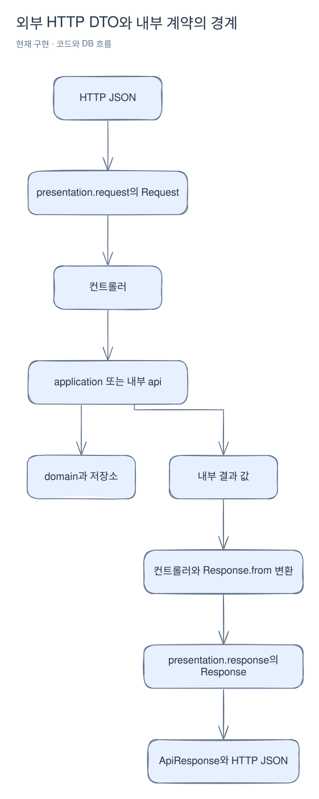

# HTTP 요청·응답과 내부 계약

[위키 시작](README.md) · 이전: [구조와 경계](architecture.md) · 다음: [회원 가입](member.md)

같은 주문을 표현해도 클라이언트가 보내는 값, 서버 내부에서 전달하는 값, DB에 저장하는 값은 역할이 다르다. 이 페이지는 Request·Response·내부 api 계약을 분리하는 이유를 설명한다. Entity와의 차이는 [코드 읽기](code-walkthrough.md)를 함께 본다.

외부 HTTP 요청과 응답은 각 도메인의 `presentation/request`, `presentation/response`에 별도 파일로 둔다. `SessionController.Login`처럼 컨트롤러 안에 선언했던 record는 `LoginRequest`로 옮겼다. CSRF 응답은 `CsrfTokenResponse`다. 컨트롤러는 내부 서비스나 도메인 값을 받은 뒤 응답 DTO로 변환한다.

파일을 나눈 이유는 HTTP 필드와 내부 모델이 서로 다른 이유로 바뀌기 때문이다. 내부 조회 값에 필드가 추가돼도 응답 DTO에 명시하지 않으면 외부 JSON에는 추가되지 않는다. DTO 분리는 접근 권한 검사를 대신하지 않으며, 주문 소유권과 인증·CSRF 검사는 기존 위치에서 수행한다.

[Excalidraw 원본 편집](diagrams/http-contracts-1.excalidraw)

## 파일에서 확인할 경계

| 흐름 | 외부 요청 | 내부 결과 | 외부 응답 |
|---|---|---|---|
| 회원 가입 | `MemberRegistrationRequest` | `Member` | `MemberResponse` |
| 로그인 | `LoginRequest` | 인증 기록과 `Member` | `MemberResponse` |
| CSRF 조회 | 본문 없음 | Spring `CsrfToken` | `CsrfTokenResponse` |
| 제품 등록 | `ProductRegistrationRequest` | `ProductDetails` | `ProductDetailsResponse` |
| 제품 목록 | page·size 쿼리 | `ProductPage` | `ProductPageResponse`와 `ProductListItemResponse` |
| 판매 생성·수정 | `SaleRequest` | `SaleDetails` | `SaleDetailsResponse` |
| 판매 목록 | 페이지·필터 쿼리 | `SalePage` | `SalePageResponse`와 `SaleListItemResponse` |
| 주문 생성 | `OrderRequest`와 요청 키 헤더 | `OrderView` | `OrderViewResponse` |
| 내 주문 목록 | page·size 쿼리 | `OrderPage` | `OrderPageResponse`와 `OrderViewResponse` |
| 주문 접수(v2, 기본 꺼짐) | `OrderRequest`와 요청 키 헤더 | `OrderAcceptance` | `OrderAcceptanceResponse` |
| 접수 상태 조회(v2, 기본 꺼짐) | 경로의 접수 ID | `OrderAcceptance` | `OrderAcceptanceStatusResponse` |
| 필드 검증 오류 | 해당 요청 | 내부 오류 상세 | 공통 `FieldErrorResponse` 목록 |

`api` 패키지는 도메인 간 Java 호출 계약이다. 예를 들어 `ProductQuery`가 반환하는 `ProductDetails`는 HTTP DTO가 아니다. [ProductDetailsResponse.from](../../src/main/java/com/wooyongjeong/limitedsale/product/presentation/response/ProductDetailsResponse.java)이 필요한 필드를 옮긴다. 페이지 응답도 내부 항목을 각 응답 DTO로 변환한다.

[MemberResponse](../../src/main/java/com/wooyongjeong/limitedsale/member/presentation/response/MemberResponse.java)의 role은 문자열이다. `MemberRole`의 `name()`을 경계에서 변환하므로 응답 DTO의 필드 타입이 도메인 enum에 의존하지 않는다. [FieldErrorResponse](../../src/main/java/com/wooyongjeong/limitedsale/common/web/FieldErrorResponse.java)는 여러 도메인이 같은 HTTP 구조인 field·reason을 사용하기 때문에 `common.web`에 둔다. 공통 응답 틀인 `ApiResponse<T>`도 이 위치를 유지한다.

## JSON 검증과 민감 값 처리

파일 이동 후에도 기존 HTTP 필드명·타입·null·상태 코드와 페이지·UUID·UTC 표현은 같다. 요청을 단순한 기본 Jackson record 바인딩으로 바꾸지는 않았다. [MemberJson](../../src/main/java/com/wooyongjeong/limitedsale/member/presentation/request/MemberJson.java)과 제품·판매·주문 요청의 역직렬화 코드가 기존 중복 필드·추가 JSON·타입 검사 동작을 유지한다.

[SaleRequest](../../src/main/java/com/wooyongjeong/limitedsale/sale/presentation/request/SaleRequest.java)와 [OrderRequest](../../src/main/java/com/wooyongjeong/limitedsale/order/presentation/request/OrderRequest.java)는 JSON 트리를 담고, 컨트롤러의 도메인별 파서가 필드를 검사한다. 판매 생성과 PATCH는 같은 본문 타입을 쓰되 허용 필드와 필수 여부를 각각 검사한다. 특히 PATCH는 생략한 값과 명시적 null의 의미를 유지한다. DTO 파일이 분리되었다고 모든 필드가 Java record 구성요소로 선언된 것은 아니다.

[LoginRequest](../../src/main/java/com/wooyongjeong/limitedsale/member/presentation/request/LoginRequest.java)와 [MemberRegistrationRequest](../../src/main/java/com/wooyongjeong/limitedsale/member/presentation/request/MemberRegistrationRequest.java)는 `toString()`에서 자격 증명을 가린다. 새 요청 필드를 추가할 때도 문자열 출력에 비밀번호를 포함시키지 않는다.

[HttpContractStructureTest](../../src/test/java/com/wooyongjeong/limitedsale/architecture/HttpContractStructureTest.java)는 컨트롤러의 RequestBody 타입·중첩 요청/응답과 반환 제네릭·응답 record 구성요소의 내부 타입 노출을 검사한다. 잘못된 선언 사례도 검사해 규칙이 위반을 찾는지 확인한다. `ApiResponse<?>`처럼 실제 값의 타입을 서명이 표현하지 않는 경우는 구조 검사만으로 입증할 수 없으므로 실제 HTTP 계약 테스트와 컨트롤러 매핑 리뷰도 필요하다. 실제 JSON 동작 검증은 각 도메인의 통합 테스트가 담당한다.

## v2 비동기 주문 접수 계약

3-3에서 `POST /api/v2/orders`와 `GET /api/v2/order-requests/{acceptanceId}`를 추가했다. 설정 `limited-sale.order.async.enabled`가 `true`일 때만 [OrderAcceptanceController](../../src/main/java/com/wooyongjeong/limitedsale/order/presentation/OrderAcceptanceController.java)가 등록되며 **기본값은 `false`**다. 끄면 두 경로 모두 매핑이 없어 404이고 아무것도 저장하지 않는다. 같은 경로를 계약이 설정에 따라 바뀌는 v1에 합치지 않고 새 경로로 둔 이유는 3-8에서 같은 환경으로 동기와 비동기를 비교하기 위해서다. 요청 본문은 v1과 같은 `OrderRequest`(`saleId`·`quantity`)이고 `Idempotency-Key` 헤더도 같다. 세션·CSRF 규칙도 같아서 POST에는 CSRF 토큰이 필요하고 GET에는 필요 없다.

| 요청 | 상태 | 코드 | 본문(`data`) |
|---|---|---|---|
| 첫 접수 | 202 | `ORDER_ACCEPTED` | `acceptanceId`, `status`(`ACCEPTED`), `statusUrl`. `Location` 헤더는 `/api/v2/order-requests/{acceptanceId}` |
| 같은 키·같은 입력 재요청(거절이 아닌 접수) | 200 | `ORDER_ACCEPTANCE_FOUND` | 같은 세 필드와 현재 `status` |
| 같은 키 재요청, 처음에 거절됐음 | 404 또는 409 | v1과 같은 `SALE_NOT_FOUND`·`SALE_OUTSIDE_PERIOD`·`SALE_STOPPED`·`SALE_SOLD_OUT` | 없음 |
| 같은 키, 다른 이벤트·수량 | 409 | `IDEMPOTENCY_CONFLICT` | 없음 |
| 새 요청이 없는 이벤트·기간 외·중단·품절 표시 | 404 또는 409 | 위와 같은 v1 코드 | 없음. 거절을 `REJECTED` 접수로 저장하므로 같은 키로 다시 보내면 같은 응답 |
| 회원별 주문 생성 제한 초과 | 429 | `ORDER_RATE_LIMITED`(`Retry-After`) | 없음. 저장하지 않음 |
| 입력·인증·CSRF 오류 | 400·401·403 | v1과 같음 | 저장하지 않음 |
| 저장 중 DB 오류 | 500 | `INTERNAL_ERROR` | 접수·발행 대기 행 모두 롤백, 실패한 접수를 202로 알리지 않음 |

`GET /api/v2/order-requests/{acceptanceId}`는 로그인한 본인의 접수만 반환한다. 남의 접수와 없는 접수는 같은 404 `ORDER_ACCEPTANCE_NOT_FOUND`이고, UUID 형식이 틀리면 400이다. 200 본문 필드는 `acceptanceId`, `saleId`, `quantity`, `status`, `rejectionReason`, `failureReason`, `orderId`, `acceptedAt`, `finishedAt`이다. `status`는 `ACCEPTED`·`ORDER_CREATED`·`REJECTED`·`PROCESSING_FAILED`이고, `orderId`는 `ORDER_CREATED`일 때만 있는 **공개 주문 UUID**라서 v1의 주문 조회·결제 경로에 그대로 쓴다. 사유와 완료 시각은 해당 상태에서만 채워진다. 3-3에는 발행기와 소비자가 없으므로 실제 접수는 `ACCEPTED`에 머문다. 나머지 상태는 3-5·3-6이 쓸 값이며, 지금은 테스트가 같은 행 모양을 직접 넣어 응답 변환만 확인한다.

`202`는 "처리됐다"가 아니라 "접수 기록과 발행 대기 행이 커밋됐다"는 뜻이다. 주문 생성 여부는 상태 조회로 확인한다. v1과 v2의 요청 키 공간은 분리돼 있어 같은 UUID를 양쪽에 보내면 서로 다른 구매 시도다. 응답 DTO는 [OrderAcceptanceResponse](../../src/main/java/com/wooyongjeong/limitedsale/order/presentation/response/OrderAcceptanceResponse.java)와 [OrderAcceptanceStatusResponse](../../src/main/java/com/wooyongjeong/limitedsale/order/presentation/response/OrderAcceptanceStatusResponse.java)이며 내부 `OrderAcceptance`를 문자열 상태로 변환한다. 실제 HTTP 검증은 [OrderAcceptanceIntegrationTest](../../src/integrationTest/java/com/wooyongjeong/limitedsale/order/OrderAcceptanceIntegrationTest.java)가 한다.
