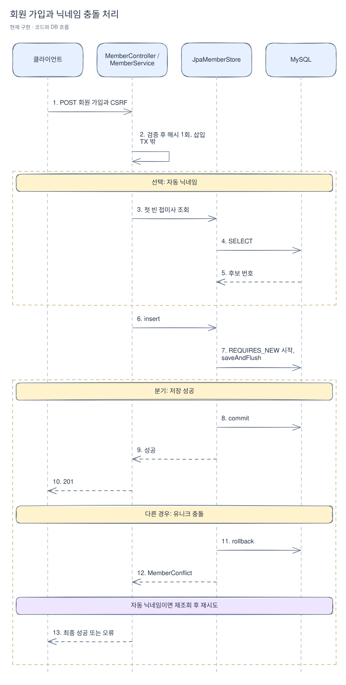
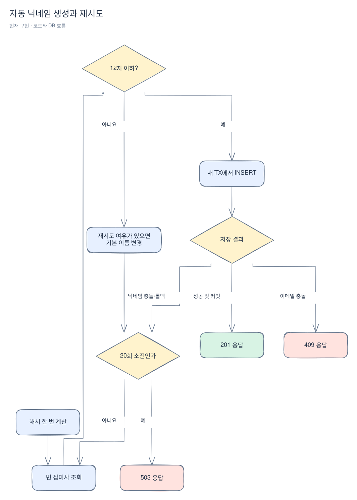

# 회원 가입과 관리자 초기화

[위키 시작](README.md) · 이전: [구조](architecture.md) · 다음: [세션 인증](authentication.md)

민수가 처음 서비스를 사용하는 상황이다. 가입은 계정을 저장하는 작업이고 로그인은 그 계정으로 현재 세션을 인증하는 작업이다. 이 페이지는 가입 입력이 검증되고 닉네임·비밀번호 해시가 저장되는 과정을 더 자세히 설명한다. [코드 읽기](code-walkthrough.md)와 함께 보면 위치를 찾기 쉽다.

회원 가입 성공만으로 로그인 처리하지 않는다. CSRF 검증에 필요한 익명 세션은 가입 전 토큰 조회에서 만들 수 있다. `POST /api/v1/members`의 `email`, `password`, 선택 `nickname`을 [MemberController.register](../../src/main/java/com/wooyongjeong/limitedsale/member/presentation/MemberController.java)가 받아 [MemberService.register](../../src/main/java/com/wooyongjeong/limitedsale/member/application/MemberService.java)로 전달한다. 변경 요청이므로 먼저 CSRF 토큰과 쿠키가 필요하다. 가입·로그인 DTO 전용 [MemberJson](../../src/main/java/com/wooyongjeong/limitedsale/member/presentation/request/MemberJson.java)이 중복·미지 필드, 잘못된 타입과 JSON 뒤의 추가 내용을 서비스 호출 전에 거절한다. 닉네임 생략·null은 허용한다.

아래에서 클라이언트와 컨트롤러 사이만 HTTP다. 저장소와 DB 사이는 SQL이며, 각 삽입의 커밋 또는 롤백이 서비스 반환보다 먼저 끝난다.

### 저장 시도가 끝나는 시점

`saveAndFlush`는 INSERT를 DB에 보내 제약 위반을 확인하는 단계다. 커밋까지 완료됐다는 뜻은 아니다. `JpaMemberStore`의 `TransactionTemplate`이 콜백을 마치고 커밋한 뒤에야 `insert`가 정상 반환한다. 실패하면 롤백을 마친 뒤 바깥 `catch`에서 충돌을 변환한다. 그래서 다음 닉네임 후보는 실패한 트랜잭션을 재사용하지 않고 새 트랜잭션에서 저장할 수 있다.

[Excalidraw 원본 편집](diagrams/member-1.excalidraw)

[MemberInput](../../src/main/java/com/wooyongjeong/limitedsale/member/domain/MemberInput.java)은 이메일 앞뒤 공백을 제거하고 소문자로 바꾼다. 서비스는 정규화 후 254자 이내와 이메일 형식을 확인한다. 비밀번호는 공백 없는 출력 가능 ASCII 8~64자이며 문자 조합을 강제하지 않는다. 닉네임은 NFC 정규화 후 ASCII 공백을 정리하고 완성형 한글·영문·숫자·공백 1~12자를 허용한다. 비교 키는 소문자다. 비어 있으면 자동 생성한다.

서비스는 [Argon2PasswordHasher](../../src/main/java/com/wooyongjeong/limitedsale/member/infrastructure/security/Argon2PasswordHasher.java)로 저장 트랜잭션 밖에서 한 번 해시한다. 자동 이름은 다섯 접두어와 다섯 동물 이름을 무작위로 조합한다. [MemberJpaRepository](../../src/main/java/com/wooyongjeong/limitedsale/member/infrastructure/persistence/MemberJpaRepository.java)의 네이티브 SQL은 비교 키 범위와 숫자 접미사, `LEAD`를 이용해 첫 빈 번호를 한 번에 조회한다. 기본 이름이 비면 0을 반환해 그대로 쓰고, 기본 이름과 1, 3이 있으면 2를 쓴다. 0 또는 선행 0이 있는 접미사는 자동 번호로 취급하지 않는다. 후보가 12자를 넘으면 새 기본 이름을 고른다. 조회 결과와 삽입 사이에 다른 요청이 끼어들 수 있으므로 유니크 제약이 최종 판단한다.

현재 해시 비용은 코드에 고정돼 있다. Argon2id 메모리 19MiB·반복 2·병렬도 1, salt 16바이트·해시 32바이트이며 환경변수로 바꾸는 구현은 없다. 로그인에서는 저장된 해시와 입력 비밀번호를 `matches`로 비교한다.

다음 예는 기본 이름이 `용감한 토끼`일 때다. 숫자는 자동 생성이 사용하는 접미사이며 `0`은 기본 이름 자체를 뜻한다.

| 이미 저장된 비교 키 | 조회 결과 | 저장 시도 |
|---|---:|---|
| 없음 | 0 | 용감한 토끼 |
| 용감한 토끼, 용감한 토끼1, 용감한 토끼3 | 2 | 용감한 토끼2 |
| 위 조회 직후 다른 요청이 2를 먼저 저장 | 다음 조회에서 4 | 용감한 토끼4 |

마지막 행은 경쟁 상황의 예다. 충돌한 삽입은 롤백하고 다시 조회하므로 같은 후보를 무조건 재사용하지 않는다.

[Excalidraw 원본 편집](diagrams/member-2.excalidraw)

이 그림은 자동 닉네임 경로다. 수동 닉네임 충돌은 재시도하지 않고 409로 끝난다. 다른 DB 장애는 그대로 전파한다.

[JpaMemberStore.insert](../../src/main/java/com/wooyongjeong/limitedsale/member/infrastructure/persistence/JpaMemberStore.java)는 `REQUIRES_NEW`와 `saveAndFlush`로 삽입을 완료한다. MySQL 1062와 지정된 이메일·닉네임 제약 이름을 확인한 뒤에만 `MemberConflict`로 변환한다. 실패 트랜잭션이 끝난 후 자동 닉네임 충돌을 다시 조회한다. 최대 20회 시도하며 해시는 재사용한다. 수동 닉네임이나 이메일 충돌은 409, 자동 생성 소진은 503이다. 다른 DB 오류는 중복으로 위장하지 않는다. [MemberExceptionHandler](../../src/main/java/com/wooyongjeong/limitedsale/member/presentation/MemberExceptionHandler.java)가 응답을 변환한다.

서비스의 내부 `Member`는 컨트롤러에서 [MemberResponse](../../src/main/java/com/wooyongjeong/limitedsale/member/presentation/response/MemberResponse.java)로 변환한다. 응답에는 이메일·닉네임·문자열 역할만 있다. 내부 ID와 해시는 인증 전용 `AuthenticationRecord`에 있고 가입 응답에 포함되지 않는다. [AdminInitializer](../../src/main/java/com/wooyongjeong/limitedsale/member/infrastructure/AdminInitializer.java)는 웹 서버 없이 `initAdmin` 명령으로 실행한다. 같은 이메일의 ADMIN은 수정하지 않고 반환하며 USER가 있으면 실패한다. 동시 생성으로 이메일이 충돌하면 다시 조회해 ADMIN인지 판정한다. 실행 환경은 [루트 README](../../README.md)를 따른다.

현재 명령은 `ADMIN_EMAIL`, `ADMIN_PASSWORD`, 선택 `ADMIN_NICKNAME` 환경변수를 읽는다. 닉네임을 생략하면 일반 가입과 같은 자동 생성 경로를 사용한다. 기존 ADMIN을 찾으면 새 비밀번호·닉네임으로 갱신하지 않는다. 성공 시 종료 코드 0, 실패 시 1로 끝나며 일반 웹 앱 기동 때 자동 실행하지 않는다.

[회원 통합 테스트](../../src/integrationTest/java/com/wooyongjeong/limitedsale/member/application/MemberIntegrationTest.java)는 HTTP와 해시, 동시 충돌, 빈 번호, 재시도와 관리자 초기화를 검증한다. [입력 단위 테스트](../../src/test/java/com/wooyongjeong/limitedsale/member/domain/MemberInputTest.java)도 함께 본다.
