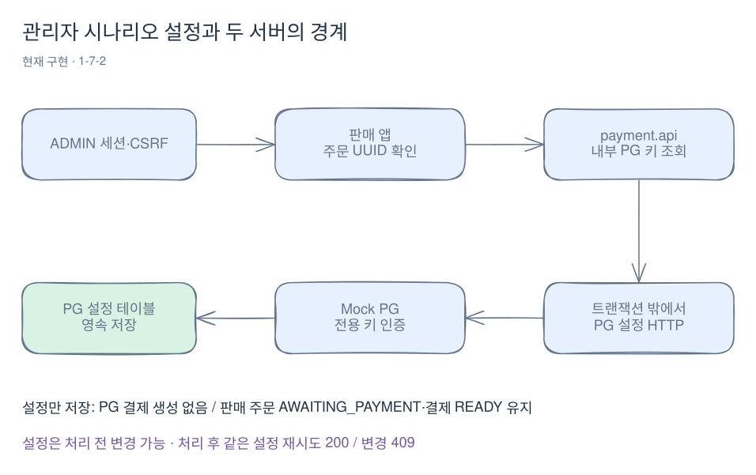
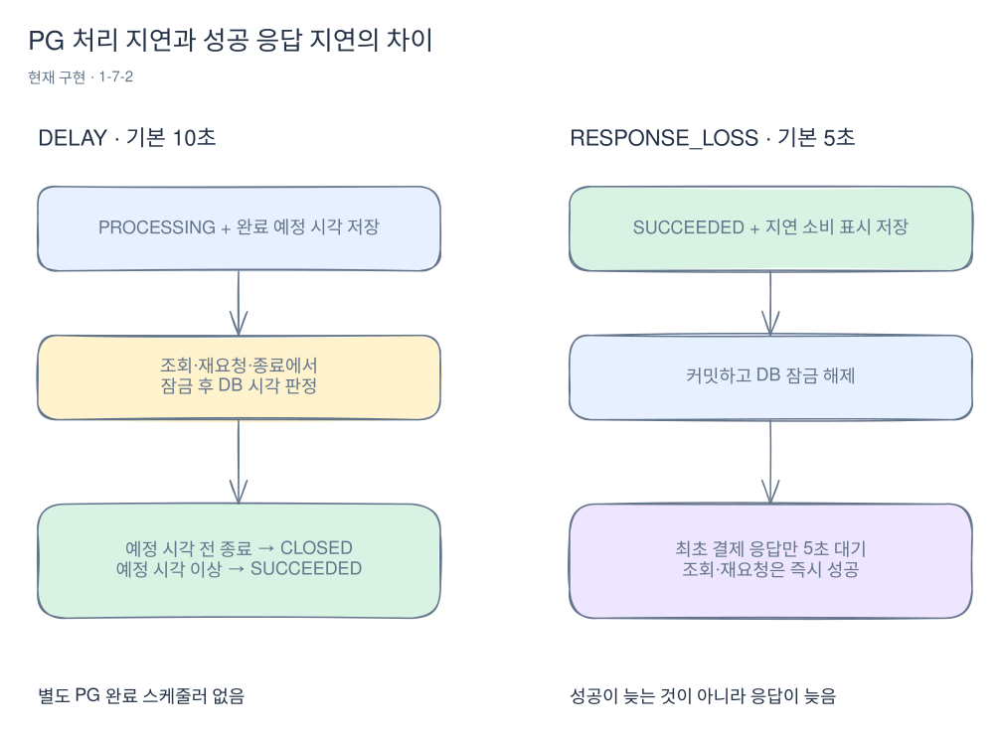

# Mock PG로 결제 결과와 장애 재현하기

[위키 시작](README.md) · [전체 구매 흐름](purchase-flow.md) · [실패 사례](failure-cases.md)

Mock PG는 실제 결제사 대신 결제 성공·거절·처리 지연·성공 응답 지연을 재현하는 별도 서버다. 1-7-2에서 PG 자체의 결제·조회·종료 API와 관리자 시나리오 전달을 구현했다. 판매 앱은 아직 사용자 결제를 실행하거나 PG 결과로 주문·재고를 마무리하지 않는다.

예를 들어 PG에서 어떤 키를 SUCCEEDED로 만들어도 판매 앱의 주문은 AWAITING_PAYMENT, 결제는 READY로 남는다. 두 서버의 업무 상태를 연결하는 것은 1-7-3, 중단된 작업을 이어 가는 것은 1-7-4다. 현재는 PG 동작만 따로 실험하고 그 결과를 확인할 수 있다.

## 먼저 관리자에게 시나리오를 정하게 한다

로컬·테스트 환경에서 ADMIN이 외부 주문 UUID로 설정을 요청한다. 주문 도메인은 존재 여부를 확인하고 payment.api가 내부 PG 키를 조회해 HTTP로 설정을 전달한다. HTTP 응답에는 내부 PG 키를 노출하지 않는다.



[Excalidraw 원본 편집](diagrams/mock-pg-1.excalidraw)

```http
PUT /api/v1/admin/orders/{orderId}/payment-simulation
Content-Type: application/json
X-CSRF-TOKEN: <관리자 로그인 후 받은 토큰>

{"scenario":"DELAY","delaySeconds":10}
```

위 요청은 판매 앱으로 보낸다. ADMIN 세션 쿠키도 함께 필요하다. 200이면 설정을 전달한 것이며 결제를 요청한 것이 아니다. 설정은 PG의 별도 테이블에 저장하고 이때 `mock_payments` 행은 만들지 않는다.

시나리오는 PG 키별로 지정한다. 결제·종료가 시작되기 전에는 바꿀 수 있고, 시작한 뒤에는 동일 설정의 재시도만 200이다. 다른 설정은 409다. DELAY의 생략된 지연값과 명시적 10초는 같은 설정으로 비교한다. 설정은 PG 재시작 후에도 남는다.

## 네 시나리오의 차이

| 시나리오 | PG에 저장되는 결과 | 호출자가 보는 결과 |
|---|---|---|
| SUCCESS | 즉시 SUCCEEDED | 200 |
| DECLINE | 즉시 FAILED | 200과 data.status: FAILED |
| DELAY | PROCESSING과 완료 예정 시각 | 우선 202. 예정 시각 이후 요청에서 SUCCEEDED·200 |
| RESPONSE_LOSS | 즉시 SUCCEEDED와 지연 소비 표시 | 최초 결제 응답만 기본 5초 대기. 타임아웃이 더 짧은 클라이언트는 성공을 모르지만 조회·재요청은 즉시 200 |

설정하지 않은 키는 SUCCESS다. DELAY는 기본 10초, RESPONSE_LOSS는 기본 5초이고 각각 1~600초를 지정할 수 있다. SUCCESS·DECLINE에는 delaySeconds를 보내면 400이다.

RESPONSE_LOSS는 실제 네트워크 패킷을 버리는 구현이 아니다. 성공 커밋 후 응답을 늦추어 호출자 타임아웃을 재현한다. 호출자 제한을 3초, 응답 지연을 5초로 두는 식으로 실험한다. 최초 응답이 대기 중이어도 다른 연결의 조회·재요청은 저장된 성공을 반환한다.

## 지연 중 종료하면 언제 성공하고 언제 닫히나?

DELAY를 10초로 설정하고 시각 T에 결제했다고 하자. PG는 T+10초를 저장하며 별도 스케줄러는 두지 않는다. 조회·결제 재요청·종료 요청이 들어올 때 잠금을 얻고 **그 뒤의 DB 시각**으로 판정한다.



[Excalidraw 원본 편집](diagrams/mock-pg-2.excalidraw)

- T+10초 전 조회는 PROCESSING이다. 그 전에 종료를 확정하면 CLOSED가 되고 뒤늦은 결제도 성공하지 못한다.
- T+10초 이상이면 종료 요청이어도 먼저 SUCCEEDED로 확정해 성공을 반환한다. 이미 완료될 결제를 뒤집어 닫지 않는다.
- 앱이 재시작돼도 예정 시각이 DB에 남으므로 같은 기준으로 판정한다. 조회가 없었던 동안 DB 행 자체는 PROCESSING일 수 있다.
- SUCCEEDED·FAILED·CLOSED는 최종 상태다. 같은 키의 후속 요청으로 바꾸지 않는다. FAILED를 종료해도 FAILED를 반환한다.

아직 존재하지 않는 키를 종료하면 CLOSED 기록을 먼저 생성한다. 이 기록이 늦게 도착하는 결제를 차단한다. 반면 조회 404는 종료를 확정했다는 뜻이 아니다.

## PG API 직접 호출하기

아래는 PG 자체를 실험하는 요청이다. 판매 앱의 사용자 결제 API가 아니며, 주문에 연결하지 않은 새 테스트 키도 사용할 수 있다. 관리자 주문 API는 내부 PG 키를 공개하지 않으므로 앞의 주문 UUID를 pgKey 자리에 넣지 않는다.

판매 앱과 PG의 실행 환경에 같은 `MOCK_PG_API_KEY`를 주입한다. 판매 앱은 `MOCK_PG_BASE_URL`로 PG 주소를 지정한다. 값은 로컬 환경에서 준비하고 문서·로그·저장소에 실제 인증값을 남기지 않는다. PG는 정확한 `/actuator/health` GET·HEAD만 공개하며 다른 요청은 기본적으로 인증한다.

Postman 같은 클라이언트에 `pgBaseUrl`은 기본 `http://localhost:8081`, `pgApiKey`는 로컬 전용 인증값, `pgKey`는 새 UUID로 지정한다. 같은 시도의 재요청에서는 pgKey를 유지한다. 다음 예시는 안내용이며 이번 문서 편집에서 실제 로컬 계정으로 실행한 기록은 아니다.

```http
PUT {{pgBaseUrl}}/api/v1/simulations/{{pgKey}}
X-Mock-PG-Key: {{pgApiKey}}
Content-Type: application/json

{"scenario":"DELAY","delaySeconds":10}
```

```http
POST {{pgBaseUrl}}/api/v1/payments
X-Mock-PG-Key: {{pgApiKey}}
Content-Type: application/json

{"pgKey":"{{pgKey}}","amount":20000}
```

```http
GET {{pgBaseUrl}}/api/v1/payments/{{pgKey}}
X-Mock-PG-Key: {{pgApiKey}}
```

```http
POST {{pgBaseUrl}}/api/v1/payments/{{pgKey}}/close
X-Mock-PG-Key: {{pgApiKey}}
Content-Type: application/json

{"amount":20000}
```

같은 키의 다른 금액은 409, 없는 키 조회는 404다. 같은 금액으로 결제를 재요청해도 결제 기록이 늘어나지 않는다. 성공·실패·종료 확정은 모두 200과 status, 처리 중은 202로 구분한다. 금액은 1~10^15원의 정수다.

## 코드를 읽는 순서

1. [PaymentController](../../mock-pg/src/main/java/com/wooyongjeong/mockpg/presentation/PaymentController.java)가 엄격한 입력 검증과 HTTP 응답을 담당한다. [ApiKeyFilter](../../mock-pg/src/main/java/com/wooyongjeong/mockpg/presentation/ApiKeyFilter.java)는 그 전에 전용 키를 확인한다.
2. [PaymentService](../../mock-pg/src/main/java/com/wooyongjeong/mockpg/application/PaymentService.java)는 저장 처리를 호출하고 필요하면 반환된 초만큼 기다린다. 이 대기는 저장 트랜잭션이 끝난 뒤이므로 DB 잠금을 유지하지 않는다.
3. [PaymentOperations](../../mock-pg/src/main/java/com/wooyongjeong/mockpg/infrastructure/persistence/PaymentOperations.java)는 설정 행 → 결제 행 순서로 잠가 같은 키 처리를 직렬화한다. 설정 행 최초 생성의 정확한 키 충돌만 분류하고 실패 트랜잭션 종료 뒤 새 트랜잭션에서 재시도한다. UUID를 앱에서 미리 지정하므로 [ScenarioEntity](../../mock-pg/src/main/java/com/wooyongjeong/mockpg/infrastructure/persistence/ScenarioEntity.java)는 `Persistable`로 신규 여부를 알려 INSERT하게 한다. 그렇지 않으면 JPA의 merge가 다른 요청이 저장한 설정을 기본 SUCCESS로 덮어쓸 수 있다.
4. [MockPayment](../../mock-pg/src/main/java/com/wooyongjeong/mockpg/domain/MockPayment.java)와 [DelayedPayment](../../mock-pg/src/main/java/com/wooyongjeong/mockpg/domain/DelayedPayment.java)는 프레임워크 없이 시작·종료 시점의 상태를 판단한다.
5. 판매 앱의 [PaymentSimulationService](../../src/main/java/com/wooyongjeong/limitedsale/order/application/PaymentSimulationService.java)는 order.api와 payment.api를 조합한다. [HttpPaymentSimulation](../../src/main/java/com/wooyongjeong/limitedsale/payment/infrastructure/http/HttpPaymentSimulation.java)은 내부 키로 설정을 HTTP 전달하고, 외부 DB 트랜잭션이 있으면 호출을 거부한다.

PG 자체는 입력 검증 전용 예외와 JSON 파싱 오류만 400으로 처리한다. 저장·처리 코드에서 발생한 예상 밖 예외는 공통 500이며 내부 상세를 응답에 넣지 않는다. 예외 클래스가 `IllegalArgumentException`이라는 이유만으로 내부 장애를 사용자 입력 오류로 바꾸지 않는다.

PG 연결·응답 오류는 판매 앱의 503, 설정 변경 충돌은 409로 구분한다. 설정 응답의 값도 타입·정수 범위를 확인하여 잘못된 응답을 설정 성공으로 취급하지 않는다.

[PaymentHttpIntegrationTest](../../mock-pg/src/integrationTest/java/com/wooyongjeong/mockpg/PaymentHttpIntegrationTest.java)는 실제 MySQL과 HTTP에서 경쟁·재시작·타임아웃·인증을 검증한다. [판매 앱 통합 테스트](../../src/integrationTest/java/com/wooyongjeong/limitedsale/order/PaymentSimulationIntegrationTest.java)는 ADMIN·CSRF·환경 제한·공통 오류 응답·설정만 전달하는 동작을 검증한다. 정책 원문은 [1-7-2 문서](../stages/01-7-2-mock-pg-http-and-scenarios.md)를 따른다.

[ScenarioInsertIntegrationTest](../../mock-pg/src/integrationTest/java/com/wooyongjeong/mockpg/infrastructure/persistence/ScenarioInsertIntegrationTest.java)는 다른 요청이 먼저 저장한 설정을 뒤늦은 기본 행 삽입이 덮어쓰지 않는지 실제 MySQL로 검사한다. [PaymentControllerMvcTest](../../mock-pg/src/test/java/com/wooyongjeong/mockpg/presentation/PaymentControllerMvcTest.java)는 입력 오류 400과 내부 오류 500을 구분하는 회귀 검사다.
