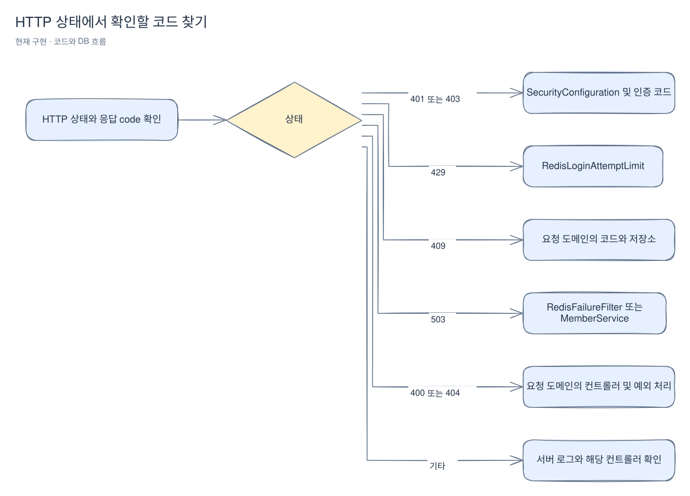

# 실행과 문제 해결

[위키 시작](README.md) · 이전: [데이터베이스](persistence.md)

요청이 기대와 다르게 동작하면 먼저 HTTP 상태와 응답 code를 확인한다. 첫 실행이라면 [주문까지 따라 하기](first-order.md)를 사용하고, 이 페이지에서는 실행 명령·테스트·오류를 추적할 코드를 찾아본다.

## 로컬에서 흐름 확인

Java 25와 Docker 준비, `.env`, DB 계정 생성 및 두 앱 시작은 [루트 README의 실행 안내](../../README.md)를 따른다. 개발 볼륨을 지우지 않는다. 판매 앱과 Mock PG의 `/actuator/health`를 각각 확인한다. Mock PG는 health GET·HEAD만 공개한다. PG 업무 API에는 X-Mock-PG-Key가 필요하며 health 성공만으로 결제·장애 시나리오 검증을 대신하지 않는다.

동작 확인은 별도 로컬 테스트 계정을 사용한다. 실제 자격 증명, 세션 쿠키, CSRF 토큰을 터미널 기록이나 공유 문서에 남기지 않는다.

1. `GET /api/v1/csrf`를 요청하고 응답의 `data.token`과 세션 쿠키를 클라이언트에 보관한다.
2. 토큰을 `X-CSRF-TOKEN` 헤더에 넣고 쿠키와 함께 `POST /api/v1/members`에 `{"email":"user@example.test","password":"<로컬 테스트 비밀번호>","nickname":"테스트회원"}`을 보낸다. 비밀번호 자리에는 정책에 맞는 로컬 값이 필요하다.
3. 같은 방식으로 `POST /api/v1/sessions`에 이메일과 비밀번호를 보내 로그인한다. 응답 쿠키로 교체하고 `GET /api/v1/csrf`를 다시 호출한다.
4. `GET /api/v1/members/me`와 공개 `GET /api/v1/products`를 확인한다. 제품 생성은 별도로 초기화한 ADMIN 세션과 새 CSRF 토큰을 사용한다.

진행 중인 판매 이벤트가 있으면 로그인 세션·새 CSRF 토큰과 UUID `Idempotency-Key`로 `POST /api/v1/orders`에 `{"saleId":1,"quantity":1}`을 보낸다. 생성된 UUID로 `GET /api/v1/orders/{orderId}`를 조회할 수 있다. 키를 유지한 재시도와 새 구매 시도의 차이는 [주문 페이지](orders.md)를 따른다. 결제 요청은 별도 POST로 실행한다. 자동 복구는 만료 후 PG 종료를 확인하며 PG 결과 미확인 중에는 점유를 유지한다.

## 지표와 요청 ID로 보기

판매 앱의 지표는 공개 포트가 아니라 관리 포트(기본 `127.0.0.1:8090`)의 `/actuator/prometheus`에서 나온다. 공개 포트에는 `/actuator/health`의 상태만 있다. 관리 포트를 따로 둔 이유는 지표를 공개 API 보안 규칙과 섞지 않고 로컬 수집기만 읽게 하려는 것이다. 두 번째 인스턴스는 `MANAGEMENT_SERVER_PORT=8092`처럼 다른 포트를 준다.

`docker compose --profile monitoring up -d redis-exporter kafka-exporter prometheus grafana`로 redis_exporter(`127.0.0.1:9121`), kafka-exporter(`127.0.0.1:9308`), Prometheus(`127.0.0.1:9090`)와 Grafana(`127.0.0.1:3000`)를 띄운다. Prometheus는 `host.docker.internal:8090`과 `8092`의 판매 앱, Compose 네트워크의 `redis-exporter:9121`과 `kafka-exporter:9308`을 5초마다 읽는다. Kafka 지표는 아래 "Kafka 실행과 확인"에 따로 적었다. 대시보드의 Redis 행은 `redis_up`, 사용 메모리와 `maxmemory`, 연결된 클라이언트 수, 앱의 Redis 명령 지연(`lettuce_seconds` 평균·최대)을 보여준다. redis_exporter는 Redis 서버만 보므로 앱과 Redis 사이 경로만 끊긴 경우는 `redis_up`에 나타나지 않는다. 그때는 HTTP 503 건수로 본다. 중단 중의 연결 실패는 `lettuce_seconds`의 `error` 라벨에도 잡히지 않았다. Compose Redis는 `maxmemory 256mb`, `noeviction`이다. 메모리가 차면 세션을 밀어내는 대신 쓰기가 실패한다. Grafana의 `limited-sale-overview` 대시보드는 파일로 준비되며 로그인 없이 볼 수 있다. 설정은 [prometheus.yml](../../infra/prometheus/prometheus.yml)과 [대시보드 JSON](../../infra/grafana/dashboards/limited-sale.json)이다.

| 보고 싶은 것 | 지표 |
|---|---|
| 요청 수, 오류, 지연 백분위 | `http_server_requests_seconds` (상태·URI 템플릿 라벨) |
| 업무 거절과 시스템 오류 | `order_creation_results_total{result}`, `order_payment_results_total{result}`와 5xx 비율 |
| 요청 제한 | `order_rate_limit_total{operation,result}`. `bypassed`는 Redis 장애로 제한 없이 통과시킨 요청 |
| 결과를 모르는 주문이 쌓이는지 | `order_unfinished`, `order_requires_review` |
| PG 응답 지연·실패 | `http_client_requests_seconds` (`status=IO_ERROR`는 시간 초과·연결 실패) |
| 커넥션 풀 고갈 | `hikaricp_connections_active`, `_pending`, `_acquire_seconds` |
| JVM | 힙, GC, 스레드 |

업무 카운터의 라벨은 결과 하나뿐이다. 회원·주문·요청 ID를 라벨로 쓰면 시계열 수가 사용자 수만큼 늘기 때문이다. 미완료·확인 필요 주문 수는 스크레이프할 때마다 DB를 읽지 않고, [OrderBacklogGauges](../../src/main/java/com/wooyongjeong/limitedsale/order/application/OrderBacklogGauges.java)가 기본 10초마다 센다. 마지막 집계가 실패하면 값은 NaN이 되어 오래된 숫자를 보여 주지 않는다.

모든 요청에는 `X-Request-Id`가 붙는다. 클라이언트 값이 영문·숫자·`-`·`_` 1~64자면 그대로 쓰고, 아니면 새 UUID로 바꾼다. 같은 값이 응답 헤더와 콘솔 로그의 `[요청ID]` 자리에 남는다. [RequestIdFilter](../../src/main/java/com/wooyongjeong/limitedsale/common/observation/RequestIdFilter.java)가 보안 필터보다 먼저 돌기 때문에 401·403 응답에도 붙는다. 클라이언트가 응답 헤더 값을 알려 주면 서버 로그에서 그 요청을 찾을 수 있다.

MySQL 잠금과 느린 쿼리는 `scripts/mysql-observe.sh`로 본다. `performance_schema`의 쿼리 요약 상위 항목, 현재 잠금 대기, InnoDB 행 잠금 대기 횟수·시간, 데드락 수를 출력한다. 실험 전후에 한 번씩 찍어 차이를 비교한다. 비밀번호는 `MYSQL_PWD`로만 받고 출력하지 않는다. 정합성은 지표가 아니라 [대조 SQL](../../tools/reconciliation/reconcile.sql)로 판정한다.

## Kafka 실행과 확인

3-2는 Kafka 연결·관측 기반을 만들었고([3-2 구현과 검증](../stages/03-kafka.md#3-2-구현과-검증)), 3-4에서 아웃박스 발행기를, 3-5에서 주문 소비자를 더했다([3-4 구현과 검증](../stages/03-kafka.md#3-4-구현과-검증), [3-5 구현과 검증](../stages/03-kafka.md#3-5-구현과-검증)).

- 브로커: `docker compose up -d`가 `apache/kafka:4.4.0`(KRaft 단일 노드)를 기본 서비스로 띄우고 `127.0.0.1:9092`에 게시한다. 포트는 `KAFKA_PORT`로 바꾸고 앱의 `KAFKA_BOOTSTRAP_SERVERS`(기본 `localhost:9092`)도 같이 맞춘다. 브로커의 자동 토픽 생성은 꺼져 있고 복제는 1이다. 한 노드라 고가용성이 아니며 브로커를 멈추면 메시징이 멈춘다.
- 앱: Kafka가 없어도 기동하고 v1 주문·조회는 그대로 동작한다. `/actuator/health`에는 Kafka가 없다. 브로커 장애는 health가 아니라 지표·로그로 본다. 운영 토픽 `limited-sale.order-acceptances.v1`(파티션 6)은 앱이 시작한 뒤 백그라운드에서 만든다. 브로커가 없으면 `KafkaTopicProvisioner`가 `Kafka topic creation failed; the application keeps running and retries` 경고를 남기고 1초에서 최대 30초 간격으로 재시도한다.
- 아웃박스 발행기(3-4): `limited-sale.order.async.enabled=true`이고 `limited-sale.order.outbox-publisher.enabled`(기본 `true`)이면 백그라운드 스레드가 `order_outbox`의 미발행 행을 보낸다. 인스턴스가 여럿이어도 MySQL 이름 잠금을 잡은 하나만 보낸다. 누가 발행자인지는 앱 지표 `order_outbox_publisher_leader`(1이면 발행자)로, 행 단위 결과는 `order_outbox_publish_total{result="success|failure"}`로 본다. DB에서는 `SELECT IS_USED_LOCK('limited-sale:order-outbox-publisher')`가 잠금을 쥔 MySQL 연결 번호를 보여주고(NULL이면 발행자 없음), `SELECT COUNT(*), MAX(attempts) FROM order_outbox WHERE published_at IS NULL`이 적체와 재시도를 보여준다. 브로커가 멈추면 접수는 계속 받고 행이 미발행으로 쌓이며 `attempts`가 늘고, 브로커가 돌아오면 최대 약 10초 안에 앱 재시작 없이 다시 보낸다. 발행자 프로세스가 죽으면 MySQL이 연결을 정리하는 즉시 다른 인스턴스가 1초 안에 이어받는다. 네트워크가 끊겨 연결이 정리되지 않으면 `wait_timeout`까지 걸릴 수 있다. 발행기 상태는 health에 없다.
- 주문 소비자(3-5): `limited-sale.order.async.enabled=true`이고 `limited-sale.order.consumer.enabled`(기본 `true`)이면 그룹 `limited-sale-order-consumer`로 토픽을 소비한다(인스턴스당 동시성 3). 소비자 세션 시간 초과는 10초, 하트비트는 3초다(4-2, Kafka 기본 45초·3초). 그룹을 떠나지 못하고 죽은 인스턴스(SIGKILL 등)의 파티션은 약 10초 뒤 다른 인스턴스로 넘어간다. 대신 10초가 넘는 정지(긴 GC 등)도 리밸런스를 일으킨다. 결과는 `order_acceptance_processed_total{result}`로, 적체는 `kafka_consumergroup_lag{consumergroup="limited-sale-order-consumer"}`와 `SELECT COUNT(*) FROM order_acceptances WHERE status = 'ACCEPTED'`로 본다. DB 연결·잠금 대기 시간 초과·데드락·쿼리 시간 초과는 같은 메시지를 첫 실패부터 30초까지 재시도하고(로그에 `Lock wait timeout exceeded`·`Record in retry and not yet recovered`가 반복된다) 그 뒤 `Order acceptance … failed with TRANSIENT_RETRIES_EXHAUSTED` 경고와 함께 접수를 `PROCESSING_FAILED`로 끝낸다. 그동안 그 파티션의 다음 메시지는 기다린다. `Could not store the failure of order acceptance …` 경고는 실패 저장도 안 되는 DB 장애라는 뜻이며, 그 메시지는 5초마다 다시 처리를 시도하다 DB가 돌아오면 정상 처리된다. 실패는 `order_acceptance_failed_total{reason}`, 시도 실패는 `order_acceptance_retries_total`, 실패한 접수는 `SELECT failure_reason, COUNT(*) FROM order_acceptances WHERE status = 'PROCESSING_FAILED' GROUP BY failure_reason`로 본다.
- 정체 재발행(3-6): 발행자 인스턴스가 10초마다 `ACCEPTED` 접수 중 마지막 발행이 60초 지났고 소비자 그룹이 그 오프셋을 지난 것(또는 5분 지난 것)을 찾아 새 아웃박스 행으로 다시 보낸다. `Found N stalled order acceptances` 경고, `order_acceptance_republished_total`, `order_acceptance_stalled`로 본다. 접수당 3번 다시 보내도 끝나지 않으면 `STALLED` 실패다. 접수별 발행 이력은 `SELECT id, published_at, partition_no, record_offset FROM order_outbox WHERE acceptance_id = ? ORDER BY id`로 본다. 읽을 수 없거나 접수가 없는 메시지는 `Skipping ... order acceptance message` 경고를 남기고 건너뛴다.
- 비동기 관측(3-7): 접수 API 지연(`http_server_requests_seconds{uri="/api/v2/orders"}`)과 주문 완료 지연(`order_acceptance_completion_seconds{result}`, 접수 시각~최종 상태 시각)을 따로 본다. 발행 구간은 `order_outbox_publish_delay_seconds`다. 적체 게이지 `order_acceptance_accepted`·`order_acceptance_oldest_accepted_seconds`·`order_outbox_unpublished`·`order_outbox_oldest_unpublished_seconds`는 `limited-sale.observability.backlog-interval`(10초)마다 DB를 센다. 모든 인스턴스가 같은 값을 내므로 `max()`로 읽는다. 소비자가 멈추면 접수 게이지와 `kafka_consumergroup_lag`가 함께 늘고, 발행기가 멈추면 미발행 게이지가 는다. lag는 그룹이 한 번도 커밋하지 않은 파티션에서 -1이므로 합계는 `clamp_min`으로 0 아래를 잘라 본다. 한 요청을 끝까지 따라가려면 응답의 `X-Request-Id`로 로그를 검색한다. 소비자의 처리 결과 줄(`Order acceptance … processed`)은 DEBUG(`logging.level.com.wooyongjeong.limitedsale.order.infrastructure.messaging.OrderAcceptanceListener=DEBUG`)이고, 실패·건너뜀·재발행 경고에는 기본으로 요청 ID가 붙는다. DB에서는 `SELECT request_id FROM order_acceptances WHERE public_id = UNHEX(REPLACE(?, '-', ''))`로 접수 ID와 요청 ID를 잇는다. 로컬 확인 결과는 [3-7 구현과 검증](../stages/03-kafka.md#3-7-구현과-검증)에 있다.
- 아웃박스 정리(4-2): 발행자 인스턴스가 `limited-sale.order.outbox.cleanup.interval`(24시간, 기동 1분 뒤 첫 실행)마다 발행 뒤 `limited-sale.order.outbox.retention`(7일)이 지난 행을 1,000행씩 지운다. 한 번에 한 묶음씩 발행 사이에 끼워 지우므로 발행이 오래 막히지 않는다. 아직 `ACCEPTED`인 접수의 행은 정체 탐지가 읽으므로 남긴다. 지운 수는 `order_outbox_deleted_total`이다.
- 커밋 뒤 Redis 실패(4-3): 응답이 커밋된 뒤 Spring Session의 마무리 조회가 Redis 장애로 실패하면 응답을 그대로 두고 `redis_failure_after_commit_total`과 `Redis failed after the response was committed` 경고를 남긴다.
- Redis 장애 중 502(4-3): 로드 밸런서의 502는 Caddy가 판매 인스턴스에 3초 안에 연결하지 못한 것(`dial tcp …: i/o timeout`)이다. 재시도로 해결되지만 원인(연결 수락 지연) 분석은 [4-3 결과](../stages/04-reliability.md#실험-중-발견한-결함과-원인)에 있다.
- 세션 저장 생략(4-2): 응답을 마무리하며 하는 세션 저장이 Redis 장애로 실패하고 응답을 살린 횟수는 `session_save_skipped_total`, 로그는 `Session save at the end of the request failed and was skipped`다.
- 토픽 확인: `docker compose exec kafka /opt/kafka/bin/kafka-topics.sh --bootstrap-server localhost:19092 --describe --topic limited-sale.order-acceptances.v1`
- 브로커가 멈췄을 때: 발행은 약 5초 뒤 `TimeoutException`으로 실패하고(프로듀서 `max.block.ms`·`delivery.timeout.ms` 5초) Spring Kafka의 `LoggingProducerListener`가 ERROR를 남기며 `kafka_producer_record_error_total`이 오른다. 브로커를 다시 켜면 앱을 재시작하지 않아도 발행이 되살아난다.
- 지표: 브로커·토픽·소비 지연은 Prometheus의 `kafka_brokers`, `kafka_topic_partitions`, `kafka_consumergroup_lag`(`monitoring` 프로필의 kafka-exporter), 앱의 클라이언트 지표는 `kafka_producer_*`·`kafka_consumer_*`다. 클라이언트 지표는 프로듀서·소비자가 처음 만들어진 뒤에 나타난다.
- 통합 테스트: 테스트가 쓰는 브로커는 같은 이미지의 Testcontainers이며, 재시작 뒤에도 주소가 유지되도록 호스트 포트를 고정한다. 나머지 통합 테스트는 Kafka 토픽 생성을 끄고(`limited-sale.kafka.topic-provisioning.enabled=false`, Gradle이 시스템 속성으로 전달) 아웃박스 발행기와 주문 소비자도 끈다(`limited-sale.order.outbox-publisher.enabled=false`, `limited-sale.order.consumer.enabled=false`). 그래서 브로커에 접속하지 않는다. 발행기·소비자 테스트만 명령행 인자로 다시 켠다.
- 1-10 격리 환경: `tools/order-regression/isolated.py`가 실행마다 같은 이미지의 브로커 컨테이너를 하나 더 만들고 두 판매 앱에 `KAFKA_BOOTSTRAP_SERVERS`로 연결한다. 호스트와 컨테이너 안의 포트를 같게 하여 광고 주소가 그대로 유효하다. 쉘의 `KAFKA_BOOTSTRAP_SERVERS`는 상속하지 않는다.

## 검사와 한계

`./gradlew test`는 단위·구조 검사를 실행한다. `./gradlew integrationTest`는 격리된 Testcontainers MySQL과 필요한 Redis를 사용한다. `./gradlew clean build`는 두 검사를 포함하며 Docker가 필요하다. `check`는 `tools/order-regression`의 Python 검증기 테스트도 실행하므로 Python 3.9 이상이 필요하다. 전체 환경과 명령은 [README](../../README.md)를 따른다. 개발 DB를 초기화해 통합 테스트를 대체하지 않는다.

[회원 통합 테스트](../../src/integrationTest/java/com/wooyongjeong/limitedsale/member/application/MemberIntegrationTest.java)는 가입과 충돌·재시도를, [세션 통합 테스트](../../src/integrationTest/java/com/wooyongjeong/limitedsale/member/SessionIntegrationTest.java)는 세션과 제한·장애를, [제품 통합 테스트](../../src/integrationTest/java/com/wooyongjeong/limitedsale/product/ProductIntegrationTest.java)는 제품 HTTP 계약을 다룬다. [스키마 통합 테스트](../../src/integrationTest/java/com/wooyongjeong/limitedsale/MySqlSchemaIntegrationTest.java)와 [구조 테스트](../../src/test/java/com/wooyongjeong/limitedsale/architecture/ArchitectureTest.java)는 각각 MySQL 제약과 패키지 경계를 검사한다. 테스트 코드가 있다는 사실과 이번 변경에서 실행해 통과했다는 사실은 다르다.

실패한 검사가 어느 경계를 다루는지 표에서 찾는다. 테스트명은 검증 범위의 예이며 이번 문서 편집에서 테스트를 실행했다는 뜻은 아니다.

| 검사 | 예시 근거 | 주로 확인하는 경계 |
|---|---|---|
| 단위 | [MemberInputTest](../../src/test/java/com/wooyongjeong/limitedsale/member/domain/MemberInputTest.java), [ProductInputTest](../../src/test/java/com/wooyongjeong/limitedsale/product/domain/ProductInputTest.java) | 입력 정규화와 규칙 |
| HTTP 계약 구조 | [HttpContractStructureTest](../../src/test/java/com/wooyongjeong/limitedsale/architecture/HttpContractStructureTest.java) | 외부 DTO 배치·내부 타입 노출·응답 구성요소 |
| 구조 | [ArchitectureTest](../../src/test/java/com/wooyongjeong/limitedsale/architecture/ArchitectureTest.java) | 패키지 의존성 |
| MySQL 통합 | [MySqlSchemaIntegrationTest](../../src/integrationTest/java/com/wooyongjeong/limitedsale/MySqlSchemaIntegrationTest.java), [MemberIntegrationTest](../../src/integrationTest/java/com/wooyongjeong/limitedsale/member/application/MemberIntegrationTest.java) | 마이그레이션, 제약, 가입 저장 |
| 판매 이벤트 MySQL·HTTP 통합 | [SaleIntegrationTest](../../src/integrationTest/java/com/wooyongjeong/limitedsale/sale/SaleIntegrationTest.java) | 기간·상태·필터·수정 버전·실제 행 잠금 대기 |
| 주문 MySQL·HTTP 통합 | [OrderIntegrationTest](../../src/integrationTest/java/com/wooyongjeong/limitedsale/order/OrderIntegrationTest.java) | 원자적 점유·요청 키 경쟁·거절 재생·롤백·소유권 |
| Kafka 통합 | [KafkaConnectionIntegrationTest](../../src/integrationTest/java/com/wooyongjeong/limitedsale/common/KafkaConnectionIntegrationTest.java), [KafkaAbsentBrokerIntegrationTest](../../src/integrationTest/java/com/wooyongjeong/limitedsale/common/KafkaAbsentBrokerIntegrationTest.java) | 키 순서·파티션 수, 브로커 중단·재시작, 브로커 없는 기동, health 분리 |
| 아웃박스 발행기 통합 | [OrderOutboxPublisherIntegrationTest](../../src/integrationTest/java/com/wooyongjeong/limitedsale/order/OrderOutboxPublisherIntegrationTest.java), 묶음 규칙 단위 [OutboxBatchTest](../../src/test/java/com/wooyongjeong/limitedsale/order/application/OutboxBatchTest.java) | 키·내용 그대로 전달, 접수 순서, 발행 전 중단·완료 표시 전 중단의 재전송, 브로커 중단·재시작, 발행자 하나와 인계, 첫 실패 행 규칙 |
| 주문 소비자 통합 | [OrderAcceptanceConsumerIntegrationTest](../../src/integrationTest/java/com/wooyongjeong/limitedsale/order/OrderAcceptanceConsumerIntegrationTest.java), 메시지 해석 단위 [OrderAcceptanceListenerTest](../../src/test/java/com/wooyongjeong/limitedsale/order/infrastructure/messaging/OrderAcceptanceListenerTest.java) | 접수→주문·READY 결제→v1 결제, 중복 전달·커밋 뒤 확인 전 실패에도 주문 하나, 종료 뒤 처리, 중단·품절·v1+v2 한도 거절, 깨진 메시지 건너뜀, 잠금 대기 시간 초과 재시도, 앱 두 개의 파티션 분담, 대조 SQL |
| 재시도·정체 복구 통합 | [OrderAcceptanceRecoveryIntegrationTest](../../src/integrationTest/java/com/wooyongjeong/limitedsale/order/OrderAcceptanceRecoveryIntegrationTest.java), 단위 [WallClockBackOffTest](../../src/test/java/com/wooyongjeong/limitedsale/order/infrastructure/messaging/WallClockBackOffTest.java)·[TransientFailuresTest](../../src/test/java/com/wooyongjeong/limitedsale/order/infrastructure/messaging/TransientFailuresTest.java)·[OrderStallDetectorTest](../../src/test/java/com/wooyongjeong/limitedsale/order/application/OrderStallDetectorTest.java) | 예산 안 일시 오류는 정상 처리, 예산 초과는 실패 저장 뒤 같은 파티션 다음 메시지 진행, 비일시 오류 즉시 실패, 실패 저장도 안 되면 DB 회복 뒤 정상 처리, 소비자가 지난 접수 재발행, 차례를 기다리는 접수는 기한 전 재발행 안 함, 재발행 3회 뒤 `STALLED`, 대조 SQL |
| 비동기 관측 통합 | [OrderAsyncObservabilityIntegrationTest](../../src/integrationTest/java/com/wooyongjeong/limitedsale/order/OrderAsyncObservabilityIntegrationTest.java) | 소비자·발행기 중단 중 적체 게이지 증가와 재개 뒤 0, 완료·발행 지연 히스토그램 건수, 요청 ID 저장과 소비자 로그 MDC |
| 3-8 종단 간 비교·장애(부하 실험, `./gradlew build`에는 실행기 단위 테스트만) | [run_comparison.py](../../tools/order-regression/run_comparison.py)(`v1-sync`·`v2-async`), [run_async_faults.py](../../tools/order-regression/run_async_faults.py), [test_async_comparison.py](../../tools/order-regression/test_async_comparison.py) | 접수·완료 지연과 처리량 비교, 모든 접수의 5분 내 최종 상태, 접수당 주문 1, 순서 역전 수, 브로커 중단·인스턴스 SIGKILL·중복 전달·적체 중 종료 |
| HTTP 및 Redis 통합 | [SessionIntegrationTest](../../src/integrationTest/java/com/wooyongjeong/limitedsale/member/SessionIntegrationTest.java), [ProductIntegrationTest](../../src/integrationTest/java/com/wooyongjeong/limitedsale/product/ProductIntegrationTest.java), [RedisConnectionIntegrationTest](../../src/integrationTest/java/com/wooyongjeong/limitedsale/common/RedisConnectionIntegrationTest.java) | 세션, 권한, 제품 계약, 장애, Redis 키 접두사·타임아웃·재연결 |

현재 노출된 Actuator 엔드포인트 설정은 health다. Prometheus·Grafana 관측과 k6 부하 실험은 [전체 계획](../project-plan.md)의 향후 범위이며 이미 구축된 관측 체계로 간주하지 않는다.

## 정합성·장애 회귀 실험 실행

실제 동시 요청, 프로세스 강제 종료, PG 장기 중단을 재현하는 실험은 `./gradlew clean build`와 별도로 실행한다. 실험 도구는 전용 MySQL·Redis 컨테이너, 판매 JVM 2개, Mock PG를 직접 만들고, 끝나면 자신이 만든 자원만 정리한다. 개발 DB와 실행 중인 서버는 사용하지 않는다.

1. 현재 소스로 실행 JAR을 만든다: `./gradlew bootJar :mock-pg:bootJar`
2. `JAVA_HOME`을 Java 25로 지정한다.
3. 출력 디렉터리를 새 경로로 정하고 전체 실험을 실행한다. macOS에서는 `caffeinate`로 잠자기를 막는다.

```sh
caffeinate -ims python3 -B tools/order-regression/run_all.py --output /tmp/order-regression-RUN
```

전체 실행은 깨어 있는 시간 기준 약 35분 걸린다. 실패·누락·기한 초과가 있으면 0이 아닌 코드로 종료한다. 잠자기 등으로 벽시계와 단조시계가 5초 넘게 어긋나도 실패한다. 개별 실행과 감사 명령은 [실험 도구 안내](../../tools/order-regression/README.md)를 따른다. 결과는 처리량이나 지연 성능을 뜻하지 않는다. 부하 생성기와 서버가 같은 컴퓨터의 CPU와 메모리를 공유하기 때문이다.

## 여러 인스턴스로 실행하고 대조하기

판매 앱 두 개를 로드 밸런서 뒤에 두려면 JAR을 `SERVER_PORT=8080`과 `SERVER_PORT=8082`로 각각 실행한다. 이어서 `docker compose --profile multi-instance up -d load-balancer`로 Caddy를 띄운다. 클라이언트는 `http://127.0.0.1:8000`만 사용한다. 실행 순서와 환경변수는 [README](../../README.md)에 있다.

Caddy는 라운드 로빈으로 나누고 고정 세션을 쓰지 않는다. 그래서 같은 사용자의 로그인, CSRF 조회, 주문, 결제가 서로 다른 인스턴스로 갈 수 있다. 세션과 CSRF 토큰이 Redis에 있으므로 어느 인스턴스든 같은 사용자로 인식한다. 실패한 요청을 다른 인스턴스로 재시도하지 않는다. 재시도하면 실패한 시도를 숨기기 때문이다. 접근 로그의 `upstream` 필드에서 각 요청을 처리한 인스턴스를 확인한다. 설정은 [Caddyfile](../../infra/caddy/Caddyfile)이다.

`run_balanced.py --instances 1` 또는 `--instances 2`는 격리 환경에서 같은 시나리오를 로드 밸런서를 거쳐 실행한다. 시나리오는 사용자 1,000명, 재고 300개다. 같은 사용자가 같은 키와 다른 키로 동시에 보내는 요청 묶음도 섞는다. 실행이 끝나면 스냅샷 검증기와 대조 SQL로 수량을 확인한다. 2개 모드에서는 두 인스턴스가 모두 주문 생성을 처리했는지 확인한다.

[reconcile.sql](../../tools/reconciliation/reconcile.sql)은 정합하면 빈 결과를 돌려준다. 위반이 있으면 검사 이름과 이벤트·회원·주문 ID가 담긴 행을 돌려준다. 검사 범위는 재고 경계와 점유 합계, 사용자 한도, 주문·결제 금액, 최종 상태와 결제 상태의 짝, 요청 키 중복이다. 결제 중인 주문은 결제 성공이 주문 확정보다 먼저 커밋될 수 있어 상태 짝 검사에서 뺀다. 개발 DB에도 읽기 전용으로 실행할 수 있다.

## 기준 부하 실험 다시 돌리기

`run_baseline.py`는 격리 환경에 판매 앱 두 개와 Caddy를 띄우고 k6로 주문·결제 부하를 보낸다. 가입과 로그인은 부하 전에 끝내므로 Argon2 비용이 측정에 섞이지 않는다. 세션은 임시 파일로만 k6에 넘기고 실행 후 지운다. 부하 전후로 관리 포트 지표와 MySQL 관측 스냅샷을 찍고, 끝나면 검증기와 대조 SQL로 수량을 판정한다.

```sh
./gradlew bootJar :mock-pg:bootJar
caffeinate -ims python3 -B tools/order-regression/run_baseline.py --scenario baseline --runs 3 --output /tmp/load-RUN
```

`baseline`은 사용자 1만 명이 재고 1,000개에, `under-demand`는 800명이 재고 1,000개에 1개씩 요청한다. k6 시나리오는 [baseline-order.js](../../tests/load/baseline-order.js)다. 동시 VU 500개가 1만 번의 반복을 나눠 맡고, 반복 하나가 사용자 한 명의 주문과 결제다.

현재 기준값과 병목 분석은 [1-11 단계 문서](../stages/01-11-baseline-load-test.md)에 있다. 기준 시나리오의 HTTP 처리량은 약 295 req/s였다. Java 25·Spring Boot 4.1.2에서 같은 시나리오로 다시 잰 2단계 비교 기준선은 약 311 req/s이며 병목 형태는 같다([재측정 결과](../stages/02-redis.md#기준선-재측정-결과)). 이 값을 정한 것은 CPU가 아니라 판매 이벤트 행 하나의 잠금이다. 주문 생성이 모두 같은 행을 `FOR UPDATE`로 잠그므로 요청이 이 행 앞에 한 줄로 선다. 잠금을 기다리는 트랜잭션이 커넥션을 쥐고 있어 커넥션 풀 대기도 함께 늘었다. 부하 생성기와 서버가 같은 컴퓨터를 쓰므로 숫자는 같은 컴퓨터에서 다음 단계와 비교할 때만 쓴다.

### 캐시·요청 제한 비교 실험 (2-6)

[run_comparison.py](../../tools/order-regression/run_comparison.py)는 기준선과 같은 환경(사용자 10,000·재고 1,000·VU 500)에서 두 실험을 따로 돌린다. 실험 A는 사용자마다 판매 상세 조회 5번 뒤 주문·결제하며 캐시를 끄고 켠다. 실험 B는 남용 사용자 100명을 섞어 요청 제한을 끄고 켠다. 결과는 [benchmarks/redis-comparison](../../benchmarks/redis-comparison/)에, 해석은 [2-6 결과](../stages/02-redis.md#2-6-실험-결과와-검증)에 있다.

- 캐시는 상세 조회 p50을 366ms에서 86ms로 줄였고 적중률은 99.3%였다. 행 잠금 대기 횟수는 같아 처리량 상한은 그대로 이벤트 행 잠금이다.
- 남용 요청도 행 잠금 대기열에 서서 느려지므로 1초 5회 한도에는 거의 닿지 않았다. 1초 1회로 하자 남용 요청의 약 86%(3회 중앙값)가 DB 전에 429로 끝났고 정상 사용자의 지연과 행 잠금 대기가 줄었으며 정상 사용자의 429는 0건이었다. 그래서 기본값을 1초 1회로 낮췄다.

### 품절 사전 판정 비교 실험 (2-7)

같은 [run_comparison.py](../../tools/order-regression/run_comparison.py)로 `c-off`·`c-on`을 돌린다. 사용자 10,000·재고 1,000·VU 500, 조회 캐시 켬, 주문 요청 제한은 앱 기본값(켬, 1초 1회), 조회와 남용 사용자는 없고 품절 사전 판정만 끄고 켠다. 스위치 `limited-sale.sale.sold-out-gate.enabled`는 실행마다 명시 전달·기록한다. 결과는 [benchmarks/redis-comparison](../../benchmarks/redis-comparison/)의 `c-off`·`c-on`, 해석은 [2-7 결과](../stages/02-redis.md#2-7-구현과-검증)에 있다. 실행 전에 커밋으로 작업 트리를 깨끗하게 하고 `PYTHONDONTWRITEBYTECODE=1`을 설정하며 부하 평균과 루프백 연결 시간을 확인한다.

```sh
PYTHONDONTWRITEBYTECODE=1 python3 -B tools/order-regression/run_comparison.py --conditions c-off,c-on --rounds 3 --order-file execution-order-c.json --output benchmarks/redis-comparison --label "2-7 sold-out gate"
```

- 거절 응답(`SALE_SOLD_OUT`) p50은 1.34초에서 0.34초로 줄었고 행 잠금 대기는 약 80%, 부하 시간은 38.9초에서 19.8초로 줄었다.
- 확정 수는 두 조건 모두 1,000건이다. 구매자의 `ORDER_CREATED`·결제 지연은 거의 같아서 주문 처리량이 늘었다고 해석하지 않는다. 빨라진 것은 거절이고, 같은 재고를 판 뒤 요청을 모두 끝내는 시간이다.

### Redis 장애 실험 (2-5)

[run_redis_outage.py](../../tools/order-regression/run_redis_outage.py)는 1-10 격리 환경(판매 앱 2개·Caddy·Mock PG·전용 MySQL·Redis)에 주문 요청 제한을 켜고, 사용자 1,000명이 재고 300에 주문·결제하는 도중 Redis를 15초 동안 멈췄다가 다시 켠다. 클라이언트는 503이면 잠깐 기다리고, 429면 `Retry-After`만큼 기다리고, 401·403 `CSRF_INVALID`면 다시 로그인한 뒤 같은 요청 키로 재시도한다. 장애 중에는 쿠키 없이 판매 상세 조회도 계속 보낸다. 끝나면 [verify.py](../../tools/order-regression/verify.py)와 [reconcile.sql](../../tools/reconciliation/reconcile.sql)로 판정하고, 복구 후 캐시 값을 MySQL과 비교한다. 실행 방법과 통과 기준은 [실험 도구 안내](../../tools/order-regression/README.md)를 본다. 결과는 [benchmarks/redis-outage](../../benchmarks/redis-outage/)에 있다.

타임아웃 1초·2초로 각각 두 번 돌렸다. 모든 실행에서 확정 300·품절 700·대조 위반 0이었다. 장애 중 인증 요청은 503(p50 1초 또는 2초)으로 끝났고, 판매 상세 조회는 MySQL로 모두 200이었다. 복구는 값과 상관없이 약 2초 걸렸다. 2초 2차 실행 한 번은 장애가 시작되는 순간 처리 중이던 결제 응답의 본문이 잘려 연결 오류 기준에서 실패했다. 주문은 커밋됐고 재시도로 결과를 받았다. 동시성 200에서는 Caddy가 판매 인스턴스에 연결하지 못한 502가 났고 원인은 찾지 못했다. 공식 실행은 동시성 100이다.

## 증상에서 코드 찾기

먼저 HTTP 상태를 확인한 다음 응답의 `code`로 원인을 좁힌다. 예를 들어 403이라도 토큰 오류와 권한 부족은 서로 다른 코드다. 아래 클래스는 확인을 시작할 위치이며 모든 장애 원인을 망라하지 않는다.



[Excalidraw 원본 편집](diagrams/operations-1.excalidraw)

- 401: 로그인 필요 또는 자격 증명 실패를 [인증 코드](../../src/main/java/com/wooyongjeong/limitedsale/member/presentation/code/AuthenticationResponseCode.java)로 구분하고 세션 쿠키와 입력을 확인한다.
- 403: CSRF 토큰 누락·불일치인지 역할 부족인지 응답 코드를 확인하고 [SecurityConfiguration](../../src/main/java/com/wooyongjeong/limitedsale/member/infrastructure/security/SecurityConfiguration.java)을 본다.
- 429 로그인: 정규화 이메일과 직접 연결 IP의 실패 구간을 [RedisLoginAttemptLimit](../../src/main/java/com/wooyongjeong/limitedsale/member/infrastructure/security/RedisLoginAttemptLimit.java)에서 확인한다.
- 429 주문·결제: `ORDER_RATE_LIMITED`는 회원별 요청 제한이다. `Retry-After`만큼 기다린 뒤 같은 요청 키로 다시 보내면 된다. `order_rate_limit_total{operation,result}`와 [주문 페이지의 요청 제한](orders.md#회원별-요청-제한)을 확인한다.
- 503: 인증 저장소 장애와 자동 닉네임 생성 소진은 서로 다른 코드다. [RedisFailureFilter](../../src/main/java/com/wooyongjeong/limitedsale/member/infrastructure/security/RedisFailureFilter.java) 또는 [MemberService](../../src/main/java/com/wooyongjeong/limitedsale/member/application/MemberService.java)를 확인한다.
- 409 주문: `IDEMPOTENCY_CONFLICT`는 같은 키의 입력 변경이다. 판매 조건 거절은 같은 키로 재시도해도 유지된다. [OrderResponseCode](../../src/main/java/com/wooyongjeong/limitedsale/order/presentation/code/OrderResponseCode.java)와 [주문 페이지](orders.md)를 확인한다.
- 409 닉네임 충돌: 수동 입력 중복인지 자동 생성 경쟁인지 [회원 가입](member.md)의 비교 키와 트랜잭션 설명을 확인한다.
- 400: 제품뿐 아니라 가입·로그인 입력 오류도 해당한다. `data`의 `field`·`reason`과 요청 경로를 먼저 보고 해당 컨트롤러·예외 처리기를 찾는다. 제품에 대한 유효한 ID가 DB에 없으면 404이며, 형식이 잘못된 ID는 400이다.
- Flyway 실패: 실패 이력과 실제 스키마를 먼저 확인한다. 특히 V3 DDL 부분 적용은 [데이터베이스](persistence.md)의 주의사항을 따른다. Flyway의 MySQL 8.4 지원 경고는 [README](../../README.md)에 기록되어 있다.

Mock PG 직접 실험과 판매 앱 ADMIN 설정 요청은 [Mock PG 안내](mock-pg.md)를 따른다. `MOCK_PG_API_KEY`가 비어 있으면 PG 시작이 실패한다. PG 거절 FAILED·200과 판매 앱 설정 전달 장애 503을 구분한다. 전체 Gradle build는 판매 앱과 mock-pg 하위 프로젝트의 단위·통합 검사를 포함한다.
