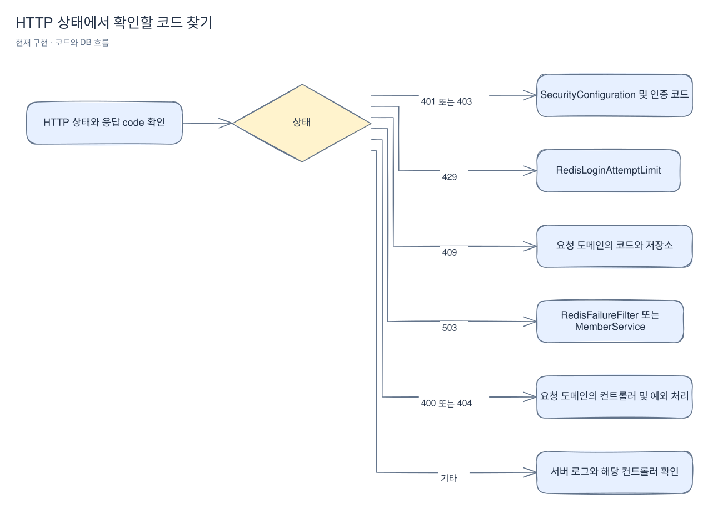

# 실행과 문제 해결

[위키 시작](README.md) · 이전: [데이터베이스](persistence.md) · 다음: [구조](architecture.md)

요청이 기대와 다르게 동작하면 먼저 HTTP 상태와 응답 code를 확인한다. 첫 실행이라면 [주문까지 따라 하기](first-order.md)를 사용하고, 이 페이지에서는 실행 명령·테스트·오류를 추적할 코드를 찾아본다.

## 로컬에서 흐름 확인

Java 21과 Docker 준비, `.env`, DB 계정 생성 및 두 앱 시작은 [루트 README의 실행 안내](../../README.md)를 따른다. 개발 볼륨을 지우지 않는다. 판매 앱과 Mock PG의 `/actuator/health`를 각각 확인한다. Mock PG health는 결제 API 구현의 증거가 아니다.

동작 확인은 별도 로컬 테스트 계정을 사용한다. 실제 자격 증명, 세션 쿠키, CSRF 토큰을 터미널 기록이나 공유 문서에 남기지 않는다.

1. `GET /api/v1/csrf`를 요청하고 응답의 `data.token`과 세션 쿠키를 클라이언트에 보관한다.
2. 토큰을 `X-CSRF-TOKEN` 헤더에 넣고 쿠키와 함께 `POST /api/v1/members`에 `{"email":"user@example.test","password":"<로컬 테스트 비밀번호>","nickname":"테스트회원"}`을 보낸다. 비밀번호 자리에는 정책에 맞는 로컬 값이 필요하다.
3. 같은 방식으로 `POST /api/v1/sessions`에 이메일과 비밀번호를 보내 로그인한다. 응답 쿠키로 교체하고 `GET /api/v1/csrf`를 다시 호출한다.
4. `GET /api/v1/members/me`와 공개 `GET /api/v1/products`를 확인한다. 제품 생성은 별도로 초기화한 ADMIN 세션과 새 CSRF 토큰을 사용한다.

진행 중인 판매 이벤트가 있으면 로그인 세션·새 CSRF 토큰과 UUID `Idempotency-Key`로 `POST /api/v1/orders`에 `{"saleId":1,"quantity":1}`을 보낸다. 생성된 UUID로 `GET /api/v1/orders/{orderId}`를 조회할 수 있다. 키를 유지한 재시도와 새 구매 시도의 차이는 [주문 페이지](orders.md)를 따른다. 현재는 결제 실행과 자동 만료 정리가 없으므로 대기 주문은 수량을 계속 점유한다.

## 검사와 한계

`./gradlew test`는 단위·구조 검사를 실행한다. `./gradlew integrationTest`는 격리된 Testcontainers MySQL과 필요한 Redis를 사용한다. `./gradlew clean build`는 두 검사를 포함하며 Docker가 필요하다. 전체 환경과 명령은 [README](../../README.md)를 따른다. 개발 DB를 초기화해 통합 테스트를 대체하지 않는다.

[회원 통합 테스트](../../src/integrationTest/java/com/wooyongjeong/limitedsale/member/application/MemberIntegrationTest.java)는 가입과 충돌·재시도를, [세션 통합 테스트](../../src/integrationTest/java/com/wooyongjeong/limitedsale/member/SessionIntegrationTest.java)는 세션과 제한·장애를, [제품 통합 테스트](../../src/integrationTest/java/com/wooyongjeong/limitedsale/product/ProductIntegrationTest.java)는 제품 HTTP 계약을 다룬다. [스키마 통합 테스트](../../src/integrationTest/java/com/wooyongjeong/limitedsale/MySqlSchemaIntegrationTest.java)와 [구조 테스트](../../src/test/java/com/wooyongjeong/limitedsale/architecture/ArchitectureTest.java)는 각각 MySQL 제약과 패키지 경계를 검사한다. 테스트 코드가 있다는 사실과 이번 변경에서 실행해 통과했다는 사실은 다르다.

실패한 검사가 어느 경계를 다루는지 표에서 찾는다. 테스트명은 검증 범위의 예이며 이번 문서 편집에서 테스트를 실행했다는 뜻은 아니다.

| 검사 | 예시 근거 | 주로 확인하는 경계 |
|---|---|---|
| 단위 | [MemberInputTest](../../src/test/java/com/wooyongjeong/limitedsale/member/domain/MemberInputTest.java), [ProductInputTest](../../src/test/java/com/wooyongjeong/limitedsale/product/domain/ProductInputTest.java) | 입력 정규화와 규칙 |
| HTTP 계약 구조 | [HttpContractStructureTest](../../src/test/java/com/wooyongjeong/limitedsale/architecture/HttpContractStructureTest.java) | 외부 DTO 배치·내부 타입 노출·응답 구성요소 |
| 구조 | [ArchitectureTest](../../src/test/java/com/wooyongjeong/limitedsale/architecture/ArchitectureTest.java) | 패키지 의존성 |
| MySQL 통합 | [MySqlSchemaIntegrationTest](../../src/integrationTest/java/com/wooyongjeong/limitedsale/MySqlSchemaIntegrationTest.java), [MemberIntegrationTest](../../src/integrationTest/java/com/wooyongjeong/limitedsale/member/application/MemberIntegrationTest.java) | 마이그레이션, 제약, 가입 저장 |
| 판매 이벤트 MySQL·HTTP 통합 | [SaleIntegrationTest](../../src/integrationTest/java/com/wooyongjeong/limitedsale/sale/SaleIntegrationTest.java) | 기간·상태·필터·수정 버전·실제 행 잠금 대기 |
| 주문 MySQL·HTTP 통합 | [OrderIntegrationTest](../../src/integrationTest/java/com/wooyongjeong/limitedsale/order/OrderIntegrationTest.java) | 원자적 점유·요청 키 경쟁·거절 재생·롤백·소유권 |
| HTTP 및 Redis 통합 | [SessionIntegrationTest](../../src/integrationTest/java/com/wooyongjeong/limitedsale/member/SessionIntegrationTest.java), [ProductIntegrationTest](../../src/integrationTest/java/com/wooyongjeong/limitedsale/product/ProductIntegrationTest.java) | 세션, 권한, 제품 계약, 장애 |

현재 노출된 Actuator 엔드포인트 설정은 health다. Prometheus·Grafana·부하 및 장애 실험은 [전체 계획](../project-plan.md)의 향후 범위이며 이미 구축된 관측 체계로 간주하지 않는다.

## 증상에서 코드 찾기

먼저 HTTP 상태를 확인한 다음 응답의 `code`로 원인을 좁힌다. 예를 들어 403이라도 토큰 오류와 권한 부족은 서로 다른 코드다. 아래 클래스는 확인을 시작할 위치이며 모든 장애 원인을 망라하지 않는다.

[Excalidraw 원본 편집](diagrams/operations-1.excalidraw)

- 401: 로그인 필요 또는 자격 증명 실패를 [인증 코드](../../src/main/java/com/wooyongjeong/limitedsale/member/presentation/code/AuthenticationResponseCode.java)로 구분하고 세션 쿠키와 입력을 확인한다.
- 403: CSRF 토큰 누락·불일치인지 역할 부족인지 응답 코드를 확인하고 [SecurityConfiguration](../../src/main/java/com/wooyongjeong/limitedsale/member/infrastructure/security/SecurityConfiguration.java)을 본다.
- 429: 정규화 이메일과 직접 연결 IP의 실패 구간을 [RedisLoginAttemptLimit](../../src/main/java/com/wooyongjeong/limitedsale/member/infrastructure/security/RedisLoginAttemptLimit.java)에서 확인한다.
- 503: 인증 저장소 장애와 자동 닉네임 생성 소진은 서로 다른 코드다. [RedisFailureFilter](../../src/main/java/com/wooyongjeong/limitedsale/member/infrastructure/security/RedisFailureFilter.java) 또는 [MemberService](../../src/main/java/com/wooyongjeong/limitedsale/member/application/MemberService.java)를 확인한다.
- 409 주문: `IDEMPOTENCY_CONFLICT`는 같은 키의 입력 변경이다. 판매 조건 거절은 같은 키로 재시도해도 유지된다. [OrderResponseCode](../../src/main/java/com/wooyongjeong/limitedsale/order/presentation/OrderResponseCode.java)와 [주문 페이지](orders.md)를 확인한다.
- 409 닉네임 충돌: 수동 입력 중복인지 자동 생성 경쟁인지 [회원 가입](member.md)의 비교 키와 트랜잭션 설명을 확인한다.
- 400: 제품뿐 아니라 가입·로그인 입력 오류도 해당한다. `data`의 `field`·`reason`과 요청 경로를 먼저 보고 해당 컨트롤러·예외 처리기를 찾는다. 제품에 대한 유효한 ID가 DB에 없으면 404이며, 형식이 잘못된 ID는 400이다.
- Flyway 실패: 실패 이력과 실제 스키마를 먼저 확인한다. 특히 V3 DDL 부분 적용은 [데이터베이스](persistence.md)의 주의사항을 따른다. Flyway의 MySQL 8.4 지원 경고는 [README](../../README.md)에 기록되어 있다.
