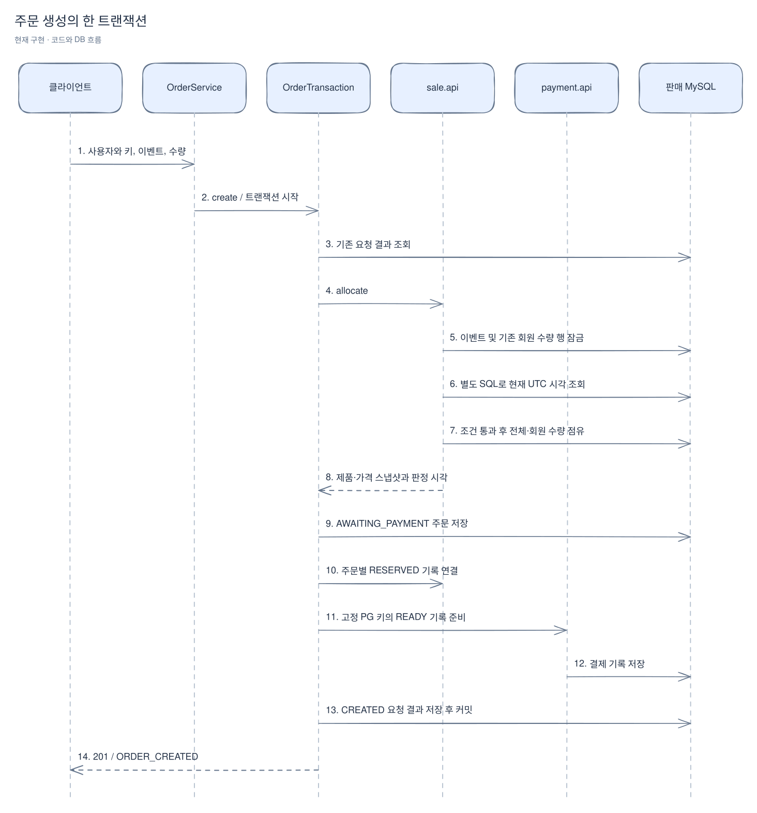
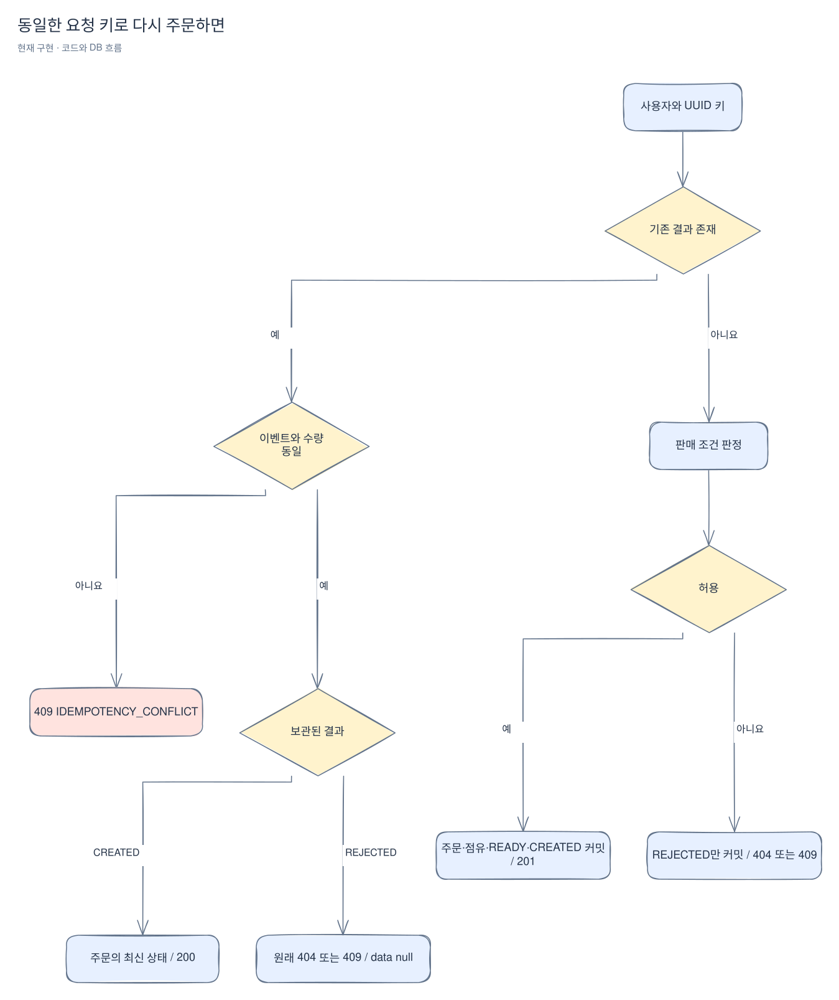
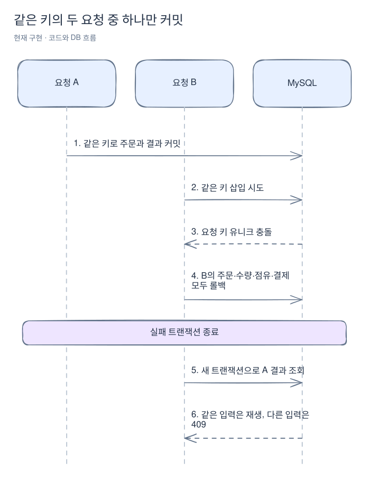

# 주문 생성과 수량 점유

[위키 시작](README.md) · 이전: [판매 이벤트](sales.md) · 다음: [데이터베이스](persistence.md)

주문 버튼을 누르는 순간 결제가 완료되는 것은 아니다. 먼저 다른 사람과 겹치지 않게 수량을 확보하고, 누가 무엇을 얼마에 주문했는지 저장한다. 여기서는 그 원자적 처리를 코드·DB 수준에서 설명한다. 수량 예시부터 보고 싶다면 [전체 구매 흐름](purchase-flow.md), 재시도가 궁금하면 [실패 사례](failure-cases.md)를 먼저 읽는다.

주문 생성은 이벤트 재고와 사용자 구매 한도를 확보하고 결제 준비 기록까지 한 번에 저장한다. 같은 요청을 다시 보내도 주문이 늘어나지 않으며, 업무상 거절도 요청 키별로 보관한다. 이 페이지는 1-7-1 구현을 설명한다. 사용자 결제용 PG 호출·주문 확정·점유 해제·복구 실행기는 후속 단계다. PG 자체의 API와 ADMIN 시나리오 설정은 [1-7-2 구현](mock-pg.md)을 본다.

## 요청에서 트랜잭션까지

로그인한 사용자가 `POST /api/v1/orders`에 UUID `Idempotency-Key`, `X-CSRF-TOKEN`, 세션 쿠키와 아래 본문을 보낸다. 서버는 금액과 주문 UUID를 생성한다.

```json
{"saleId": 1, "quantity": 2}
```

[OrderController](../../src/main/java/com/wooyongjeong/limitedsale/order/presentation/OrderController.java)는 엄격한 JSON·양의 ID·수량 1~1,000,000·UUID 형식을 검증한다. 로그인 ID는 [MemberIdentity](../../src/main/java/com/wooyongjeong/limitedsale/member/api/MemberIdentity.java) 계약을 통해 얻는다. 다른 도메인의 보안 구현이나 JPA 엔티티를 직접 참조하지 않는다.



[Excalidraw 원본 편집](diagrams/orders-1.excalidraw)

[OrderTransaction](../../src/main/java/com/wooyongjeong/limitedsale/order/application/OrderTransaction.java)이 트랜잭션을 소유한다. 도메인 판정·주문 결과·HTTP 코드의 enum은 명시적 switch로 매핑하므로 새 항목을 추가하면 누락된 변환을 컴파일 단계에서 확인할 수 있다. [SaleReservation](../../src/main/java/com/wooyongjeong/limitedsale/sale/api/SaleReservation.java)과 [PaymentPreparation](../../src/main/java/com/wooyongjeong/limitedsale/payment/api/PaymentPreparation.java)은 같은 로컬 트랜잭션에 참여한다. 구현 어댑터는 `MANDATORY`로 외부 트랜잭션 없는 호출을 거절한다. 여기에는 PG 네트워크 호출이 없다.

## 잠금 뒤에 주문 가능 여부를 판정하는 이유

[JpaSaleReservation](../../src/main/java/com/wooyongjeong/limitedsale/sale/infrastructure/persistence/JpaSaleReservation.java)은 항상 이벤트를 먼저 잠근다. 같은 이벤트의 요청은 이 행을 기준으로 순서대로 판정되므로 아직 사용자 수량 행이 없는 첫 주문도 서로 충돌해 중복 행을 만들지 않는다. 기존 사용자 수량 행도 잠근 뒤 DB 시각을 읽는다.

이벤트 잠금을 기다리는 동안 판매가 끝날 수 있다. 따라서 잠금을 기다리던 SQL의 시작 시각을 사용하지 않고, 잠금 획득 후 별도 시각 쿼리를 실행한다. [Sale.allocationDecision](../../src/main/java/com/wooyongjeong/limitedsale/sale/domain/Sale.java)은 기간 → 중단 → 사용자 한도 → 가용 재고 순서로 검사한다. 사용자 한도와 재고는 모두 점유 수량과 구매 확정 수량의 합을 사용한다. 모든 검사가 끝나기 전에는 수량을 쓰지 않는다.

예를 들어 총수량 5개, 사용자 한도 4개라면 한 사용자가 2개씩 두 주문을 생성할 수 있다. 그 사용자의 다음 주문은 한도 초과다. 다른 사용자는 남은 1개를 주문할 수 있다. 요청 수량의 일부만 확보하는 동작은 없다.

공개 이벤트 상태의 `SOLD_OUT`은 구매 확정 수량만으로 결정한다. 반면 주문의 `SALE_SOLD_OUT` 거절은 현재 점유를 포함한 재고 부족을 뜻한다. 전량 점유된 이벤트가 공개 조회에서는 OPEN이면서 새 주문은 거절될 수 있다.

## 같은 키를 다시 보내면

키는 `(member_id, request_key)`로 구분하고 TTL 없이 보관한다. 서로 다른 사용자는 같은 UUID를 독립적으로 사용할 수 있다. [OrderRequestResultEntity](../../src/main/java/com/wooyongjeong/limitedsale/order/infrastructure/persistence/OrderRequestResultEntity.java)는 입력 이벤트·수량과 주문 참조 또는 업무 거절 사유를 보관한다.



[Excalidraw 원본 편집](diagrams/orders-2.excalidraw)

없는 이벤트도 `SALE_NOT_FOUND`로 보관한다. 같은 키의 거절 뒤 판매가 재개되거나 재고 조건이 바뀌어도 원래 거절을 반환한다. 새 구매 시도에는 새 키가 필요하다. 성공 결과는 응답 JSON을 복사하지 않고 주문을 다시 읽으므로 이후 주문 상태가 바뀌면 최신 상태를 반환한다.

입력·인증·CSRF 실패와 DB 장애는 요청 결과로 저장하지 않는다. 업무 거절은 예외를 던져 롤백시키는 대신 타입으로 반환하여 결과를 커밋한 다음 HTTP 응답으로 바꾼다.

### 같은 키의 두 요청이 동시에 들어오면

둘 다 기존 결과를 찾지 못해도 DB 유니크 제약이 최종 승자를 정한다. [JpaOrderStore](../../src/main/java/com/wooyongjeong/limitedsale/order/infrastructure/persistence/JpaOrderStore.java)는 MySQL 1062 중 두 요청 키 제약만 `OrderRequestKeyCollision`으로 변환한다. [OrderService](../../src/main/java/com/wooyongjeong/limitedsale/order/application/OrderService.java)는 실패 트랜잭션이 종료된 다음 별도 조회 트랜잭션으로 승자의 결과를 읽는다. 다른 유니크 충돌과 DB 오류는 500으로 전파한다.



[Excalidraw 원본 편집](diagrams/orders-3.excalidraw)

## 상세 응답과 현재 상태

`GET /api/v1/orders/{orderId}`는 외부 UUID를 사용하며 본인 주문만 반환한다. 없는 주문과 타인 주문은 모두 404다. 생성·재생·상세의 data 필드는 같다.

```json
{
    "orderId": "e54c9df2-73ef-4a12-93c2-d4bb6a3e7591",
    "saleId": 1,
    "productId": 1,
    "productNameSnapshot": "한정 제품",
    "quantity": 2,
    "unitPrice": 1000,
    "totalAmount": 2000,
    "status": "AWAITING_PAYMENT",
    "createdAt": "2030-01-01T00:00:00Z",
    "updatedAt": "2030-01-01T00:00:00Z",
    "expiresAt": "2030-01-01T00:05:00Z"
}
```

실제 HTTP 본문은 위 값을 공통 `ApiResponse`의 data에 담는다. 내부 PK·회원 ID·요청 키·PG 키는 노출하지 않는다. 기본 만료는 생성 후 5분이고 `limited-sale.order.expiration`으로 양의 기간을 지정한다. `next_recovery_at`에는 만료 시각을 기록한다. 현재는 만료 시각이 지나도 자동 상태 변경이나 점유 해제가 실행되지 않는다.

[OrderIntegrationTest](../../src/integrationTest/java/com/wooyongjeong/limitedsale/order/OrderIntegrationTest.java)는 실제 MySQL·Redis에서 재고 소진, 회원 한도 경쟁, 요청 키 경쟁, 거절 재생, 소유권과 엄격 입력을 검증한다. 단가 10억 원·수량 100만 개의 총액 1,000조 원이 주문·결제·응답에 정확히 유지되는지도 검사한다. 결제 INSERT에 DB 오류를 주입해 전체 롤백을 확인하며, 잠금 대기 SQL을 확인한 뒤 판매 종료·중단을 반영한다. 응답 유실 검사는 첫 HTTP 응답을 버리고 재요청하는 방식이다. 네트워크 단절 자체를 주입한 검사는 아니다. 정책 원문과 실행 근거는 [1-7-1 단계 문서](../stages/01-7-1-order-reservation.md)에 있다.

주문 생성 본문은 [OrderRequest](../../src/main/java/com/wooyongjeong/limitedsale/order/presentation/request/OrderRequest.java)다. 내부 OrderView는 [OrderViewResponse](../../src/main/java/com/wooyongjeong/limitedsale/order/presentation/response/OrderViewResponse.java)로 변환한 후 공통 응답에 담는다. 타입 배치는 달라졌지만 위 JSON과 멱등성·상태 코드 계약은 같다.
