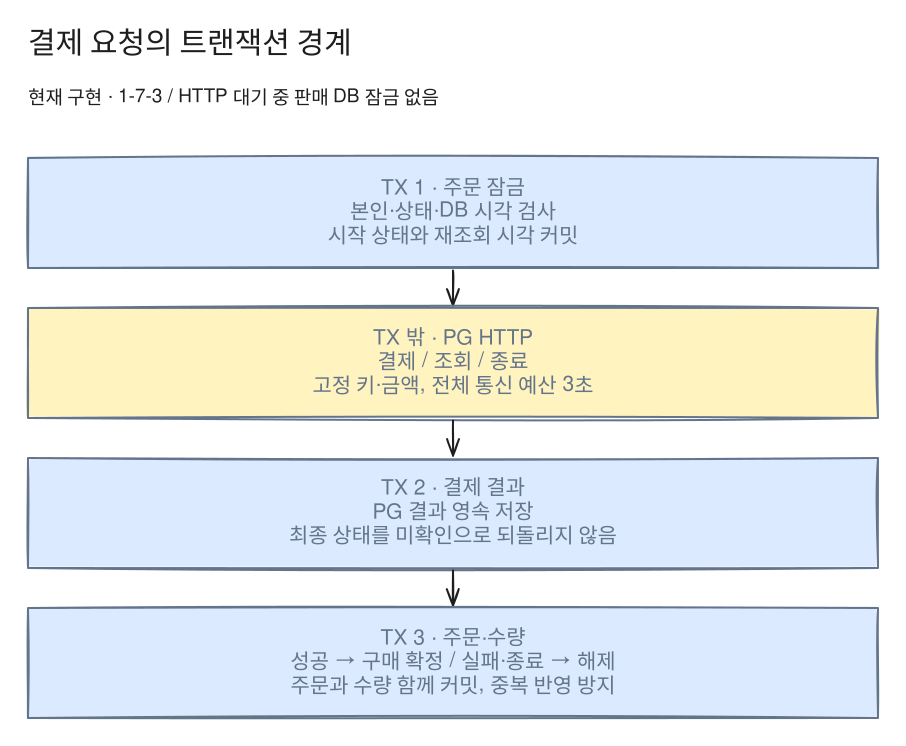

# 결제 요청부터 주문 확정까지

[위키 시작](README.md) · 이전: [주문 생성](orders.md) · 다음: [자동 복구](recovery.md)

주문은 자리를 확보하는 작업이고 결제는 그 자리를 구매 확정으로 바꾸는 작업이다. 로그인한 사용자가 결제를 요청하면 판매 서버가 Mock PG를 호출하고 주문과 수량을 마무리한다. [자동 복구](recovery.md)도 같은 결제 처리를 사용한다. 사용자 요청과 자동 복구는 주문별 임대를 공유한다.

## 정상 결제 한 번을 따라가자

```http
POST /api/v1/orders/{orderId}/payment
X-CSRF-TOKEN: <로그인 후 받은 CSRF 토큰>
```

세션 쿠키도 함께 보낸다. 요청 본문은 보내지 않는다. 금액·결제 키는 주문 생성 시 서버가 정한 값을 사용하며 클라이언트가 바꿀 수 없다. 없는 주문과 타인 주문은 모두 404다.



[Excalidraw 원본 편집](diagrams/payments-1.excalidraw)

1. 주문을 잠그고 본인 주문·결제 상태를 검사한다. 잠금을 얻은 뒤 DB 시각을 읽는다. 최초 요청이면 주문 PAYMENT_PENDING·결제 PROCESSING과 다음 재조회 시각을 저장하고 커밋한다.
2. 잠금을 놓은 뒤 고정 PG 키와 주문 금액으로 HTTP를 호출한다. PG 서버가 지연돼도 판매 DB 잠금을 잡고 기다리지 않는다.
3. payment가 PG 결과를 별도 트랜잭션으로 먼저 저장한다. 응답 키·금액·상태·시간·JSON 구조가 계약과 다르면 성공으로 신뢰하지 않는다.
4. 주문을 다시 잠그고 저장된 결제 결과를 확인한다. 성공이면 주문 CONFIRMED와 이벤트·사용자 구매 확정 수량을 함께 커밋한다. 확정 실패면 점유를 해제한다.

예를 들어 3개 중 2개를 주문하면 점유 2·확정 0이다. 성공 후에는 점유 0·확정 2, 실패 후에는 점유 0·확정 0이 된다. 같은 주문의 결제를 반복해도 수량은 다시 변하지 않는다. 이벤트가 종료되거나 중단돼도 기존 점유의 정리는 허용한다.

## 결제 버튼을 다시 누르면

| 저장된 상태·시각 | 처리 |
|---|---|
| 주문까지 최종 정리됨 | PG 호출 없이 기존 결과 반환 |
| 결제만 최종 결과 저장됨 | PG 호출 없이 주문·수량 마무리 재적용 |
| 처리 중·미확인, 다음 재조회 전 | 저장된 상태로 202 |
| 재조회 시각 도달, 5분 전 | 같은 키로 PG 조회. 404일 때만 만료를 다시 검사하고 같은 키로 결제 재전송 |
| 주문 생성 후 5분 이상 | 10초 간격과 관계없이 PG 종료 확인. 새 결제를 시작하지 않음 |

기본 재조회 간격은 10초이며 DB의 next_recovery_at에 저장하므로 다른 판매 앱 인스턴스도 같은 기준을 본다. 자동 복구가 예정 시각이 지난 주문을 찾아 처리한다. 유효한 다른 작업 임대가 있으면 사용자 요청은 저장된 상태로 202를 받으며 임대를 빼앗지 않는다.

PG 통신은 사용자 요청 한 번에 기본 3초 예산을 공유한다. 조회 후 재전송도 남은 예산만 사용하고 응답 본문이 멈춘 경우도 시간 제한으로 중단한다. DB 잠금·처리 시간까지 포함한 API 전체 3초 보장은 아니다.

## 202는 결제 실패가 아니다

DELAY는 아직 PROCESSING일 수 있고 RESPONSE_LOSS는 이미 성공했는데 응답을 못 받았을 수 있다. 통신 장애나 검증에 실패한 PG 응답도 성공·실패를 단정할 근거가 아니다. 이때 주문은 PAYMENT_PENDING, 결제는 PROCESSING 또는 UNKNOWN으로 남고 점유를 유지한다.

사용자가 기본 10초 후 결제를 재요청하면 조회를 통해 결과를 확인한다. GET 주문 상세는 저장된 상태만 읽으므로 조회만 반복한다고 PG 결과를 반영하지는 않는다.

| 결제 API 결과 | HTTP·code | data |
|---|---|---|
| 구매 확정 | 200·PAYMENT_SUCCEEDED | 주문 상세와 paymentStatus |
| 처리 중·결과 미확인 | 202·PAYMENT_PENDING | 주문 상세와 paymentStatus |
| 명확한 결제 거절 | 409·PAYMENT_DECLINED | null |
| PG 종료 확인된 만료 | 409·ORDER_EXPIRED | null |

상세 GET은 실패·만료 주문도 200과 저장된 상태로 보여 준다. 결제 실패·만료 주문을 새 PG 키로 되살리지 않는다. 재구매는 새 요청 키로 새 주문을 만들어 현재 재고·한도를 다시 검사한다.

## 중간에 서버가 실패하면

PG 결과 저장과 주문·수량 마무리는 서로 다른 트랜잭션이다. PG 성공을 저장한 뒤 로컬 수량 반영이 실패할 수 있다. DB 장애는 500으로 알리고 성공 응답으로 숨기지 않는다. 다음 결제 요청은 저장된 최종 결제를 보고 PG 호출 없이 주문 마무리를 다시 시도한다.

주문 → 결제 잠금으로 같은 주문을 직렬화하고 수량 마무리에서는 이벤트 → 사용자 수량 → 점유를 잠근다. 이미 최종 정리된 주문은 수량 처리를 반복하지 않는다. 늦게 도착한 PROCESSING·UNKNOWN 응답도 SUCCEEDED·FAILED·CLOSED를 되돌리지 못한다.

5분이 지났다는 사실만으로 수량을 풀지 않는다. PG 종료가 SUCCEEDED면 구매 확정, FAILED면 실패, CLOSED면 만료다. PG가 응답하지 않으면 점유를 유지한다. 사용자 요청 없이 미완료 작업을 이어 가는 과정은 [자동 복구](recovery.md)에서 설명한다.

## 코드 읽는 순서와 검증

- [OrderPaymentService](../../src/main/java/com/wooyongjeong/limitedsale/order/application/OrderPaymentService.java): 짧은 트랜잭션과 외부 HTTP 사이를 조합한다.
- [OrderPaymentTransaction](../../src/main/java/com/wooyongjeong/limitedsale/order/application/OrderPaymentTransaction.java): 시작·대기·조회·종료를 결정하고 결과 저장과 주문 마무리를 분리한다.
- [HttpPaymentGateway](../../src/main/java/com/wooyongjeong/limitedsale/payment/infrastructure/http/HttpPaymentGateway.java): 예산 내 HTTP 호출과 PG 응답 검증. 트랜잭션 안에서 호출하면 거절한다.
- [PaymentState](../../src/main/java/com/wooyongjeong/limitedsale/payment/domain/PaymentState.java): 최종 결제 상태를 유지한다.
- [JpaSaleReservation](../../src/main/java/com/wooyongjeong/limitedsale/sale/infrastructure/persistence/JpaSaleReservation.java): 확정·해제를 주문 트랜잭션 안에서 수량에 반영한다.

[OrderPaymentIntegrationTest](../../src/integrationTest/java/com/wooyongjeong/limitedsale/order/OrderPaymentIntegrationTest.java)는 실제 HTTP와 격리 MySQL·Redis에서 동시 결제, 응답 유실, 만료, 늦은 응답, 다중 인스턴스 재조회 간격과 로컬 확정 실패 후 재적용을 검사한다. [HTTP 어댑터 검사](../../src/test/java/com/wooyongjeong/limitedsale/payment/infrastructure/http/HttpPaymentGatewayTest.java)는 잘못된 응답과 본문 지연의 시간 제한도 확인한다. 상세 정책과 검증 기록은 [1-7-3 문서](../stages/01-7-3-order-payment-integration.md)를 본다.
