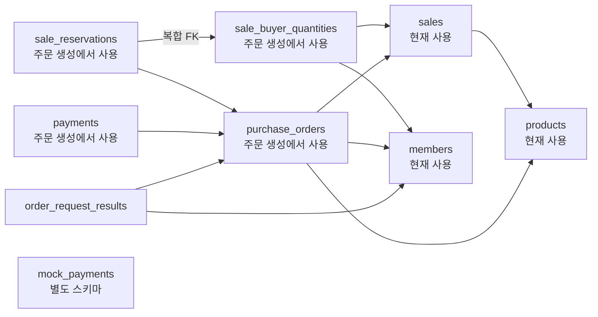
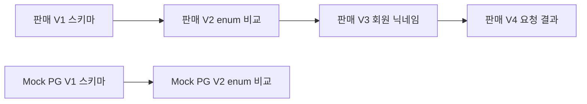
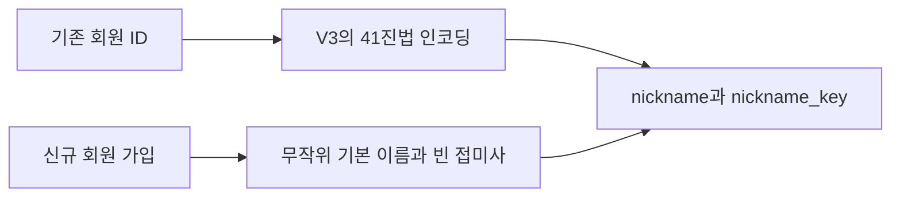

# 데이터베이스와 마이그레이션

[위키 시작](README.md) · 이전: [주문 생성과 수량 점유](orders.md) · 다음: [실행과 문제 해결](operations.md)

판매 앱과 Mock PG는 각자 소유한 MySQL 스키마와 Flyway 이력을 사용한다. [판매 V1](../../src/main/resources/db/migration/V1__sales_schema.sql)은 회원·제품과 이후 판매·주문·결제용 테이블 및 FK·제약을 만든다. [Mock PG V1](../../mock-pg/src/main/resources/db/migration/V1__mock_pg_schema.sql)은 별도 `mock_payments`를 만든다. 서로 다른 스키마 사이 FK는 없다. 양쪽 V2는 enum 비교 규칙을 변경한다.

아래 화살표는 자식 테이블에서 실제 FK가 참조하는 부모 테이블을 가리킨다. `members`·`products`·`sales`는 현재 회원·제품·판매 이벤트 기능에서 사용한다. 주문·회원별 수량·주문별 점유·READY 결제·요청 결과도 현재 주문 생성에서 사용한다. 결제 실행과 복구는 후속 단계다. Mock PG는 별도 스키마이므로 선으로 연결하지 않았다. 관계와 제약의 전체 정의는 [판매 V1 SQL](../../src/main/resources/db/migration/V1__sales_schema.sql)을 확인한다.

예를 들어 `sale_reservations`의 복합 FK는 `sale_buyer_quantities`의 `(sale_id, member_id)`를 참조한다. [판매 V4](../../src/main/resources/db/migration/V4__order_request_results.sql)의 `order_request_results`는 회원·주문에 FK를 둔다. 원본 요청 이벤트 ID에는 FK가 없으므로 없는 이벤트의 거절도 저장할 수 있다. CHECK는 성공에 주문 참조만, 거절에 사유만 허용한다. 요청 키는 회원별 유니크이며 UUID는 BINARY(16)이다.

[판매 설정](../../src/main/resources/application.yml)은 시작 시 SQL 경로와 Java 마이그레이션 경로를 Flyway에 지정하고 Hibernate `ddl-auto: validate`를 사용한다. 따라서 스키마 생성은 Flyway가 담당하고 JPA는 매핑을 검증한다. 적용된 마이그레이션은 수정하지 않고 새 버전을 추가한다. Flyway 이력에 성공한 버전은 정상 재시작 때 다시 적용하지 않는다.

두 앱의 버전은 별도 이력으로 관리한다. 다음 그림은 실행 순서를 나타내며, 같은 번호가 두 앱 사이의 의존성을 뜻하지 않는다.

예를 들어 이미 판매 V1과 V2를 적용한 DB는 다음 시작에서 V3과 V4를 순서대로 적용한다. 중단 시 복구 주의사항은 아래를 따른다. [판매 V2](../../src/main/resources/db/migration/V2__exact_enum_comparisons.sql)와 [Mock PG V2](../../mock-pg/src/main/resources/db/migration/V2__exact_enum_comparisons.sql)도 각각 확인할 수 있다.

## 닉네임 이행과 현재 저장

[V3 Java 마이그레이션](../../src/main/java/db/nickmigration/V3__member_nickname.java)은 기존 회원 ID를 41진법 문자로 인코딩해 `nickname`과 `nickname_key`를 채운 후 NOT NULL과 유니크 제약을 추가한다. 이 결정적 변환은 기존 행 이행용이다. 신규 가입의 무작위 이름과 첫 빈 접미사 탐색은 [회원 가입](member.md)의 별도 로직이다. MySQL DDL은 전체가 하나의 원자적 트랜잭션이 아니므로 중단 시 Flyway 이력과 실제 컬럼 상태를 확인해야 한다. 자동 재실행만으로 부분 적용 복구를 보장하지 않는다. 근거와 주의사항은 [1-3 문서](../stages/01-3-member.md)에 있다.

예를 들어 `nickname=Happy 토끼`라면 비교 키는 `happy 토끼`다. DB는 `nickname_key`에 유니크 제약을 두므로 대소문자만 다른 이름의 동시 가입도 거절한다. 표시할 이름과 중복 비교용 값을 따로 저장하는 이유다.

현재 회원 읽기와 쓰기는 [JpaMemberStore](../../src/main/java/com/wooyongjeong/limitedsale/member/infrastructure/persistence/JpaMemberStore.java)와 Spring Data JPA 저장소가 담당한다. 접미사 조회에만 네이티브 SQL을 쓴다. V3와 일부 테스트에서 JDBC를 사용한다는 사실은 운영 회원 저장소가 JDBC라는 뜻이 아니다. [MemberEntity](../../src/main/java/com/wooyongjeong/limitedsale/member/infrastructure/persistence/MemberEntity.java)는 비교 키와 해시를 저장하고 도메인 `Member` 또는 인증용 `AuthenticationRecord`로 변환한다. [ProductEntity](../../src/main/java/com/wooyongjeong/limitedsale/product/infrastructure/persistence/ProductEntity.java)는 도메인 `Product`로 변환한다.

다음은 기존 행과 신규 가입의 닉네임 경로다. 두 결과 모두 유니크 비교 키에 저장하지만 이름을 만드는 방법은 다르다.

| 변환 | 사용하는 곳 | 외부 응답에 해시 포함 |
|---|---|---|
| `MemberEntity.toMember()` | 이메일로 회원 조회·관리자 기존 계정 확인 | 아니요 |
| `MemberEntity.toAuthenticationRecord()` | 로그인 검증용 내부 값 | HTTP 응답에는 포함하지 않음 |
| `ProductEntity.toProduct()` | 제품 도메인 값 | 해당 없음 |

회원 시각은 DB의 `UTC_TIMESTAMP(6)`으로 생성하고 제품 시각은 애플리케이션 `Instant`를 마이크로초로 잘라 저장한다. Hibernate JDBC 시간대와 로컬 MySQL 연결은 UTC로 설정한다. 두 앱 DataSource는 READ COMMITTED다. 주문 생성과 수량 점유·READY 결제 기록·요청 결과는 Spring Data JPA 저장소를 사용한다. 주문 생성 시각은 이벤트·회원 수량 잠금 뒤 읽은 MySQL UTC 시각이다. Mock PG는 아직 별도 스키마와 매핑만 있고 결제 API는 없다. 제약은 테이블 간 모든 업무 일치나 동시성·복구를 혼자 보장하지 않는다.

가입 성공 시 `MemberService`가 저장에 성공한 입력값으로 내부 `Member`를 구성하고 컨트롤러가 `MemberResponse`로 변환한다. 로그인은 `toAuthenticationRecord()`를 통해 조회한 엔티티를 변환한다. 모든 응답이 항상 `toMember()`의 별도 호출이나 DB 재조회를 거치는 것은 아니다.

[스키마 통합 테스트](../../src/integrationTest/java/com/wooyongjeong/limitedsale/MySqlSchemaIntegrationTest.java)는 실제 MySQL의 마이그레이션·제약·매핑을 다룬다. [V3 테스트](../../src/test/java/db/nickmigration/MemberNicknameMigrationTest.java)와 [회원 통합 테스트](../../src/integrationTest/java/com/wooyongjeong/limitedsale/member/application/MemberIntegrationTest.java)도 함께 본다. 전체 스키마 설계와 한계는 [1-2 문서](../stages/01-2-mysql-schema-and-boundaries.md)에 있다.
