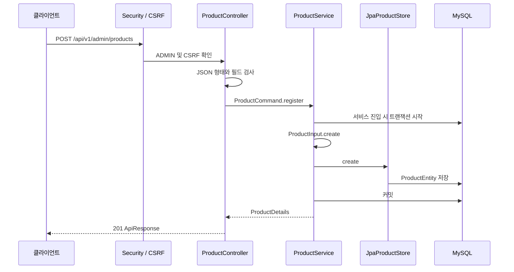
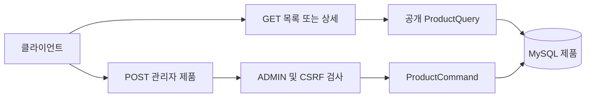
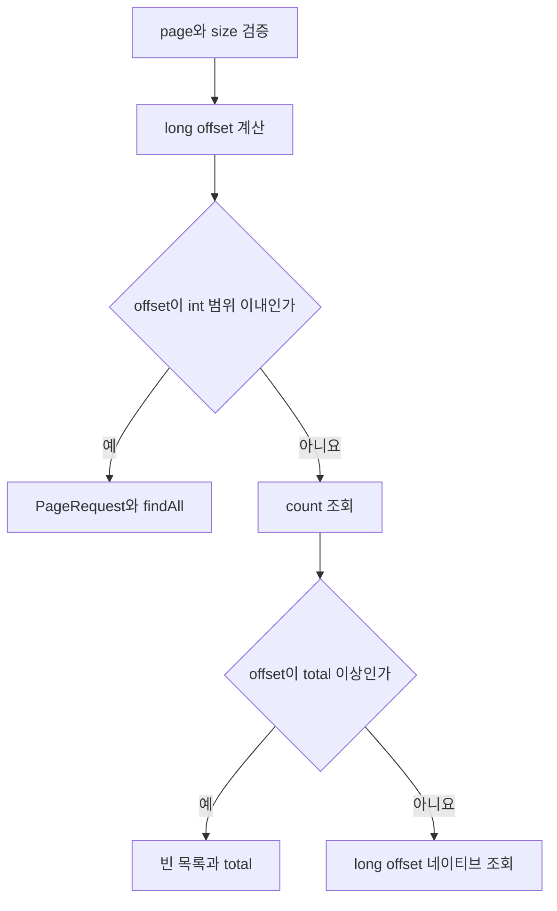

# 제품 등록과 조회

[위키 시작](README.md) · 이전: [세션 인증](authentication.md) · 다음: [데이터베이스](persistence.md)

제품은 이름, 설명, 기준 가격을 가진다. 재고는 제품에 두지 않는다. 이벤트 전용 재고는 이후 판매 기능의 계획이다. [ProductController](../../src/main/java/com/wooyongjeong/limitedsale/product/presentation/ProductController.java)는 HTTP를 받고 [ProductService](../../src/main/java/com/wooyongjeong/limitedsale/product/application/ProductService.java)는 공개 계약과 저장소를 연결한다.

아래 클라이언트 요청은 HTTP다. 서비스와 저장소 사이는 메서드 호출이며 MySQL 화살표는 트랜잭션과 DB 접근을 나타낸다.

`ProductService.register`의 `@Transactional` 프록시가 입력 검증 전에 트랜잭션을 시작하고, 메서드가 반환하려는 시점에 커밋한다. 그림의 트랜잭션 화살표는 이 프록시의 동작을 포함한 것이다. 컨트롤러는 커밋이 성공한 뒤 201을 반환하며, 커밋 실패를 성공 응답으로 바꾸지 않는다.



`POST /api/v1/admin/products`는 ADMIN 세션과 CSRF가 필요하다. JSON 객체의 `name`, 선택 `description`, 정수 `basePrice`를 받는다. 성공 `data`는 `productId`, `name`, `description`, `basePrice`, `createdAt`, `updatedAt`이다. `GET /api/v1/products?page=0&size=20`은 공개 목록이다. `data`에는 `items`, `page`, `size`, `totalElements`, `totalPages`가 있고 항목은 설명을 제외한 제품 정보다. ID 내림차순이다. `GET /api/v1/products/{id}`는 공개 상세다.

예를 들어 다음 등록 요청은 ADMIN 세션과 CSRF가 있는 경우 201이며, 응답 `data.name`은 앞뒤 공백이 제거된 `텀블러`다.

```json
{"name":" 텀블러 ","basePrice":1000}
```

아래 표는 같은 JSON 문법이라도 어느 경계에서 거절하는지 보여준다. 응답 형식은 [ProductExceptionHandler](../../src/main/java/com/wooyongjeong/limitedsale/product/presentation/ProductExceptionHandler.java)를 따른다.

| 입력 예 | 결과 | 검출 지점 |
|---|---|---|
| `{"name":"컵","name":"병","basePrice":1000}` | 400 | 중복 필드 역직렬화 오류 |
| `{"name":"컵","basePrice":1000} {}` | 400 | 뒤따르는 JSON 값 역직렬화 오류 |
| `{"name":"컵","basePrice":"1000"}` | 400, `basePrice` | 컨트롤러 타입 검사 |
| `{"name":" ","basePrice":1000}` | 400, `name` | 도메인 입력 검사 |

조회와 생성은 같은 제품 데이터를 다루지만 진입 권한이 다르다. 다음 경로는 [보안 설정](../../src/main/java/com/wooyongjeong/limitedsale/member/infrastructure/security/SecurityConfiguration.java)과 컨트롤러를 함께 읽는다.



등록 전용 `RegistrationDeserializer`는 중복 JSON 필드와 뒤따르는 추가 JSON 값을 거절한다. 컨트롤러는 객체 여부, 알 수 없는 필드와 타입을 검사한다. [ProductInput.create](../../src/main/java/com/wooyongjeong/limitedsale/product/domain/ProductInput.java)는 이름 앞뒤 공백을 제거한 후 1~100 코드 포인트인지 확인한다. 설명은 생략 또는 null이면 빈 문자열이며 원문을 보존하고 최대 2,000 코드 포인트다. 가격은 1~1,000,000,000원의 정수다. 이름 중복은 허용한다.

목록은 기본 `page=0`, `size=20`이다. page는 0~2,147,483,647, size는 1~100 범위의 정수이며 상세 ID는 Java `long` 범위의 양의 정수다. 범위·형식이 잘못되면 400이며 검증 오류는 `data`에 필드와 이유를 담는다. 파싱 불가능한 JSON은 400의 `data: null`이다. 존재하지 않는 유효한 ID는 404다. 권한·CSRF 검사는 본문 검증보다 먼저 실행될 수 있으므로, 잘못된 본문을 보냈더라도 세션이나 토큰이 없으면 먼저 401·403을 받을 수 있다. 세부 코드는 [인증 응답 코드](../../src/main/java/com/wooyongjeong/limitedsale/member/presentation/code/AuthenticationResponseCode.java)에서 구분한다.

예를 들어 제품이 23개일 때 `page=1&size=20`은 나머지 3개와 `totalPages=2`를 반환한다. `page=2`부터는 빈 `items`와 같은 총수를 반환한다. `sort` 입력으로 정렬을 바꾸는 기능은 없고 제품 ID 내림차순으로 고정한다.

[ProductCommand](../../src/main/java/com/wooyongjeong/limitedsale/product/api/ProductCommand.java), [ProductQuery](../../src/main/java/com/wooyongjeong/limitedsale/product/api/ProductQuery.java)와 반환 record는 HTTP와 JPA 타입을 노출하지 않는다. [JpaProductStore](../../src/main/java/com/wooyongjeong/limitedsale/product/infrastructure/persistence/JpaProductStore.java)는 일반 offset에 `PageRequest`를 사용한다. offset이 `Integer.MAX_VALUE`를 넘으면 count를 확인하고 범위 안일 때 long offset을 받는 네이티브 쿼리를 사용한다. READ COMMITTED에서는 목록 내용과 count가 동시 변경에 대해 같은 스냅샷이라고 보장하지 않는다.

목록에서 `page * size`가 매우 크면 다음 분기를 탄다. 예를 들어 offset이 총 개수 이상이면 큰 offset 조회 대신 빈 목록과 총 개수를 반환한다.



[제품 통합 테스트](../../src/integrationTest/java/com/wooyongjeong/limitedsale/product/ProductIntegrationTest.java)는 HTTP 계약·경계·JSON·Redis 장애를 다룬다. [입력 테스트](../../src/test/java/com/wooyongjeong/limitedsale/product/domain/ProductInputTest.java)와 [저장소 테스트](../../src/test/java/com/wooyongjeong/limitedsale/product/infrastructure/persistence/JpaProductStoreTest.java)도 확인한다.
