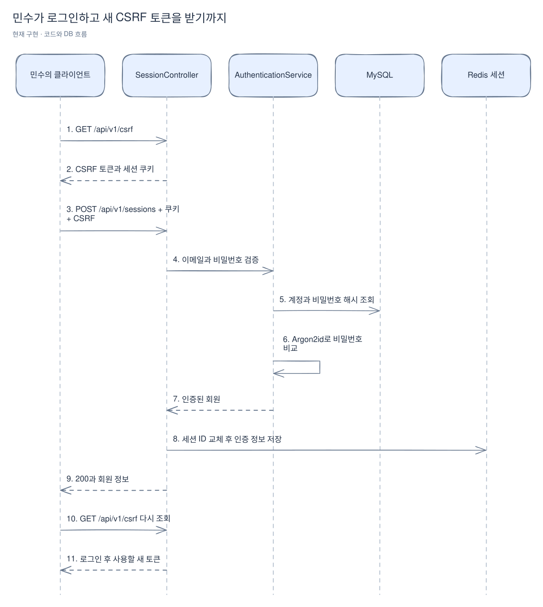
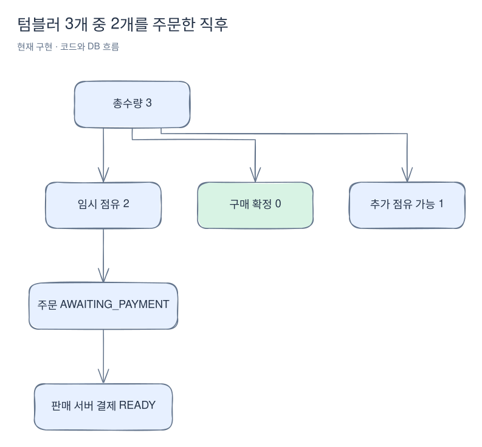
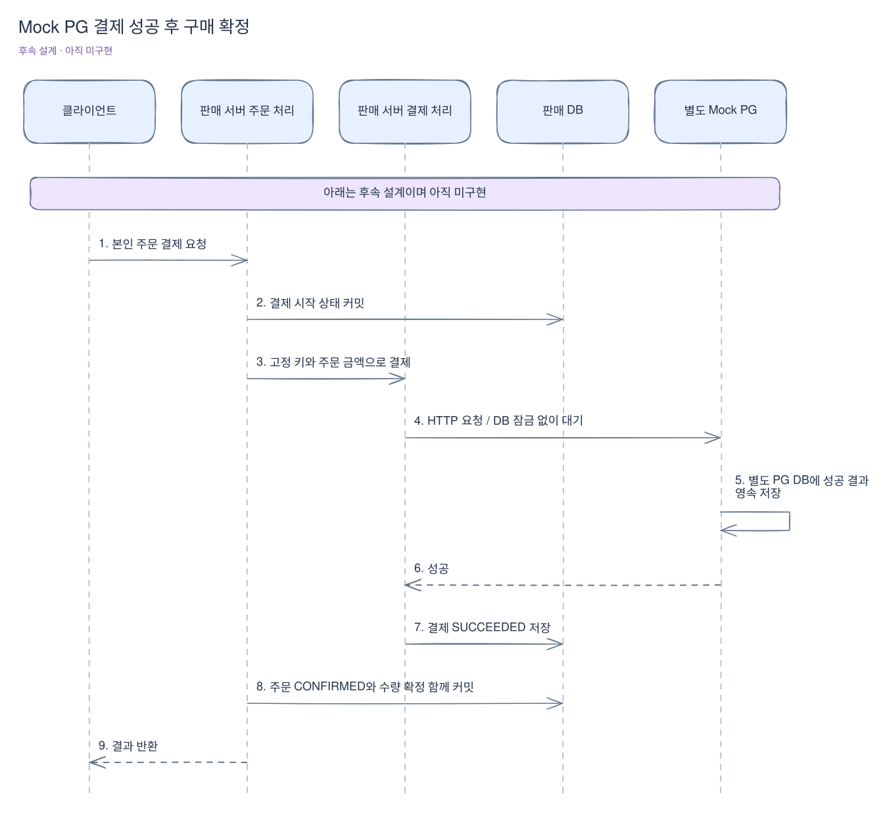

# 로그인부터 구매 완료까지

[위키 시작](README.md) · 다음: [실패·재시도 사례](failure-cases.md)

민수가 이벤트에서 텀블러 2개를 구매한다고 생각해 보자. 제품 기준 가격은 12,000원이지만 이번 이벤트 가격은 10,000원, 총수량은 3개, 사용자 한도는 2개다. 민수의 주문 금액은 서버가 이벤트 가격으로 계산한 20,000원이다.

제품은 판매할 물건의 정보다. 판매 이벤트는 언제, 얼마에, 몇 개를, 한 사람에게 몇 개까지 팔지 정한다. 재고는 이벤트마다 따로 관리한다. 같은 제품이 다른 이벤트에도 등장하더라도 공용 창고 재고를 공유하는 모델은 아니다.

## 1. 관리자가 판매를 준비한다 — 구현됨

관리자는 제품을 등록하고 미래에 시작하는 이벤트를 만든다. 이때 이벤트에 제품 이름과 판매 단가를 보관한다. 나중에 제품 정보가 바뀌어도 이미 생성된 주문의 상품명·결제 금액이 바뀌면 안 되기 때문이다. 주문 생성 시에는 이벤트에 잠긴 값을 다시 주문에 보관한다.

관리자가 하는 일과 구매자가 하는 일은 다르다. 구매자는 공개 제품·이벤트를 조회할 수 있지만 제품 등록·이벤트 관리에는 ADMIN 권한이 필요하다. 자세한 요청은 [제품](products.md)과 [판매 이벤트](sales.md)를 본다.

## 2. 민수가 로그인한다 — 구현됨

가입은 계정 생성까지만 한다. 가입했다고 로그인한 상태가 되지는 않는다. 변경 요청에 필요한 CSRF 토큰을 먼저 받고 이메일·비밀번호로 로그인한다.



[Excalidraw 원본 편집](diagrams/purchase-flow-1.excalidraw)

세션 쿠키는 다음 요청이 누구의 요청인지 연결하는 값이다. 비밀번호를 주문할 때마다 다시 보내지는 않는다. CSRF 토큰은 로그인 여부와 별개로 변경 요청에 요구하는 값이다. 로그인 시 기존 CSRF 토큰을 지우므로 다음 주문 전에 새로 받아야 한다.

실제 진입점은 [SessionController.login](../../src/main/java/com/wooyongjeong/limitedsale/member/presentation/SessionController.java)이다. 비밀번호 비교와 실패 횟수 처리는 [AuthenticationService.authenticate](../../src/main/java/com/wooyongjeong/limitedsale/member/application/AuthenticationService.java)가 맡는다.

## 3. 이벤트를 고른다 — 구현됨

민수는 `GET /api/v1/sales`와 `GET /api/v1/sales/{id}`로 이벤트를 확인한다. 공개 응답에는 총수량과 상태가 있지만 남은 수량은 제공하지 않는다. 조회 직후 다른 사람이 주문할 수 있기 때문에 조회 결과로 구매 성공을 약속할 수도 없다.

민수가 조회한 상태가 OPEN이어도 주문은 실패할 수 있다. 예를 들어 마지막 수량을 다른 사람이 먼저 점유했거나, 주문을 처리할 차례가 왔을 때 판매가 끝났을 수 있다.

## 4. 주문 버튼을 누른다 — 구현됨

클라이언트가 이번 구매 시도를 나타내는 UUID 요청 키를 한 번 생성한다. 통신 문제로 같은 주문을 다시 보낼 때는 이 키를 유지한다.

```http
POST /api/v1/orders
Idempotency-Key: 753be3c6-41d2-4f78-88d4-94e7b6026e43
X-CSRF-TOKEN: <로그인 후 받은 토큰>
Cookie: SESSION=<클라이언트가 보관한 쿠키>
Content-Type: application/json

{"saleId": 1, "quantity": 2}
```

위 값은 설명용 예시이며 실제 세션·이벤트 ID로 바꿔야 한다. 요청에는 가격이 없다. 클라이언트가 1원이라고 보내 서버 금액을 바꿀 수 없도록 서버가 단가와 총액을 정한다. 알 수 없는 JSON 필드도 거절한다.

서버는 이벤트 행을 잠그고 기존 민수의 누적 수량 행도 잠근다. 잠금을 얻은 뒤 MySQL 현재 시각으로 기간을 확인하고 중단 여부·민수 한도·전체 재고를 검사한다. 통과하면 다음 기록을 같은 DB 트랜잭션으로 저장한다.

| 기록 | 이번 예시에서 저장되는 내용 |
|---|---|
| 이벤트 수량 | 전체 점유 0 → 2 |
| 민수의 누적 수량 | 점유 0 → 2, 구매 확정 0 |
| 주문 | 수량 2, 단가 10,000, 총액 20,000, AWAITING_PAYMENT |
| 주문별 점유 | 이 주문이 수량 2를 확보했다는 RESERVED 기록 |
| 판매 서버 결제 | 고정된 PG 키, 금액 20,000, READY |
| 요청 결과 | 민수+요청 키가 생성한 주문 참조 |

중간 저장이 실패하면 전부 롤백한다. 수량만 줄고 주문이 없는 상태를 남기지 않는다. 성공하면 201과 외부 주문 UUID를 반환한다. 이 UUID로 본인 상세를 조회한다.

여기서 **점유는 구매 확정이 아니다.** 현재 예시의 DB 수량은 아래와 같다.



[Excalidraw 원본 편집](diagrams/purchase-flow-2.excalidraw)

현재 실행 가능한 흐름은 여기까지다. READY 기록이 생겼다는 이유로 PG에 결제를 요청한 것은 아니다. 기본 5분의 만료 시각은 저장하지만, 현재 코드에는 이를 보고 자동으로 수량을 반환하는 실행기가 없다.

## 5. 별도로 결제를 요청한다 — 후속 설계, 미구현

합의한 결제 요청 경로는 `POST /api/v1/orders/{id}/payment`다. 아직 이 경로를 호출해 정상 결제할 수는 없다. 다음은 1-7-2~1-7-4에서 만들 흐름을 이해하기 위한 설명이다.

주문 생성과 결제 요청을 분리하므로 주문만 만들고 결제 버튼을 누르지 않을 수도 있다. 결제를 요청하면 서버가 주문에 저장한 20,000원과 고정 PG 키를 사용한다. PG 키는 결제 재시도 때마다 새로 생성하지 않는다.



[Excalidraw 원본 편집](diagrams/purchase-flow-3.excalidraw)

Mock PG는 실제 결제사 대신 지연·실패·응답 유실을 재현하는 별도 HTTP 서버다. 결제 기록도 별도 스키마에 저장한다. 판매 서버가 PG 테이블을 직접 읽는 방식으로 결제를 확인하지 않는다.

외부 응답을 기다리는 동안 DB 잠금을 잡고 있으면 다른 주문까지 오래 기다린다. 따라서 짧은 DB 트랜잭션으로 시작 상태를 저장하고 잠금을 놓은 뒤 PG를 호출한다. 결과를 받은 뒤 다시 DB 트랜잭션으로 마무리한다.

## 6. 구매가 완료된다 — 후속 설계, 미구현

성공을 확인하면 민수의 점유 2개를 확정 구매 2개로 옮기고 주문을 CONFIRMED로 바꾼다. 총수량이 늘거나 점유와 확정에 동시에 2개를 더하는 처리가 아니다.

| 시점 | 전체 점유 | 전체 구매 확정 | 추가 주문 가능한 수량 |
|---|---:|---:|---:|
| 주문 전 | 0 | 0 | 3 |
| 주문 생성 후 | 2 | 0 | 1 |
| 결제 성공 반영 후 — 후속 설계 | 0 | 2 | 1 |
| 명확한 결제 실패 반영 후 — 대안 경로, 후속 설계 | 0 | 0 | 3 |

PG 성공을 저장한 직후 서버가 재시작되면 주문이 잠시 대기 상태일 수 있다. 후속 복구 작업은 DB에 남은 결제 결과를 다시 읽어 주문과 수량 반영을 이어간다. **PG가 성공했는지 모르는 상태를 결제 실패로 간주해 수량을 먼저 반환하면 안 된다.** 그 이유와 다른 사례는 [실패·재시도·장애](failure-cases.md)에서 이어서 설명한다.
