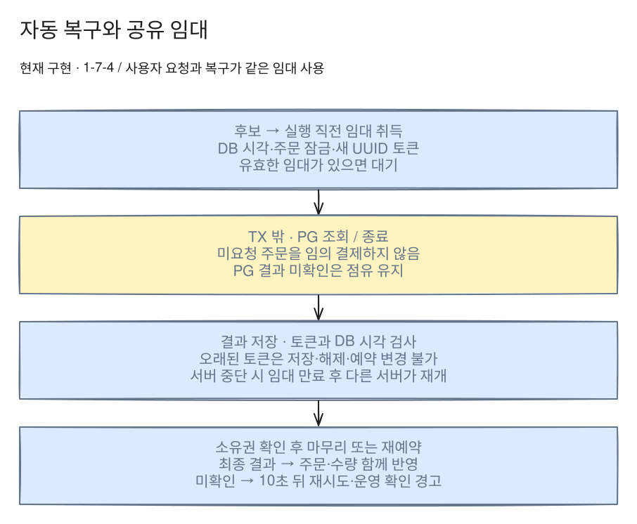

# 서버가 중단된 주문을 다시 이어 가는 방법

[위키 시작](README.md) · [사용자 결제](payments.md) · [실패 사례](failure-cases.md)

사용자가 결제 버튼을 누른 뒤 서버가 중단됐다고 하자. PG는 성공했지만 판매 서버는 응답을 못 받았을 수 있다. 이때 주문을 실패로 만들거나 수량을 먼저 반환하면 안 된다. 1-7-4의 자동 복구는 DB의 미완료 상태를 찾고 같은 PG 키의 결과를 확인해 주문을 마무리한다.

## 누가 어떤 주문을 처리하나

스케줄러는 기본 1초마다 예정 시각이 지난 주문을 최대 20개 후보로 읽는다. 서버당 동시 실행은 4개다. 후보를 읽었다고 실행 권리가 생기는 것은 아니다. 실제 실행 스레드가 주문을 잠그고 DB 시각·상태·기존 임대를 다시 검사한 뒤 토큰을 저장한다. 실행 대기열에서 임대 시간이 소진되지 않도록 대기열 없이 작업을 제출한다.

[Excalidraw 원본 편집](diagrams/recovery-1.excalidraw)

임대는 한 작업이 특정 주문을 처리할 권리를 잠시 갖는 것이다. 기본 유효 시간은 30초다. lease_token은 매번 새로운 UUID이고 lease_until은 DB 시각 기준 만료다. 네트워크 대기 동안 DB 잠금은 놓는다. 잠금과 임대는 다르다.

여러 서버가 같은 후보를 읽어도 최종 임대 판정은 주문 행 잠금 안에서 이루어진다. 잠겨 있는 후보는 SKIP LOCKED로 건너뛴다. 다른 주문은 동시에 처리할 수 있다. 후보 인덱스는 검사했지만 대량 데이터에서 최적의 실행 계획이나 처리량을 측정한 것은 아니다.

사용자 결제 요청도 같은 임대를 사용한다. 다른 작업이 처리 중이면 현재 저장된 상태로 202를 받는다. 5분 만료에 도달해도 다른 작업의 유효 임대를 빼앗지 않는다. GET 상세는 여전히 읽기 전용이다.

## DB에 남은 상태별 다음 행동

| 상태 | 다음 처리 |
|---|---|
| 결제 미요청·만료 전 | 기다림. 사용자의 동의 없이 자동 결제하지 않음 |
| 결제 요청 이력 있음·만료 전 | PG 조회. 404이면 소유권·만료·남은 예산 확인 후 같은 키로 결제 재개 |
| 미완료·만료 도달 | PG 종료 요청. 이미 성공이면 확정, FAILED면 실패, CLOSED면 만료 |
| PG 결과 미확인 | 점유 유지, 다음 재조회 예약 |
| 결제 최종 결과만 저장됨 | PG 없이 주문과 수량 마무리 재적용 |
| 주문까지 최종 정리됨 | 재처리하지 않음 |

기본 재조회는 결과 확인 후 10초 뒤다. 만료 전 예약이 만료 시각보다 늦어지면 만료 시각으로 당긴다. 만료를 통과한 작업이 아직 종료 요청을 하지 않았다면 즉시 종료 확인을 예약하고, 종료 결과도 모르면 다시 10초 뒤로 예약한다. 사용자 요청의 만료 우선 처리와 자동 복구의 주기적 재예약을 구분한다.

## 오래된 작업이 뒤늦게 돌아오면

서버 A가 토큰 A를 받았지만 멈췄다고 하자. 30초가 지나 서버 B가 토큰 B로 이어받는다. 이후 A가 깨어나 PG 성공 응답을 가져와도 토큰 A로는 결제 기록·주문 확정·예약 변경·임대 해제를 할 수 없다. 새로운 B의 임대를 지워서도 안 된다.

결과 저장과 최종 마무리는 주문 잠금 후 토큰·임대 만료를 검사한다. 수량 잠금을 기다리는 동안 임대가 만료되는 경우도 마지막 DB 시각 검사에서 롤백한다. PG 요청은 취소할 수 없는 순간이 있으므로 PG 자체의 고정 키·최종 상태 불변도 함께 필요하다. B는 같은 PG 결과를 다시 확인해 마무리한다.

임대는 한 번만 실행을 보장하는 장치가 아니다. 임대 만료와 재시작으로 중복 시도는 생길 수 있다. PG 키, 최종 결제 상태 유지, 주문 잠금, 주문·수량의 원자적 반영이 함께 중복 확정·해제를 막는다.

## 장애가 오래 지속되면

5분 이후에도 결과를 확인할 수 없으면 requires_review와 next_review_warning_at을 저장하고 점유를 유지한다. 기본 10초마다 재확인하며 최초 운영 확인 전환과 이후 기본 5분 간격에 경고 로그를 남긴다. 경고는 표시·다음 경고 시각을 저장한 트랜잭션의 커밋이 성공한 뒤에 출력한다. 임대 만료나 DB 오류로 롤백된 작업은 경고를 출력하지 않아 저장되지 않은 전환을 운영 확인 대상으로 알리지 않는다. 주문이 최종 정리되면 표시·경고 예약·복구 예약·임대가 해제된다.

관리자 수동 처리 API와 외부 알림은 없다. 무한 재시도 횟수 소진으로 실패를 만들어 재고를 돌려주는 기능도 없다. PG가 복구되면 다음 작업이 최종 결과를 확인한다. DB 장애는 정상 실패 결과로 바꾸지 않고 로그에 남긴다. 한 작업의 예외가 다른 주문 실행을 막지 않으며 남은 임대는 만료 뒤 회수한다.

## 재시작과 설정

next_recovery_at·lease_token·lease_until·requires_review는 주문 테이블이 소유한다. [V5 마이그레이션](../../src/main/resources/db/migration/V5__order_recovery_warning.sql)은 반복 경고 시각을 추가한다. 다음 행동의 근거는 JVM 메모리가 아닌 DB다.

| 설정 | 기본값 |
|---|---|
| limited-sale.recovery.enabled | true |
| limited-sale.recovery.interval | PT1S |
| limited-sale.recovery.batch-size | 20 |
| limited-sale.recovery.concurrency | 4 |
| limited-sale.recovery.lease-duration | PT30S |
| limited-sale.recovery.warning-interval | PT5M |
| limited-sale.payment.timeout | PT3S |
| limited-sale.payment.retry-interval | PT10S |

정상 종료 시 새 작업 제출을 멈추고 실행 중 작업을 최대 5초 기다린 뒤 중단을 요청한다. 강제 종료로 정리 코드가 실행되지 않아도 임대가 만료되면 다른 서버가 이어받을 수 있다. 설정을 줄여 임대가 작업 시간보다 짧아지면 오래된 작업은 완료를 저장하지 못하므로 기본값을 바꿀 때 재검증해야 한다.

## 코드를 읽고 검증하기

1. [OrderRecoveryScheduler](../../src/main/java/com/wooyongjeong/limitedsale/order/application/OrderRecoveryScheduler.java)는 후보 조회·동시 실행 제한·종료를 담당한다.
2. [OrderPaymentTransaction](../../src/main/java/com/wooyongjeong/limitedsale/order/application/OrderPaymentTransaction.java)은 임대 취득·토큰 검사·결과 저장·최종 마무리·재예약을 담당한다.
3. [RecoveryPolicy](../../src/main/java/com/wooyongjeong/limitedsale/order/domain/RecoveryPolicy.java)는 시각과 상태에 따른 행동 및 소유권을 판단한다.
4. [OrderPaymentService](../../src/main/java/com/wooyongjeong/limitedsale/order/application/OrderPaymentService.java)는 사용자·복구 진입을 공통 결제 처리로 연결하고 트랜잭션 밖에서 PG를 호출한다.
5. [PurchaseOrderJpaRepository](../../src/main/java/com/wooyongjeong/limitedsale/order/infrastructure/persistence/PurchaseOrderJpaRepository.java)는 SKIP LOCKED 후보·실행 잠금과 DB 시각 쿼리를 제공한다.

[실제 MySQL·HTTP 통합 테스트](../../src/integrationTest/java/com/wooyongjeong/limitedsale/order/OrderPaymentIntegrationTest.java)는 다중 인스턴스, 오래된 토큰, 잠금 대기 중 만료, 장애 중 점유 유지, PG 복구 후 수렴을 검사한다. 중단 경계는 예외·DB 트리거 주입과 앱 인스턴스 종료·재시작으로 검증했다. OS 프로세스 강제 종료는 실행하지 않았다. 5분 경고·10초 간격 검사는 격리 DB의 예정 시각 조정도 사용했으며 실제 5분 이상 장기 장애 실험은 하지 않았다. 상세 근거는 [1-7-4 문서](../stages/01-7-4-order-recovery-and-leases.md)에 남긴다.

[경고 커밋 회귀 검사](../../src/test/java/com/wooyongjeong/limitedsale/order/application/RecoveryWarningCommitTest.java)는 임대 만료로 롤백되면 경고가 남지 않고, 커밋이 완료된 경우에만 한 번 출력되는지 확인한다. 이 로그 전달 자체는 영속 메시지 전송이 아니므로 DB 커밋 직후 프로세스가 중단되는 경우까지 로그 출력을 보장하지 않는다.
