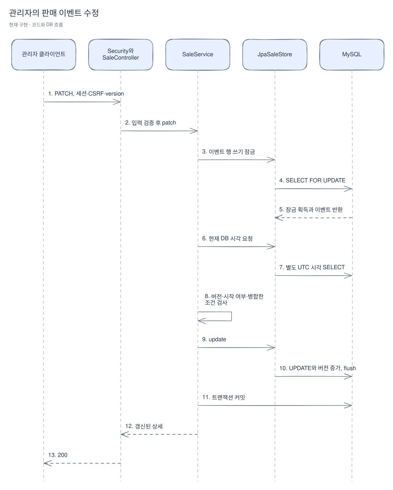
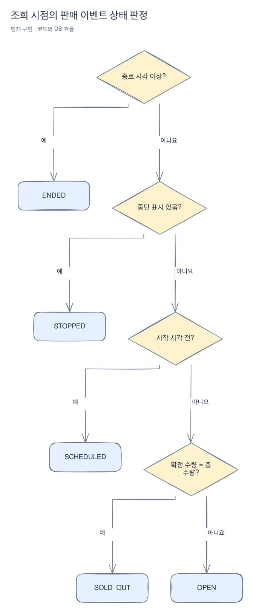

# 판매 이벤트 관리와 조회

[위키 시작](README.md) · 이전: [제품](products.md) · 다음: [데이터베이스](persistence.md)

판매 이벤트는 제품에 기간·판매 가격·수량·사용자 한도를 붙인 것이다. 같은 제품이라도 이벤트마다 가격과 재고를 따로 가질 수 있다. 여기서는 관리자가 이벤트를 만들고 바꾸는 규칙과 사용자에게 보이는 상태를 설명한다. 실제 구매 시나리오는 [전체 흐름](purchase-flow.md)을 본다.

판매 이벤트는 제품 하나의 이름과 판매 가격을 보관하고 판매 기간·전용 총수량·사용자 구매 한도를 소유한다. [SaleService](../../src/main/java/com/wooyongjeong/limitedsale/sale/application/SaleService.java)는 제품을 [product.api](../../src/main/java/com/wooyongjeong/limitedsale/product/api/ProductQuery.java)로 확인한다. 제품 테이블을 직접 읽거나 제품 JPA 엔티티를 참조하지 않는다. 제품 변경은 시작 전에만 가능하며 새 제품명을 보관하되 판매 가격은 요청에서 명시하지 않으면 유지한다.

현재 구현은 생성·부분 수정·삭제·중단·재개와 공개 목록·상세 및 주문을 위한 수량 점유다. [주문 유스케이스](orders.md)가 sale.api를 통해 점유한다. 구매 확정·해제는 후속 단계다. 품절 상태 검사는 테스트에서 DB 수량을 구성해 검증하며, 판매 이벤트 API 자체가 수량을 점유하거나 판매 완료로 바꾸지는 않는다.

## 관리 요청과 트랜잭션

[SaleController](../../src/main/java/com/wooyongjeong/limitedsale/sale/presentation/SaleController.java)는 `/api/v1/admin/sales`에서 등록을 받고 `/{id}`에서 PATCH·DELETE를, `/{id}/stop`·`/{id}/resume`에서 운영 요청을 받는다. ADMIN 세션과 CSRF가 필요하다. JSON은 중복 필드·후행 값·미지 필드·잘못된 타입을 거절한다. PATCH는 생략과 null을 구분하며 설명 null만 빈 문자열로 처리한다.

아래는 PATCH 성공 경로다. 컨트롤러와 서비스 사이는 Java 호출이며 MySQL 화살표는 별도 SQL이다. 스프링 트랜잭션 프록시가 커밋에 성공한 뒤 컨트롤러가 응답한다.

[Excalidraw 원본 편집](diagrams/sales-1.excalidraw)

잠금 대기 중 시작 시각을 넘었을 수 있으므로 [JpaSaleStore.now](../../src/main/java/com/wooyongjeong/limitedsale/sale/infrastructure/persistence/JpaSaleStore.java)는 잠금 반환 뒤 새 SQL로 시각을 읽는다. `SELECT FOR UPDATE`와 같은 문장의 NOW()를 쓰지 않는다. UTC 문자열을 Instant로 변환하므로 JDBC/JVM의 시각 타입 변환으로 DB 시각이 이동하지 않는다. 생성에는 잠글 기존 행이 없으며 제품 확인 후 DB 시각으로 미래 시작을 검사한다.

`save`나 `flush`는 커밋과 다르다. 관리 작업의 트랜잭션은 서비스 범위에 있고 잠금은 커밋·롤백까지 유지한다. PATCH의 version이 저장된 값과 다르면 409다. 같은 버전으로 두 요청이 경쟁하면 먼저 반영한 요청만 성공한다.

| 작업 | 시작 전 | 시작 후 | 종료 후 |
|---|---|---|---|
| 이름·설명 변경 | 허용 | 허용 | 허용 |
| 제품·가격·기간·총수량·한도 변경 | 허용 | 409 | 409 |
| 삭제 | 허용 | 409 | 409 |
| 중단·재개 | 허용 | 허용 | 409 |

중단·재개 재요청이 같은 상태이면 200을 유지하며 UPDATE나 버전 증가를 만들지 않는다. 이 정책은 종료 전만 적용한다. 이미 종료됐다면 동일 운영 상태 재요청도 409다. 수량은 총수량만 공개한다.

## 조회 상태와 필터

[Sale](../../src/main/java/com/wooyongjeong/limitedsale/sale/domain/Sale.java)의 상태는 아래 순서대로 처음 맞는 조건에서 결정한다. 상태 컬럼을 DB에 따로 저장하지 않는다. 필터 SQL도 같은 우선순위를 사용한다.

[Excalidraw 원본 편집](diagrams/sales-2.excalidraw)

예를 들어 시작 전 중단 이벤트는 STOPPED이며 재개하면 SCHEDULED다. 판매 기간 안에 수량이 전부 점유됐어도 확정 수량이 총수량보다 적으면 OPEN이다. 이는 주문 성공을 보장하지 않는다. 수량 확보는 주문 유스케이스가 소유하는 트랜잭션에서 sale.api를 호출해 판정한다.

`GET /api/v1/sales?productId=1&status=OPEN&page=0&size=20`은 제품과 상태 조건을 모두 적용한다. 목록은 ID 내림차순이며 기본 20·최대 100개다. 상세는 `GET /api/v1/sales/{id}`로 조회한다. 목록에서는 설명을 제외하고, 두 응답 모두 구매 가능·점유·확정 수량을 직접 노출하지 않는다. 상태 필터와 응답은 같은 DB 기준 시각을 사용하지만 READ COMMITTED에서 count와 목록 내용이 동시 변경의 같은 스냅샷이라고 보장하지는 않는다.

[SaleTerms](../../src/main/java/com/wooyongjeong/limitedsale/sale/domain/SaleTerms.java)는 이름·가격·수량·기간을 검증한다. 시각은 오프셋을 포함해 입력하고 DB 마이크로초 정밀도를 넘으면 400이다. [SaleIntegrationTest](../../src/integrationTest/java/com/wooyongjeong/limitedsale/sale/SaleIntegrationTest.java)는 실제 MySQL의 잠금 대기·동시 수정·시각·필터와 HTTP 계약을 검사한다. 정책 및 한계는 [1-6 상세 문서](../stages/01-6-sale-management-and-query.md)를 따른다.

매우 큰 페이지의 네이티브 조회에는 기준 시각을 `Instant`로 직접 바인딩한다. UTC 값을 LocalDateTime으로 바꿔 넘기면 Hibernate/JDBC의 시간대 처리에 따라 비교 시각이 이동할 수 있어 실제 MySQL 회귀 테스트로 방어한다.

HTTP 생성·수정 본문은 SaleRequest이며, 내부 SaleDetails·SalePage 결과는 SaleDetailsResponse·SalePageResponse로 변환한다. 목록 항목은 SaleListItemResponse다. DTO 이동 후에도 PATCH의 생략·명시적 null 처리는 같으며 [HTTP 계약](http-contracts.md)에서 구조를 확인한다.
